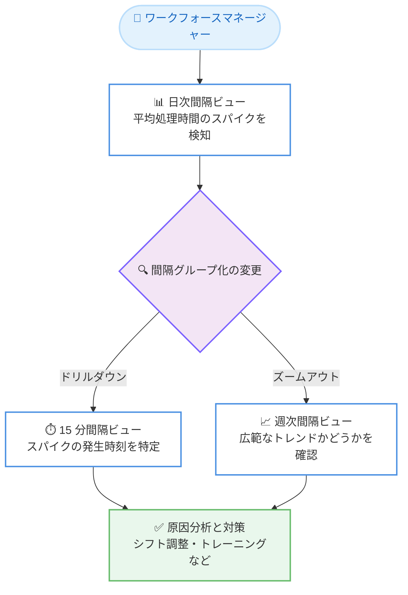

# Amazon Connect - Customer ダッシュボードが履歴メトリクスの時間間隔グループ化をサポート

**リリース日**: 2026 年 11 月 24 日
**サービス**: Amazon Connect
**機能**: Customer 分析ダッシュボードにおける履歴メトリクスの時間間隔グループ化

📊 [このアップデートのインフォグラフィックを見る](https://takech9203.github.io/aws-news-summary/20261124-amazon-connect-time-interval.html)

## 概要

Amazon Connect Customer の分析ダッシュボードで、トレーリングウィジェットに表示される履歴メトリクスを時間間隔でグループ化できるようになりました。15 分、30 分、1 時間 (Hourly)、日次、週次の 5 種類の間隔から選択でき、各間隔がウィジェット内の行として表示されます。これにより、マネージャーはパフォーマンスデータを時系列でどのように可視化するかをきめ細かく制御できます。

このアップデートは、コンタクトセンターのワークフォースマネージャーやスーパーバイザーにとって特に有益です。たとえば平均処理時間 (AHT) のスパイクを調査する際に、日次ビューから 15 分間隔のビューにドリルダウンしてスパイクが発生した正確な時刻を特定し、その後週次ビューにズームアウトして、それが一時的な事象なのか広範なトレンドなのかを確認する、といった分析が同じダッシュボード上で完結します。

時間間隔のグループ化は、Trailing queue performance や Trailing agent performance などのトレーリングウィジェットに「Interval」グループ化を追加することで利用できます。Queue などの他のグループ化と組み合わせると、間隔がネストされた行として表示され、多角的な分析が可能です。

**アップデート前の課題**

このアップデート以前は、ダッシュボードのトレーリングウィジェットで履歴メトリクスを時間間隔ごとに分解して表示できませんでした。

- ウィジェットには選択した時間範囲全体の集計値しか表示されず、期間内のどの時間帯に問題が発生したかを特定できなかった
- メトリクスのスパイク発生時刻を特定するには、ダッシュボードの時間範囲フィルターを繰り返し変更するか、履歴メトリクスレポートを別途作成して確認する必要があった
- 粒度の異なるビュー (日次と 15 分間隔など) を切り替えた比較分析が、ダッシュボード上の操作だけでは難しかった

**アップデート後の改善**

今回のアップデートにより、トレーリングウィジェットに Interval グループ化を追加するだけで時系列分析が可能になりました。

- 15 分、30 分、1 時間、日次、週次の 5 種類の間隔でメトリクスの推移を行単位で表示できるようになった
- 日次ビューから 15 分間隔へのドリルダウン、週次ビューへのズームアウトといった粒度の切り替えが、ウィジェットの編集操作だけで完結するようになった
- Queue などの既存のグループ化と組み合わせて、キューごとの時間帯別パフォーマンスをネスト表示できるようになった

## アーキテクチャ図



ワークフォースマネージャーが日次ビューでスパイクを検知し、15 分間隔へのドリルダウンで発生時刻を特定、週次ビューへのズームアウトでトレンドを確認するという、今回のアップデートで可能になった分析フローを示しています。

## サービスアップデートの詳細

### 主要機能

1. **時間間隔によるグループ化 (Interval グループ化)**
   - トレーリングウィジェットのデータを時間間隔でグループ化し、メトリクスの時系列変化を行単位で表示
   - 15 分、30 分、1 時間 (Hourly)、日次 (Daily)、週次 (Weekly) の 5 種類から選択可能
   - グループ化列には「Interval (Hourly)」のように選択した間隔が表示され、間隔ごとに 1 行ずつデータが並ぶ

2. **対象ウィジェット**
   - Trailing queue performance や Trailing agent performance などのトレーリングウィジェットで利用可能
   - Current queue performance などのリアルタイムウィジェットでは Interval グループ化は利用不可
   - ウィジェットには最大 3 つのグループ化を追加可能

3. **他のグループ化との組み合わせ (ネスト表示)**
   - Interval グループ化を Queue などの他のグループ化と組み合わせると、間隔がネストされた行として表示される
   - 他のグループ化の行を展開すると、その配下に各間隔の行が表示される
   - キューごと・エージェントごとの時間帯別パフォーマンス分析が可能

## 技術仕様

### 選択可能な時間間隔と時間範囲の条件

選択できる間隔は、ダッシュボードで選択している時間範囲に依存します。

| 時間間隔 | 利用可能な時間範囲 |
|------|------|
| 15 分 | 時間範囲が 3 日未満の場合 |
| 30 分 | 時間範囲が 3 日未満の場合 |
| 1 時間 (Hourly) | 時間範囲が 3 日未満の場合 |
| 日次 (Daily) | 時間範囲が 35 日未満の場合 |
| 週次 (Weekly) | 時間範囲が 35 日未満の場合 |

選択した時間範囲で利用できない間隔がある場合、ウィジェットには選択可能な間隔の一覧を示すメッセージが表示されます。

### 機能の制約

| 項目 | 詳細 |
|------|------|
| グループ化の上限 | 1 ウィジェットあたり最大 3 つのグループ化 |
| 対象ウィジェット | トレーリングウィジェットのみ (リアルタイムウィジェットは対象外) |
| 比較表示 (Show comparison) | Interval グループ化の使用中は利用不可。比較を表示するには Interval グループ化を削除する必要がある |

### 必要な権限

ダッシュボードの利用には、管理者アカウント、またはセキュリティプロファイルで以下のいずれかの権限が必要です。

| 権限 | 内容 |
|------|------|
| Analytics and Optimization - Access metrics | メトリクスへのアクセス権限 |
| Dashboard - Access | ダッシュボードへのアクセス権限 |

## 設定方法

### 前提条件

1. Amazon Connect Customer のインスタンスが作成済みであること
2. ダッシュボードにアクセスできる権限 (Analytics and Optimization - Access metrics または Dashboard - Access) を持つユーザーであること
3. 対象のダッシュボードに Trailing queue performance などのトレーリングウィジェットが配置されていること

### 手順

#### ステップ 1: ウィジェットの編集画面を開く

ダッシュボード上の対象のトレーリングウィジェットで、アクションアイコンを選択し [Edit] を選択します。ウィジェットの編集ペインが表示されます。

#### ステップ 2: Interval グループ化を追加する

編集ペインで [Add grouping] を選択し、新しいグループ化のリストから [Interval] を選択します。続いて、15 分、30 分、Hourly、Daily、Weekly の中から表示したい間隔を選択します。

#### ステップ 3: 保存して表示を確認する

[Save] を選択して設定を保存します。ウィジェットのグループ化列に「Interval (Hourly)」のように選択した間隔が表示され、間隔ごとに 1 行ずつメトリクスが表示されます。Queue などの他のグループ化と組み合わせた場合は、その行を展開すると間隔ごとの行が表示されます。

## メリット

### ビジネス面

- **問題の早期特定**: メトリクスの異常が発生した時間帯を 15 分単位で特定でき、原因調査と対策のリードタイムを短縮できる
- **ワークフォース管理の精度向上**: 時間帯別のコンタクト量や処理時間の傾向を把握し、シフト計画や人員配置の最適化に活用できる
- **追加コストなしで利用可能**: 既存のダッシュボード機能の拡張であり、追加料金なしで時系列分析の能力が向上する

### 技術面

- **ダッシュボード上で分析が完結**: 時間範囲フィルターの繰り返し変更や別レポートの作成なしに、粒度の異なるビューを切り替えられる
- **柔軟な粒度選択**: 15 分から週次まで 5 段階の間隔を、調査の目的に応じて使い分けられる
- **既存グループ化との組み合わせ**: Queue などのグループ化とのネスト表示により、ディメンションを掛け合わせた分析が可能

## デメリット・制約事項

### 制限事項

- Interval グループ化はトレーリングウィジェットのみで利用でき、Current queue performance などのリアルタイムウィジェットでは利用できない
- 15 分、30 分、1 時間の間隔はダッシュボードの時間範囲が 3 日未満、日次・週次は 35 日未満の場合にのみ選択できる
- Interval グループ化の使用中は比較表示 (Show comparison) オプションを利用できない

### 考慮すべき点

- 1 ウィジェットに追加できるグループ化は最大 3 つであり、Interval を含める場合は他のグループ化の構成を検討する必要がある
- グループ化はウィジェットで選択しているメトリクスに応じて動的に提供されるため、メトリクスの組み合わせによっては意図したグループ化が選択できない場合がある
- 35 日以上の長期トレンド分析には、ダッシュボードではなく履歴メトリクスレポートやデータレイク連携の利用を検討する必要がある

## ユースケース

### ユースケース 1: 平均処理時間のスパイク調査

**シナリオ**: ワークフォースマネージャーが日次ビューで平均処理時間 (AHT) のスパイクに気づき、原因を調査したい。

**実装例**:
```
1. Trailing queue performance ウィジェットに Interval グループ化 (Daily) を追加し、スパイクが発生した日を特定
2. ダッシュボードの時間範囲を該当日を含む 3 日未満に絞り、間隔を 15 分に変更
3. スパイクが発生した正確な時刻を特定し、該当時間帯のコンタクト量やエージェント稼働状況を確認
4. 間隔を Weekly に変更し、同様の傾向が毎週発生していないかを確認
```

**効果**: スパイクの発生時刻と再現性をダッシュボード上の操作だけで特定でき、一時的な事象か構造的な問題かを迅速に判断できる。

### ユースケース 2: 時間帯別のサービスレベル監視とシフト最適化

**シナリオ**: スーパーバイザーが、サービスレベルが低下する時間帯を特定して人員配置を最適化したい。

**実装例**:
```
1. Trailing queue performance ウィジェットに Interval グループ化 (Hourly) と Queue グループ化を追加
2. キューの行を展開し、キューごとの時間帯別サービスレベルをネスト表示で確認
3. サービスレベルが低下する時間帯とキューの組み合わせを特定し、シフト計画に反映
```

**効果**: キュー別・時間帯別のボトルネックが可視化され、根拠に基づいた人員配置の調整が可能になる。

### ユースケース 3: 施策導入後の効果測定

**シナリオ**: 新しいルーティング設定やエージェントトレーニングを導入した後、パフォーマンス改善の定着を確認したい。

**実装例**:
```
1. Trailing agent performance ウィジェットに Interval グループ化 (Daily) を追加し、導入前後の日次推移を確認
2. 間隔を Weekly に変更し、改善が週単位のトレンドとして定着しているかを確認
3. 必要に応じて 15 分・30 分間隔で特定の日の詳細を確認し、残存する課題を特定
```

**効果**: 施策の効果を複数の時間粒度で検証でき、短期的な変動と長期的なトレンドを区別した評価が可能になる。

## 料金

今回のアップデートによる追加料金はありません。時間間隔によるグループ化は Amazon Connect Customer の分析ダッシュボードの機能として提供され、Amazon Connect の標準の従量制料金体系の範囲内で利用できます。詳細は [Amazon Connect の料金ページ](https://aws.amazon.com/connect/pricing/) を参照してください。

## 利用可能リージョン

Amazon Connect Customer が提供されているすべての AWS リージョンで利用できます。対象リージョンの詳細は [リージョン別の利用可能状況](https://docs.aws.amazon.com/connect/latest/adminguide/regions.html#amazonconnect_region) を参照してください。

## 関連サービス・機能

- **Amazon Connect ダッシュボードウィジェットのカスタマイズ**: メトリクスの選択、フィルター、しきい値、比較表示など、今回の Interval グループ化と組み合わせて利用できるウィジェット設定機能
- **Amazon Connect 履歴メトリクス**: ダッシュボードの元データとなるメトリクス群。35 日を超える長期分析には履歴メトリクスレポートの活用が有効
- **Amazon Connect カスタムメトリクス**: カスタムサービスレベル計算などの独自メトリクスを定義し、ウィジェットに追加して Interval グループ化と併用可能

## 参考リンク

- 📊 [インフォグラフィック](https://takech9203.github.io/aws-news-summary/20261124-amazon-connect-time-interval.html)
- [公式発表 (What's New)](https://aws.amazon.com/about-aws/whats-new/2026/11/amazon-connect-time-interval/)
- [ドキュメント: Customize your Connect Customer dashboard - Configure groupings](https://docs.aws.amazon.com/connect/latest/adminguide/dashboard-customize-widgets.html#configure-groupings)
- [Amazon Connect 製品ページ](https://aws.amazon.com/connect/)
- [Amazon Connect 料金ページ](https://aws.amazon.com/connect/pricing/)

## まとめ

Amazon Connect Customer の分析ダッシュボードで、トレーリングウィジェットの履歴メトリクスを 15 分から週次までの 5 種類の時間間隔でグループ化できるようになり、スパイク調査やトレンド確認といった時系列分析がダッシュボード上で完結するようになりました。追加料金なしで利用でき、ウィジェットの編集画面から Interval グループ化を追加するだけで有効化できます。コンタクトセンターのパフォーマンス管理を行っているチームは、既存のダッシュボードに Interval グループ化を追加し、時間帯別の分析フローへの組み込みを検討することをお勧めします。
