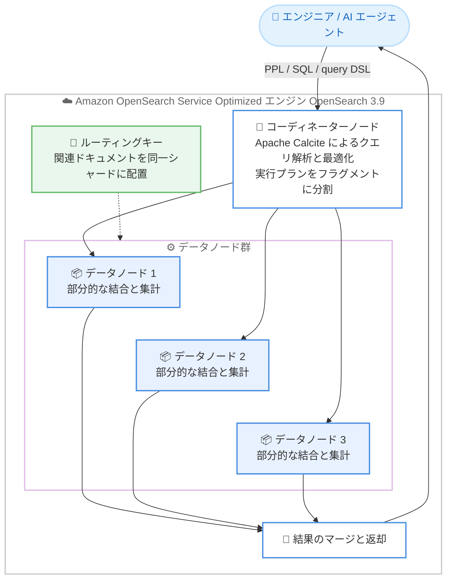

# Amazon OpenSearch Service - 新エンジンにおける分散結合・高カーディナリティ集計・query DSL サポート

**リリース日**: 2026 年 11 月 24 日
**サービス**: Amazon OpenSearch Service
**機能**: Optimized エンジン (ログ分析最適化エンジン) における分散結合、高カーディナリティ集計、OpenSearch query DSL のサポート

📊 [このアップデートのインフォグラフィックを見る](https://takech9203.github.io/aws-news-summary/20261124-amazon-opensearch-service-distributed-joins.html)

## 概要

Amazon OpenSearch Service の新エンジン (Amazon OpenSearch Service optimized for log analytics、以下 Optimized エンジン) が、分散結合 (distributed joins)、高カーディナリティ集計、OpenSearch query DSL をサポートしました。エンジニアや AI エージェントは、PPL (Piped Processing Language) または SQL を使用して、ペタバイト規模のデータに対して、エラーログとトレースの関連付けや、テレメトリデータへのサービス所有者・デプロイメタデータの付加を 1 つのクエリで実行できます。

Optimized エンジンは、集計と結合をデータノード全体に分散して実行します。また、ルーティングキーのサポートにより、関連するドキュメントを同一シャードに保持できるため、そのキーに対するルックアップや結合が高速に動作します。さらに、query DSL のサポートにより、既存のアプリケーション、アラート、インテグレーションを書き換えることなく、Optimized エンジンのコストとパフォーマンスのメリットを享受できます。

本機能は OpenSearch 3.9 で利用可能であり、追加料金は不要です。東京リージョンを含む 12 リージョンで提供されます。

**アップデート前の課題**

- ログ、トレース、サービスメタデータ、デプロイ記録、テナントデータなど、オブザーバビリティデータが複数のインデックスに分散しており、インシデント対応時にデータの相関付けが困難だった
- 関連データを結合して分析するには、事前に関連データを 1 つのインデックスにコピー (非正規化) する必要があった
- 数百万件規模のホスト、ユーザー、テナントにまたがる高カーディナリティ集計で、インシデントの影響範囲を測定することが難しかった
- Optimized エンジンは PPL と SQL が中心であり、query DSL を使用する既存のアプリケーションやアラートをそのまま移行できなかった

**アップデート後の改善**

- PPL または SQL により、エラーログとトレースの結合や、テレメトリへのメタデータ付加を 1 つのクエリで実行できるようになった
- エンジンが集計と結合をデータノード全体に分散するため、関連データを事前に 1 つのインデックスへコピーする必要がなくなった
- 高カーディナリティ集計により、数百万件の異なるホスト、ユーザー、テナントにまたがるインシデント影響の測定が可能になった
- ルーティングキーにより関連ドキュメントを同一シャードに保持でき、該当キーでのルックアップと結合が高速化された
- query DSL のサポートにより、既存のアプリケーション、アラート、インテグレーションが書き換えなしで動作するようになった

## アーキテクチャ図



コーディネーターノードがクエリを解析・最適化してフラグメントをデータノードにスケジュールし、各データノードで結合と集計を分散実行した後、結果をマージして返却します。ルーティングキーにより関連ドキュメントを同一シャードに配置することで、そのキーでの結合を高速化できます。

## サービスアップデートの詳細

### 主要機能

1. **分散結合 (Distributed Joins)**
   - 結合処理をデータノード全体に分散して実行し、ペタバイト規模のデータに対する結合クエリを実現
   - エラーログとトレースの関連付け、サービス所有者情報やデプロイメタデータによるテレメトリの拡充を 1 つのクエリで実行可能
   - PPL では `join`、`lookup`、`streamstats` コマンド、SQL では `INNER`、`LEFT`、`RIGHT`、`CROSS` の各 JOIN をサポート
   - 事前に関連データを 1 つのインデックスへコピーする非正規化作業が不要

2. **高カーディナリティ集計**
   - 数百万件の異なるホスト、ユーザー、テナントにまたがる集計を分散実行
   - インシデントの影響範囲 (影響を受けたユーザー数やテナント数など) の測定に有効
   - 集計処理をデータノード全体に分散することでスケーラビリティを確保

3. **ルーティングキーのサポート**
   - 関連するドキュメントを同一シャードに保持する仕組み
   - ルーティングキーに対するルックアップと結合がシャードをまたがずに完結するため高速に動作

4. **OpenSearch query DSL のサポート (OpenSearch 3.9)**
   - Optimized エンジンを使用するインデックスに対して `_search` API で query DSL リクエストを送信可能
   - 既存のアプリケーション、アラート、インテグレーションが書き換えなしで動作
   - クエリの内容に応じて「高速化 (Accelerated)」と「サポート (Supported)」の 2 つの実行モードを OpenSearch が自動選択

## 技術仕様

### Optimized エンジンの構成要素

| コンポーネント | 役割 |
|------|------|
| Apache Parquet | ログデータの主要ストレージとなるオープンな列指向フォーマット |
| Lucene 転置インデックス | ログ内容に対する全文検索 (フレーズ、あいまい、ワイルドカード) 用に保持 |
| Apache Calcite | コーディネーターノード上で動作する SQL パーサー・プランナー・オプティマイザー |
| DataFusion | Rust ベースのベクトル化実行エンジン。集計・フィルター・範囲スキャンを列指向データ上で実行 |
| Apache Arrow | インメモリ列指向フォーマット。ゼロコピーのデータ転送とベクトル化処理を実現 |
| Amazon S3 | Parquet ファイルと転置インデックスセグメントの耐久性のあるバッキングストア |

### クエリ言語ごとのサポート状況 (OpenSearch 3.9)

| クエリ言語 | 実行方式 | 主なサポート内容 |
|------|------|------|
| PPL | ベクトル化実行エンジンでネイティブ実行 | `join`、`lookup`、`streamstats`、`stats`、`eventstats`、サブクエリなど |
| SQL | ベクトル化実行エンジンでネイティブ実行 | `JOIN` (INNER / LEFT / RIGHT / CROSS)、サブクエリ、`UNION`、ウィンドウ関数など |
| query DSL | 高速化またはサポートモードを自動選択 | term 系クエリ、`bool`、bucket / metric 集計などが高速化対象 |

### query DSL の実行モード

| モード | 内容 |
|------|------|
| 高速化 (Accelerated) | クエリ内のすべての句と集計が高速化対象リストに含まれる場合、ベクトル化実行エンジンで実行され、PPL や SQL と同等のパフォーマンスメリットを得られる |
| サポート (Supported) | 高速化対象外の句や集計を含む場合、Optimized エンジンのストレージ上で標準の OpenSearch クエリ実行が行われる。結果は同一だが高速化はされない |

高速化対象には、term 系クエリ (`term`、`terms`、`range`、`prefix`、`wildcard`、`regexp` など)、`must` / `should` / `filter` を使用する `bool` クエリ、bucket 集計 (`terms`、`histogram`、`date_histogram` など)、metric 集計 (`min`、`max`、`avg`、`sum`、`percentiles`、`cardinality` など) が含まれます。

### 設定例: 高速化対象となる query DSL リクエスト

```json
GET logs/_search
{
  "size": 0,
  "query": {
    "bool": {
      "filter": [
        { "range": { "@timestamp": { "gte": "now-1h" } } },
        { "range": { "status_code": { "gte": 500 } } },
        { "term":  { "env": "prod" } }
      ]
    }
  },
  "aggs": {
    "by_service": {
      "terms": { "field": "service.name", "size": 10 },
      "aggs": {
        "p99_latency": { "percentiles": { "field": "latency_ms", "percents": [99] } }
      }
    }
  }
}
```

過去 1 時間のステータスコード 500 以上のログをサービス別に集計し、各サービスのレイテンシー 99 パーセンタイルを算出するリクエストです。高速化対象のクエリと集計のみで構成され、`size: 0` を指定しているため、ベクトル化実行エンジンで高速に実行されます。

## 設定方法

### 前提条件

1. Amazon OpenSearch Service ドメインを作成または管理できる IAM 権限があること
2. 対象リージョンが Optimized エンジンの提供リージョン (東京リージョンを含む 12 リージョン) であること
3. query DSL サポートを利用する場合は OpenSearch 3.9 を使用すること

### 手順

#### ステップ 1: 利用可能なバージョンの確認

```bash
aws opensearch list-versions --region ap-northeast-1
```

対象リージョンで OpenSearch 3.9 が利用可能であることを確認します。

#### ステップ 2: Optimized エンジンのドメインを作成またはアップグレード

新規の場合は、AWS マネジメントコンソールまたは API からドメイン作成時にエンジンモードとして Optimized (ログ分析最適化) を選択し、OpenSearch 3.9 を指定します。既存の Optimized ドメインの場合は、以下のコマンドでバージョンをアップグレードします。

```bash
aws opensearch upgrade-domain \
  --domain-name my-logs-domain \
  --target-version OpenSearch_3.9 \
  --region ap-northeast-1
```

既存ドメインの OpenSearch バージョンを 3.9 にアップグレードします。アップグレードにより query DSL サポートを含む最新機能が利用可能になります。

#### ステップ 3: クエリの実行

OpenSearch UI、REST API、JDBC / ODBC ドライバー、Query Workbench などから PPL、SQL、query DSL でクエリを実行します。既存の query DSL ベースのアプリケーションやアラートは、`_search` API に対してそのまま動作します。

## メリット

### ビジネス面

- **インシデント対応の迅速化**: エラーログ、トレース、メタデータの相関付けを 1 つのクエリで実行でき、障害の根本原因特定までの時間を短縮できる
- **追加コストなし**: OpenSearch 3.9 上で追加料金なしで利用でき、Optimized エンジンの価格性能メリットをそのまま享受できる
- **既存資産の保護**: query DSL サポートにより、既存のアプリケーション、アラート、インテグレーションへの投資を書き換えなしで活用できる

### 技術面

- **分散実行によるスケーラビリティ**: 結合と集計がデータノード全体に分散されるため、ペタバイト規模のデータに対してもクエリを実行できる
- **非正規化が不要**: 関連データを 1 つのインデックスにコピーする事前処理が不要になり、パイプラインとストレージが簡素化される
- **ルーティングキーによる高速化**: 関連ドキュメントを同一シャードに保持することで、特定キーでのルックアップと結合を高速に実行できる
- **AI エージェントとの親和性**: PPL や SQL によるクエリは AI エージェントからも利用しやすく、エージェントによる自動調査のユースケースに適合する

## デメリット・制約事項

### 制限事項

- query DSL サポートには OpenSearch 3.9 が必要 (Optimized エンジン自体は OpenSearch 3.5 以降)
- query DSL の `nested` クエリ、`has_child` / `has_parent` などの親子結合、地理空間クエリ、`percolate`、`must_not` を含む `bool` クエリ、keyword フィールドによるソートはサポートされない
- `geo_point`、`knn_vector`、`join`、`percolator` などのフィールドタイプはサポートされず、これらを含むマッピングはインデックス作成時に拒否される
- `_count`、`_update_by_query`、`_delete_by_query`、`_reindex`、スクロール API はサポートされない (ページングにはポイントインタイムと `search_after` を使用)
- PPL の `expand`、`xyseries` などの一部コマンドは、プライマリシャードが 1 つのインデックスでのみサポートされる

### 考慮すべき点

- query DSL は高速化対象リスト内のクエリと集計で構成された場合のみ高速化され、対象外の句を含むと標準実行となる (実行モードは自動選択であり、ユーザーは指定できない)
- ソート指定のない query DSL リクエストは関連度スコア順となり高速化されないため、フィールドソートの指定または `size: 0` の設定が推奨される
- 高速化クエリでは `_source` 内の日付フィールドがマッピングのカスタム書式ではなく標準書式で返却されるなど、一般エンジンと一部挙動が異なる
- 関連度ランキング、ベクトル検索、地理空間検索、頻繁なドキュメント更新が中心のワークロードには、引き続き General Purpose エンジンが推奨される

## ユースケース

### ユースケース 1: エラーログとトレースの結合によるインシデント調査

**シナリオ**: 本番環境で 503 エラーが急増しており、どのサービスのどのトレースが原因かを特定したい。ログとトレースは別々のインデックスに格納されている。

**実装例**:
```sql
SELECT l.trace_id, t.service_name, t.duration_ms, l.message
FROM error_logs l
INNER JOIN traces t ON l.trace_id = t.trace_id
WHERE l.status_code = 503
ORDER BY t.duration_ms DESC
LIMIT 100
```

**効果**: エラーログとトレースを事前の非正規化なしに 1 つのクエリで結合でき、原因となるサービスと処理時間の長いトレースを即座に特定できる。

### ユースケース 2: サービス所有者メタデータによるテレメトリの拡充

**シナリオ**: 障害発生時に、影響を受けているサービスの所有チームと直近のデプロイ情報を即座に把握し、エスカレーション先を特定したい。

**実装例**:
```
source=error_logs
| where status_code >= 500
| lookup service_catalog service_name
| stats count() as errors by service_name, owner_team, last_deploy_version
| sort - errors
```

**効果**: PPL の `lookup` コマンドでエラーログにサービスカタログの所有者情報とデプロイメタデータを付加し、エスカレーション先の特定とデプロイ起因の切り分けを 1 クエリで実行できる。

### ユースケース 3: 高カーディナリティ集計によるインシデント影響範囲の測定

**シナリオ**: マルチテナント SaaS でインシデントが発生し、数百万のユーザーとテナントのうち、実際に影響を受けた数を正確に把握したい。

**実装例**:
```
source=app_logs
| where status_code >= 500 and @timestamp >= '2026-11-24 00:00:00'
| stats distinct_count(user_id) as affected_users,
        distinct_count(tenant_id) as affected_tenants by service.name
| sort - affected_users
```

**効果**: 集計がデータノード全体に分散実行されるため、数百万件規模の異なるユーザー・テナントにまたがる影響範囲の測定をペタバイト規模のログに対して実行できる。

## 料金

本機能は追加料金なしで利用できます。Amazon OpenSearch Service の通常のドメイン料金 (インスタンス時間、ストレージなど) のみが適用されます。Optimized エンジンは列指向圧縮と効率的なインスタンス利用により、ログ分析ワークロードの価格性能を改善します。

詳細は [Amazon OpenSearch Service の料金ページ](https://aws.amazon.com/opensearch-service/pricing/) を参照してください。

## 利用可能リージョン

以下の 12 リージョンで利用可能です。

- 米国東部 (バージニア北部)
- 米国東部 (オハイオ)
- 米国西部 (オレゴン)
- カナダ (中部)
- アジアパシフィック (ムンバイ)
- アジアパシフィック (シンガポール)
- アジアパシフィック (シドニー)
- **アジアパシフィック (東京)**
- 欧州 (フランクフルト)
- 欧州 (アイルランド)
- 欧州 (ロンドン)
- 欧州 (スペイン)

## 関連サービス・機能

- **OpenSearch Ingestion**: Optimized エンジンへのデータ取り込みに使用できるマネージドなデータパイプライン
- **Amazon S3**: Optimized エンジンの Parquet ファイルと転置インデックスセグメントの耐久性のあるバッキングストア
- **Amazon QuickSight / Grafana**: SQL サポート (JDBC / ODBC) を通じて BI ツールから Optimized エンジンのデータを可視化可能
- **OpenSearch の Alerting / Anomaly Detection**: PPL ベースのアラートと異常検知が Optimized ドメインで利用可能

## 参考リンク

- 📊 [インフォグラフィック](https://takech9203.github.io/aws-news-summary/20261124-amazon-opensearch-service-distributed-joins.html)
- [公式発表 (What's New)](https://aws.amazon.com/about-aws/whats-new/2026/11/amazon-opensearch-service-distributed-joins)
- [ドキュメント: Amazon OpenSearch Service optimized for log analytics](https://docs.aws.amazon.com/opensearch-service/latest/developerguide/optimized-log-analytics.html)
- [ドキュメント: Supported query languages](https://docs.aws.amazon.com/opensearch-service/latest/developerguide/optimized-log-analytics-queries.html)
- [料金ページ](https://aws.amazon.com/opensearch-service/pricing/)

## まとめ

Amazon OpenSearch Service の Optimized エンジンが分散結合、高カーディナリティ集計、query DSL をサポートしたことで、ペタバイト規模のオブザーバビリティデータに対する相関分析が 1 つのクエリで実行可能になり、既存の query DSL ベースの資産も書き換えなしで移行できるようになりました。東京リージョンで追加料金なしで利用できるため、ログ分析ワークロードを運用しているチームは、OpenSearch 3.9 の Optimized エンジンへの移行またはアップグレードの検討を推奨します。
