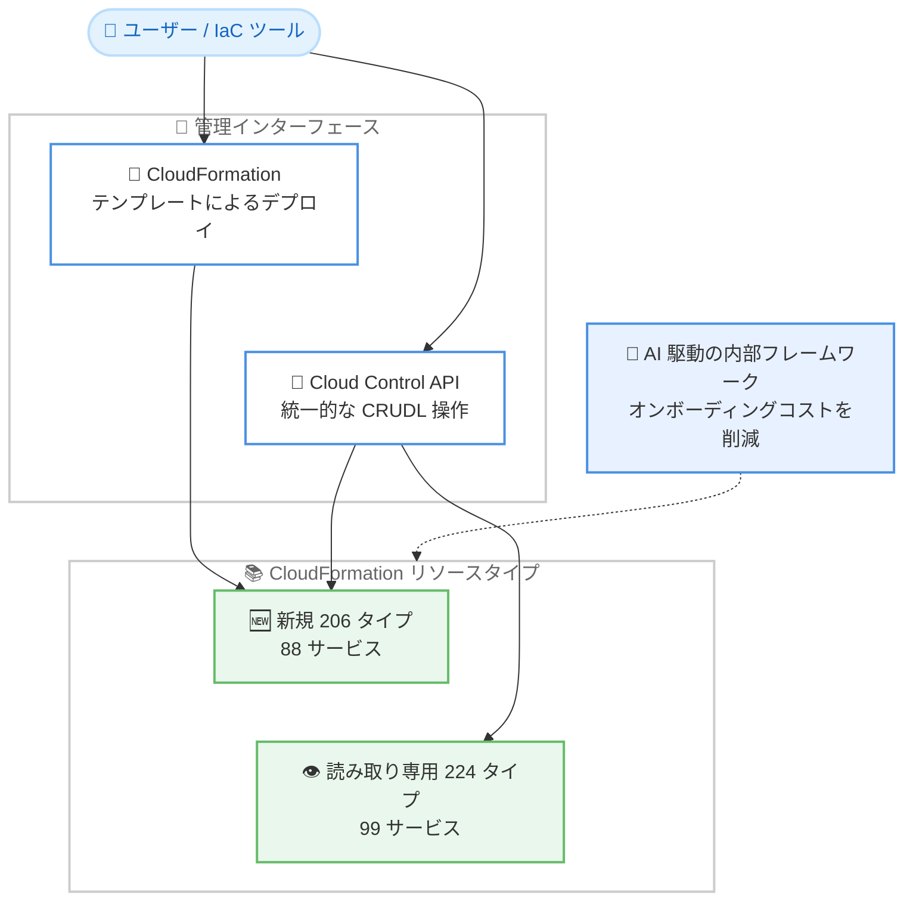

# AWS CloudFormation - 206 の新リソースタイプ追加によるリソースカバレッジの包括化

**リリース日**: 2026 年 11 月 24 日
**サービス**: AWS CloudFormation / AWS Cloud Control API
**機能**: 88 サービスにわたる 206 の新リソースタイプのサポート

📊 [このアップデートのインフォグラフィックを見る](https://takech9203.github.io/aws-news-summary/20261124-cloudformation-coverage-expansion.html)

## 概要

AWS CloudFormation が、88 のサービスにわたる 206 の新しいリソースタイプのサポートを発表しました。今回の拡張には Amazon SageMaker Hub、Amazon Bedrock AgentCore PolicyEngine、Amazon EC2 Snapshot などのリソースタイプが含まれ、CloudFormation カバレッジの主要なギャップを解消します。これにより、お客様は安全かつスケーラブルなインフラストラクチャ管理ワークフローへの標準化を一層進めることができます。

今回のローンチの特徴は、AI を活用した新しい内部フレームワークによって実現された点です。このフレームワークはリソースタイプのオンボーディングコストを大幅に削減し、今後も継続的にカバレッジを拡大していくための基盤となります。IaC (Infrastructure as Code) でカバーできないリソースが残っているという長年の課題に対して、構造的な解決アプローチが示されたアップデートです。

さらに、AWS Cloud Control API も CloudFormation がサポートするすべての新リソースタイプに対応します。加えて Cloud Control API では、99 サービスにわたる 224 の読み取り専用リソースタイプも提供され、既存の AWS リソースの検出と調査が容易になります。

**アップデート前の課題**

- 一部の AWS リソースは CloudFormation に対応しておらず、テンプレートでの管理対象外のリソースはコンソールや CLI で個別に作成・管理する必要があった
- IaC でカバーできないリソースが混在すると、構成ドリフトや手作業によるミスのリスクが高まり、環境全体の再現性が損なわれていた
- 新しいサービスや機能のリソースタイプが CloudFormation に追加されるまでに時間がかかることがあり、IaC への完全な標準化の障壁となっていた

**アップデート後の改善**

- 88 サービスにわたる 206 のリソースタイプが新たに CloudFormation テンプレートで宣言的に管理可能になった
- Cloud Control API からも同じリソースタイプを統一的な CRUDL 操作で管理できるようになり、Terraform や Pulumi など Cloud Control API を利用するサードパーティツールにも恩恵が広がる
- AI 駆動の内部フレームワークによりリソースタイプのオンボーディングコストが削減され、今後のカバレッジ拡大の継続が期待できる
- Cloud Control API の 224 の読み取り専用リソースタイプにより、既存リソースの検出・調査 (インベントリ把握) が簡素化された

## アーキテクチャ図



AI 駆動の内部フレームワークによってオンボーディングされた新リソースタイプは、CloudFormation テンプレートと Cloud Control API の両方から利用できます。読み取り専用タイプは Cloud Control API 経由で既存リソースの検出・調査に活用できます。

## サービスアップデートの詳細

### 主要機能

1. **206 の新リソースタイプのサポート**
   - 88 のサービスにわたり、206 のリソースタイプが CloudFormation テンプレートで新たに利用可能
   - 発表で挙げられた例: Amazon SageMaker Hub、Amazon Bedrock AgentCore PolicyEngine、Amazon EC2 Snapshot
   - CloudFormation カバレッジの主要なギャップを解消し、IaC への標準化を推進

2. **AI 駆動の内部フレームワークによるオンボーディング**
   - 新しい AI 活用フレームワークにより、リソースタイプを CloudFormation に対応させる際のコストを大幅に削減
   - 今回の 206 タイプ追加はこのフレームワークによって実現されており、今後の継続的なカバレッジ拡大の基盤となる

3. **Cloud Control API の完全対応**
   - CloudFormation がサポートするすべての新リソースタイプを Cloud Control API でも利用可能
   - 統一的な Create / Read / Update / Delete / List (CRUDL) 操作でリソースを管理できる

4. **224 の読み取り専用リソースタイプ**
   - Cloud Control API では、99 サービスにわたる 224 の読み取り専用リソースタイプを追加で提供
   - 既存の AWS リソースの検出 (List) と調査 (Read) を簡素化し、インベントリ管理や監査の用途に活用できる

## 技術仕様

### 今回の拡張の規模

| 項目 | 詳細 |
|------|------|
| 新規リソースタイプ数 | 206 タイプ |
| 対象サービス数 | 88 サービス |
| 読み取り専用リソースタイプ (Cloud Control API) | 224 タイプ / 99 サービス |
| リソースタイプの例 | Amazon SageMaker Hub、Amazon Bedrock AgentCore PolicyEngine、Amazon EC2 Snapshot |
| 対応インターフェース | CloudFormation テンプレート、Cloud Control API |

### リソースタイプ定義の例: AWS::EC2::Snapshot

新たにサポートされた `AWS::EC2::Snapshot` の構文は以下のとおりです (公式テンプレートリファレンスより)。

```yaml
Type: AWS::EC2::Snapshot
Properties:
  Description: String        # スナップショットの説明 (任意、変更時は置換)
  VolumeId: String           # 対象 EBS ボリュームの ID (必須、変更時は置換)
  Tags:                      # タグ (任意、中断なしで更新可能)
    - Key: String
      Value: String
```

`Fn::GetAtt` で `SnapshotId`、`Arn`、`Encrypted`、`State`、`StorageTier`、`VolumeSize` などの属性を取得できます。

## 設定方法

### 前提条件

1. AWS アカウントと、対象リソースを操作できる IAM 権限
2. AWS CLI または CloudFormation コンソールへのアクセス
3. 利用したいリソースタイプが [リソースおよびプロパティタイプのリファレンス](https://docs.aws.amazon.com/AWSCloudFormation/latest/TemplateReference/aws-template-resource-type-ref.html) に掲載されていることの確認

### 手順

#### ステップ 1: 新リソースタイプを含むテンプレートを作成

```yaml
# template.yaml
AWSTemplateFormatVersion: "2010-09-09"
Resources:
  MySnapshot:
    Type: AWS::EC2::Snapshot
    Properties:
      VolumeId: vol-0123456789abcdef0
      Description: Managed by CloudFormation
Outputs:
  SnapshotId:
    Value: !GetAtt MySnapshot.SnapshotId
```

新たにサポートされた `AWS::EC2::Snapshot` を宣言するテンプレートです。既存 EBS ボリュームのスナップショットを IaC として定義し、スナップショット ID を出力します。

#### ステップ 2: スタックをデプロイ

```bash
aws cloudformation deploy \
  --template-file template.yaml \
  --stack-name ebs-snapshot-stack
```

作成したテンプレートを CloudFormation スタックとしてデプロイします。スナップショットの作成・更新・削除がスタックのライフサイクルで管理されるようになります。

#### ステップ 3: Cloud Control API で同じリソースタイプを操作 (任意)

```bash
# リソースの一覧を取得
aws cloudcontrol list-resources --type-name AWS::EC2::Snapshot

# 特定リソースの詳細を取得
aws cloudcontrol get-resource \
  --type-name AWS::EC2::Snapshot \
  --identifier snap-0123456789abcdef0
```

Cloud Control API の統一的な CRUDL 操作で、同じリソースタイプを一覧表示・取得します。CloudFormation がサポートするすべての新リソースタイプが Cloud Control API でも利用できます。

## メリット

### ビジネス面

- **IaC 標準化の推進**: CloudFormation のカバレッジギャップが解消され、組織全体でインフラストラクチャ管理を IaC に統一しやすくなる
- **ガバナンスと監査性の向上**: より多くのリソースをテンプレートとスタックで管理できるため、変更履歴の追跡やレビュープロセスの適用範囲が広がる
- **将来への期待**: AI 駆動フレームワークによりオンボーディングコストが下がったため、今後も新サービス・新機能のリソースタイプが迅速に追加されることが見込まれる

### 技術面

- **構成ドリフトの削減**: 手作業で管理していたリソースをスタック管理に移行でき、環境の再現性が向上する
- **エコシステムへの波及**: Cloud Control API が全新規タイプに対応するため、Cloud Control API を基盤とするサードパーティ IaC ツールでも同じリソースを扱える
- **リソース検出の簡素化**: 224 の読み取り専用リソースタイプにより、既存リソースのインベントリ把握や監査が統一 API で行える

## デメリット・制約事項

### 制限事項

- 読み取り専用の 224 リソースタイプは検出・調査 (Read / List) 用であり、作成・更新・削除には利用できない
- 各リソースタイプが利用できるのは、基盤となるサービスが提供されているリージョンに限られる
- AI 駆動の内部フレームワークは AWS 内部の仕組みであり、ユーザーが直接利用・制御できるものではない

### 考慮すべき点

- 既存の手動管理リソースをスタック管理に移行する場合は、CloudFormation のリソースインポート機能の利用を検討する必要がある
- 新リソースタイプごとにサポートされるプロパティや更新時の動作 (置換の有無など) が異なるため、テンプレートリファレンスで事前に確認することが推奨される
- 206 タイプの具体的な一覧は、[リソースおよびプロパティタイプのリファレンス](https://docs.aws.amazon.com/AWSCloudFormation/latest/TemplateReference/aws-template-resource-type-ref.html) で確認する必要がある

## ユースケース

### ユースケース 1: EBS スナップショットのコード管理

**シナリオ**: データ移行やゴールデンイメージ作成の際に、EBS スナップショットの作成を手順書ベースの手作業で行っており、作業の再現性と追跡性に課題がある。

**実装例**:
```yaml
Resources:
  MigrationSnapshot:
    Type: AWS::EC2::Snapshot
    Properties:
      VolumeId: !Ref SourceVolume
      Description: Pre-migration snapshot
      Tags:
        - Key: Purpose
          Value: migration
```

**効果**: スナップショット作成がテンプレートとして定義され、レビュー・バージョン管理・再実行が可能になる。スタック削除時のクリーンアップも自動化できる。

### ユースケース 2: 生成 AI ワークロードの IaC 化

**シナリオ**: Amazon Bedrock AgentCore や Amazon SageMaker を活用した生成 AI 基盤を構築しており、ポリシーエンジンやモデルハブなどの周辺リソースだけが手動管理として残っている。

**実装例**:
```
1. リソースタイプリファレンスで Amazon SageMaker Hub /
   Amazon Bedrock AgentCore PolicyEngine の定義を確認
2. 既存の CloudFormation テンプレートにリソース定義を追加
3. 開発・ステージング・本番の各環境へ同一テンプレートでデプロイ
```

**効果**: 生成 AI ワークロード全体を単一のスタックで管理でき、環境間の構成差異を排除できる。ガバナンス要件の厳しい AI 基盤でも変更管理を一元化できる。

### ユースケース 3: Cloud Control API による全社リソースインベントリ

**シナリオ**: セキュリティチームが複数アカウントにまたがる既存リソースの棚卸しを行いたいが、サービスごとに異なる API を呼び分けるスクリプトの維持負担が大きい。

**実装例**:
```bash
# 読み取り専用タイプを含む統一 API でリソースを列挙
aws cloudcontrol list-resources --type-name <リソースタイプ名>
aws cloudcontrol get-resource \
  --type-name <リソースタイプ名> --identifier <識別子>
```

**効果**: 99 サービス・224 の読み取り専用タイプを含む統一インターフェースでリソースを検出・調査でき、インベントリスクリプトの実装・保守コストを削減できる。

## 料金

CloudFormation 自体の利用において、AWS リソースタイプ (`AWS::*` 名前空間) を使用する場合の追加料金はありません。テンプレートから作成された AWS リソースに対する通常の利用料金のみが発生します。Cloud Control API の利用にも追加料金はかかりません。

詳細は [AWS CloudFormation 料金ページ](https://aws.amazon.com/cloudformation/pricing/) を参照してください。

## 利用可能リージョン

基盤となるサービスが利用可能なすべての AWS リージョンで、対応するリソースタイプを利用できます。

## 関連サービス・機能

- **AWS Cloud Control API**: 今回の全新規リソースタイプに対応し、統一的な CRUDL 操作と 224 の読み取り専用タイプによるリソース検出を提供する
- **AWS CDK**: CloudFormation を基盤とするため、新リソースタイプは CDK の L1 コンストラクトとしても利用可能になる
- **CloudFormation リソースインポート**: 既存の手動管理リソースをスタック管理下に移行する際に活用できる
- **Terraform / Pulumi (AWS Cloud Control プロバイダー)**: Cloud Control API を利用するサードパーティ IaC ツールも新リソースタイプの恩恵を受けられる

## 参考リンク

- 📊 [インフォグラフィック](https://takech9203.github.io/aws-news-summary/20261124-cloudformation-coverage-expansion.html)
- [公式発表 (What's New)](https://aws.amazon.com/about-aws/whats-new/2026/11/cloudformation-coverage-expansion/)
- [AWS リソースおよびプロパティタイプのリファレンス](https://docs.aws.amazon.com/AWSCloudFormation/latest/TemplateReference/aws-template-resource-type-ref.html)
- [Cloud Control API がサポートするリソースタイプ](https://docs.aws.amazon.com/cloudcontrolapi/latest/userguide/supported-resources.html)
- [AWS CloudFormation ユーザーガイド](https://docs.aws.amazon.com/AWSCloudFormation/latest/UserGuide/Welcome.html)
- [AWS CloudFormation 料金ページ](https://aws.amazon.com/cloudformation/pricing/)

## まとめ

CloudFormation が 88 サービス・206 の新リソースタイプに対応し、IaC カバレッジの主要なギャップが解消されました。AI 駆動の内部フレームワークによりオンボーディングコストが削減されたため、今後も継続的なカバレッジ拡大が期待できます。手動管理が残っていたリソースの一覧を [リソースタイプリファレンス](https://docs.aws.amazon.com/AWSCloudFormation/latest/TemplateReference/aws-template-resource-type-ref.html) で確認し、リソースインポートも活用しながらスタック管理への移行を検討することを推奨します。
