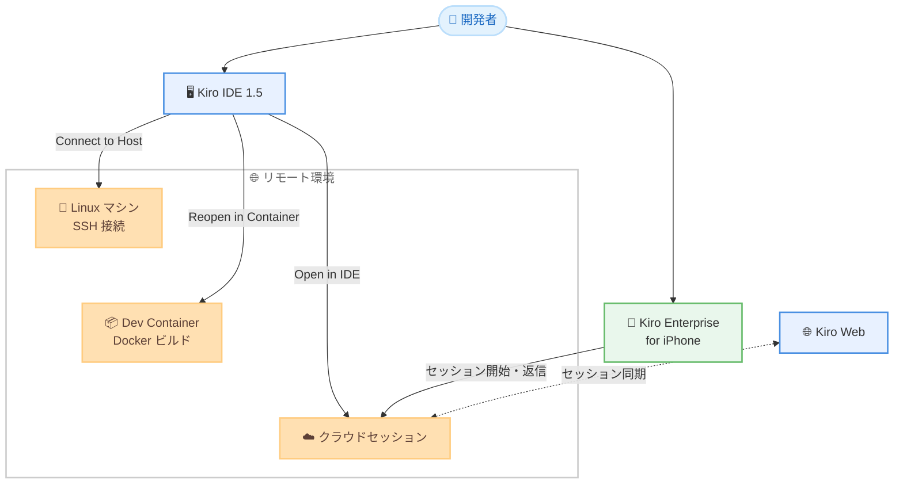

# Kiro - SubagentStop フック、Kiro Enterprise for iPhone、紹介コード、IDE リモート開発対応

**リリース日**: 2026 年 11 月 24 日
**サービス**: Kiro
**機能**: CLI 3.6.0 (SubagentStop フックとガイド付きコンパクション)、Kiro Enterprise for iPhone、紹介コード、IDE 1.5 (Remote SSH / Dev Containers / クラウドセッション)

📊 [このアップデートのインフォグラフィックを見る](https://takech9203.github.io/aws-news-summary/20261124-kiro-changelog-2026-11-24.html)

## 概要

2026 年 11 月 24 日付の Kiro Changelog では、CLI、Mobile、General、IDE の 4 つのカテゴリでアップデートが発表されました。開発者のローカル環境からリモート環境、モバイルまで、Kiro の利用範囲を大きく広げる内容です。

**Kiro CLI 3.6.0** では、V3 セッションにおいてディスパッチされたサブエージェントの終了時に実行される `SubagentStop` フックが追加され、結果が返る前にサブエージェントへ追加の指示を 1 回送信できるようになりました。また、Hook の出力が 3,000 文字を超える場合に完全な出力をファイルに保存する機能や、`/compact` コマンドにサマリーへ残すべき内容の指示を付加できるガイド付きコンパクションが追加されています。**Kiro IDE 1.5** では、SSH による自分の Linux マシンへの接続、Dev Container でのプロジェクトのオープン、クラウドセッションを専用の Kiro ウィンドウで開く機能が追加され、IDE からリモート環境で作業できるようになりました。

さらに、組織アカウント向けのモバイルアプリ **Kiro Enterprise for iPhone** が App Store に登場し、iPhone からクラウドセッションを開始してエージェントの作業をフォローできるようになりました。加えて、Enterprise ユーザーが個人向け有料プランを 20% オフで紹介できる**紹介コード**機能も追加されています。

**アップデート前の課題**

- 以前は CLI の Hook でサブエージェントの終了に介入する手段がなく、結果が返る前に追加の指示を与えることができなかった
- 以前は Hook の長い出力が扱いにくく、`/compact` のサマリーに残したい内容を指定することもできなかった
- 以前は Kiro IDE はローカル環境での作業が前提で、リモートの Linux マシンや Dev Container 内のプロジェクトを IDE から直接扱えなかった
- 以前はクラウドセッションの確認や返信には Kiro Web が必要で、外出先の iPhone から組織アカウントでエージェントの作業をフォローする手段がなかった

**アップデート後の改善**

- 今回のアップデートにより、`SubagentStop` フックでサブエージェントの結果が返る前に追加指示を送信できるようになった
- 今回のアップデートにより、`/compact` に指示を付けて、そのコンパクションのサマリーに残す内容を制御できるようになった
- 今回のアップデートにより、Kiro IDE から SSH 接続、Dev Container、クラウドセッションの 3 つのリモート環境で作業できるようになった
- 今回のアップデートにより、iPhone からクラウドセッションの開始、作業のフォロー、変更のレビュー、返信ができ、セッションは Kiro Web と同期されるようになった
- 今回のアップデートにより、Enterprise ユーザーが紹介コードを生成し、個人向け有料プランを 12 請求サイクルの間 20% オフで紹介できるようになった

## アーキテクチャ図



Kiro IDE 1.5 は SSH 接続、Dev Container、クラウドセッションの 3 つのリモート環境に接続できます。クラウドセッションは iPhone アプリと Kiro Web の間でも同期され、デバイスをまたいで作業を継続できます。

## サービスアップデートの詳細

### 主要機能

1. **SubagentStop フック (CLI 3.6.0)**
   - V3 セッションにおいて、ディスパッチされたサブエージェントが終了したタイミングで実行される Hook
   - 結果が呼び出し元に返る前に、サブエージェントへ追加の指示を 1 回送信できる
   - サブエージェントの成果物の検証や仕上げの指示を自動化できる

2. **Hook 出力の完全保存 (CLI 3.6.0)**
   - 任意の Hook の出力が 3,000 文字を超えた場合、Kiro CLI が完全な出力をファイルに保存する
   - エージェントには出力の冒頭部分と保存先ファイルのパスが渡される
   - 会話の可読性を保ちながら、完全な出力へのアクセスも維持できる

3. **ガイド付きコンパクション (CLI 3.6.0)**
   - V3 セッションで `/compact` の後に指示を追加できる (例: `/compact Keep the migration decisions and remaining validation steps`)
   - 指示はそのコンパクションのサマリーにのみ適用され、以降の指示なしのコンパクションは標準のサマリーを使用する
   - このリリースでは、会話のリキャップ、通知コントロール、マネージド V2 コントロール、全ユーザー向け Windows インストーラーも追加されている

4. **Kiro Enterprise for iPhone (Mobile)**
   - 組織アカウント向けの Kiro Mobile アプリが App Store で提供開始 (iOS 26 以降が必要)
   - iPhone からクラウドセッションを開始し、エージェントの作業をフォローし、変更をレビューし、入力が必要なときに返信できる
   - セッションは Kiro Web と同期され、スマートフォンで開始したセッションを Web で引き継げる
   - AWS IAM Identity Center と、Okta や Microsoft Entra ID などの外部 ID プロバイダーに対応。ソーシャルログインと AWS Builder ID は非対応で、Google、GitHub、AWS Builder ID でサインインする場合は TestFlight 経由の Kiro アプリを使用する

5. **紹介コード (General)**
   - Enterprise ユーザーが Kiro Web で紹介コードを生成し、友人や家族と共有できる
   - 各コードは個人向け有料プラン (Pro、Pro+、Pro Max、Power) を 12 請求サイクルの間 20% オフにする
   - 紹介機能はデフォルトで無効であり、管理者が Controls で組織ごとに有効化する

6. **Remote SSH、Dev Containers、クラウドセッション対応 (IDE 1.5)**
   - **Connect to Host**: Kiro ウィンドウを自分の Linux マシンに SSH で接続する。エディタは手元のコンピュータで動作し、ファイル、ターミナル、エージェントはリモートマシン上で実行されるため、切断後もエージェントは作業を継続できる
   - **Reopen in Container**: リポジトリが定義する Dev Container を Docker でビルドし、その中でプロジェクトを開く。ツールや依存関係を手元のコンピュータにインストールせずに利用でき、ローカルと SSH ホストの両方で動作する
   - **Open in IDE**: クラウドセッションを新しい Kiro ウィンドウで開き、そこで既に動作しているエージェントにチャットを接続する。リポジトリを手元にコピーせずに、クラウドセッションの作業をレビューして継続できる

## 技術仕様

### アップデート対象と提供範囲

| 項目 | 詳細 |
|------|------|
| Kiro CLI | 3.6.0 (SubagentStop フック、Hook 出力の完全保存、ガイド付きコンパクション) |
| SubagentStop フック | V3 セッションのみ対応 |
| Hook 出力保存のしきい値 | 3,000 文字超で完全な出力をファイルに保存 |
| Kiro IDE | 1.5 (Remote SSH、Dev Containers、クラウドセッションの IDE 内オープン) |
| Remote SSH の接続先 | Linux マシン |
| Dev Containers | Docker が必要。ローカルまたは SSH ホスト上でビルド可能 |
| Kiro Enterprise for iPhone | iOS 26 以降。組織アカウント専用 |
| Mobile の対応 ID プロバイダー | AWS IAM Identity Center、Okta、Microsoft Entra ID などの外部 ID プロバイダー |
| Mobile の非対応サインイン | ソーシャルログイン (Google、GitHub)、AWS Builder ID (TestFlight 版 Kiro アプリを使用) |
| 紹介コード | Enterprise ユーザーが生成。個人向け有料プランが 12 請求サイクルの間 20% オフ |
| 紹介コードのデフォルト | 無効 (管理者が Controls で組織ごとに有効化) |

### SubagentStop フックの設定例

```json
{
  "hooks": {
    "subagentStop": [
      {
        "command": "python3 check_subagent_result.py"
      }
    ]
  }
}
```

V3 セッションで、サブエージェントの終了時にスクリプトを実行し、必要に応じて追加の指示を返す構成の例です。詳細な設定形式は [Hook タイプのドキュメント](https://kiro.dev/docs/hooks/types/#subagent-stop-cli-v3-only)を参照してください。

## 設定方法

### 前提条件

1. Kiro CLI の新機能を使用する場合は、CLI 3.6.0 以降へのアップデートと V3 セッションの利用
2. IDE のリモート開発機能を使用する場合は、Kiro IDE 1.5 以降と、接続先の Linux マシン (SSH) または Docker (Dev Containers)
3. Kiro Enterprise for iPhone を使用する場合は、iOS 26 以降の iPhone と組織アカウント
4. 紹介コードを使用する場合は、Enterprise プランと管理者による Controls での有効化

### 手順

#### ステップ 1: ガイド付きコンパクションを使う

```bash
# CLI の V3 セッション内で、サマリーに残す内容を指示してコンパクションを実行
/compact Keep the migration decisions and remaining validation steps
```

`/compact` の後に続けた指示は、そのコンパクションのサマリー生成にのみ適用されます。以降の指示なしの `/compact` は標準のサマリーを使用します。

#### ステップ 2: IDE から SSH ホストに接続する

Kiro IDE で SSH ホストを追加し、**Connect to Host** から接続先を選択します。新しい Kiro ウィンドウがリモートホスト上で開き、ファイル、ターミナル、エージェントがリモートマシン上で実行されます。Dev Container を使う場合は、`.devcontainer` フォルダを含むプロジェクトでリモートメニューから **Reopen in Container** を選択します。

#### ステップ 3: iPhone アプリをセットアップする

App Store から **Kiro Enterprise** をダウンロードし、勤務先のメールアドレスまたは組織のスタート URL を入力して、組織経由でサインインを完了します。クラウドセッションの開始、作業のフォロー、変更のレビュー、返信が iPhone から行えます。

#### ステップ 4: 紹介コードを有効化して生成する (Enterprise)

管理者が Controls で組織の紹介機能を有効化すると、Enterprise ユーザーは Kiro Web で紹介コードを生成して共有できます。

## メリット

### ビジネス面

- **場所を選ばない開発ワークフロー**: iPhone からクラウドセッションを開始・フォローできるため、外出中でもエージェントの長時間タスクを止めずに進められる
- **オンボーディングの迅速化**: Dev Container 対応により、リポジトリが定義する開発環境をそのまま利用でき、環境構築の工数を削減できる
- **コスト面のインセンティブ**: 紹介コードにより、個人向け有料プランを 12 請求サイクルの間 20% オフで利用でき、組織のメンバーの家族や友人への展開を後押しできる

### 技術面

- **サブエージェント制御の強化**: `SubagentStop` フックにより、サブエージェントの結果が返る前に検証や修正の指示を自動で差し込める
- **コンテキスト管理の精度向上**: ガイド付きコンパクションにより、長いセッションでも重要な決定事項や残タスクをサマリーに確実に残せる
- **切断後も継続するリモート実行**: SSH 接続ではエージェントがリモートマシン上で動作するため、クライアントの切断後も作業を継続できる
- **会話の可読性維持**: 3,000 文字を超える Hook 出力はファイルに保存され、会話には冒頭とパスのみが残るため、コンテキストの浪費を防げる

## デメリット・制約事項

### 制限事項

- `SubagentStop` フックとガイド付きコンパクションは CLI の V3 セッションのみで利用できる
- IDE の Remote SSH 接続は Linux マシンが対象
- Dev Container の利用には Docker が必要
- Kiro Enterprise for iPhone は iOS 26 以降が必要で、組織アカウント専用。ソーシャルログインと AWS Builder ID には対応しない
- 紹介コードは Enterprise ユーザーのみ生成でき、デフォルトでは無効

### 考慮すべき点

- 個人アカウント (Google、GitHub、AWS Builder ID) で iPhone から Kiro を使う場合は、TestFlight 経由の Kiro アプリを使用する必要がある
- 紹介コードの割引は個人向け有料プラン (Pro、Pro+、Pro Max、Power) が対象で、Enterprise プラン自体の割引ではない
- `SubagentStop` フックで追加指示を送るとサブエージェントの実行時間とクレジット消費が増えるため、指示の内容は必要最小限にすることが望ましい

## ユースケース

### ユースケース 1: サブエージェントの成果物を自動検証する

**シナリオ**: 複数のサブエージェントに分担させたリファクタリングで、各サブエージェントの完了時にテスト実行を必ず確認させたい。

**実装例**:
```text
1. CLI 3.6.0 の V3 セッションで SubagentStop フックを設定
2. フックがサブエージェント終了時にテスト結果を確認し、未実行なら
   「テストを実行して結果を報告すること」という追加指示を送信
3. 検証済みの結果のみがメインエージェントに返る
```

**効果**: サブエージェントの品質チェックを自動化し、メインエージェントに返る結果の信頼性を高められる。

### ユースケース 2: リモートの Linux マシンで長時間タスクを実行する

**シナリオ**: 手元のノート PC より高性能なリモートの Linux 開発サーバー上で、エージェントにビルドやテストを含む長時間タスクを実行させたい。

**実装例**:
```text
1. Kiro IDE 1.5 の Connect to Host でリモートマシンに SSH 接続
2. リモート上のプロジェクトを開き、エージェントにタスクを依頼
3. ノート PC を閉じて切断しても、エージェントはリモート上で作業を継続
```

**効果**: ローカルマシンのスペックや稼働時間に縛られず、エージェントの長時間タスクを安定して実行できる。

### ユースケース 3: 移動中に iPhone からクラウドセッションを進める

**シナリオ**: 通勤中にエージェントへタスクを依頼し、オフィス到着後に Web で作業を引き継ぎたい。

**実装例**:
```text
1. iPhone の Kiro Enterprise アプリで組織アカウントにサインイン
2. クラウドセッションを開始してタスクを依頼し、進捗をフォロー
3. エージェントからの質問に iPhone から返信
4. オフィス到着後、同期された同じセッションを Kiro Web で継続
```

**効果**: デバイスをまたいだシームレスな作業継続により、エージェントの待ち時間を最小化できる。

## 料金

今回のアップデート自体に追加料金はなく、各機能は既存のプランの範囲で利用できます。紹介コードを利用すると、個人向け有料プラン (Pro、Pro+、Pro Max、Power) が 12 請求サイクルの間 20% オフになります。詳細は [Kiro の料金ページ](https://kiro.dev/pricing/)を参照してください。

## 利用可能リージョン

Kiro はグローバルに利用可能です。Kiro Enterprise for iPhone は App Store から入手できます。

## 関連サービス・機能

- **Kiro Hooks**: エージェントのライフサイクルに処理を差し込む仕組み。今回 `SubagentStop` タイプが追加された
- **Kiro クラウドセッション**: クラウド上でエージェントを実行する機能。今回 IDE と iPhone アプリからのアクセスが追加された
- **Kiro Web**: ブラウザベースのクライアント。iPhone アプリとセッションが同期され、紹介コードの生成にも使用する
- **Kiro Controls**: Enterprise 向けの組織管理機能。紹介コードの有効化やプロファイルのデフォルト設定に使用する

## 参考リンク

- 📊 [インフォグラフィック](https://takech9203.github.io/aws-news-summary/20261124-kiro-changelog-2026-11-24.html)
- [Kiro Changelog](https://kiro.dev/changelog/)
- [Changelog: CLI 3.6 - Subagent Stop Hooks and Guided Compaction](https://kiro.dev/changelog/cli/3-6/)
- [Changelog: Kiro Enterprise for iPhone](https://kiro.dev/changelog/mobile/kiro-enterprise-for-ios/)
- [Changelog: Share Kiro with Referral Codes](https://kiro.dev/changelog/general/share-kiro-with-referral-codes/)
- [Changelog: IDE 1.5 - Remote SSH, Dev Containers, and Cloud Sessions](https://kiro.dev/changelog/ide/1-5/)
- [ドキュメント: SubagentStop フック](https://kiro.dev/docs/hooks/types/#subagent-stop-cli-v3-only)
- [ドキュメント: コンパクション](https://kiro.dev/docs/compaction/)
- [ドキュメント: Remote Development - SSH](https://kiro.dev/docs/ide/remote-development/ssh/)
- [ドキュメント: Remote Development - Dev Containers](https://kiro.dev/docs/ide/remote-development/dev-containers/)
- [ドキュメント: Remote Development - クラウドセッション](https://kiro.dev/docs/ide/remote-development/cloud-sessions/)
- [ドキュメント: Mobile Setup & First Run](https://kiro.dev/docs/mobile/setup/)
- [ドキュメント: 紹介コード](https://kiro.dev/docs/enterprise/referral/)

## まとめ

2026 年 11 月 24 日の Kiro Changelog は、CLI の `SubagentStop` フックとガイド付きコンパクションによるエージェント制御の強化、IDE の Remote SSH / Dev Containers / クラウドセッション対応、iPhone 向け Kiro Enterprise アプリ、Enterprise 向け紹介コードと、ローカルからリモート、モバイルまで利用範囲を広げる多面的なアップデートです。特にリモート開発対応とモバイルアプリにより、デバイスや場所に縛られずにエージェントの作業を継続できるようになるため、CLI と IDE を最新バージョンへ更新し、組織では iPhone アプリのサインイン方式と紹介コードの有効化方針を確認することを推奨します。
