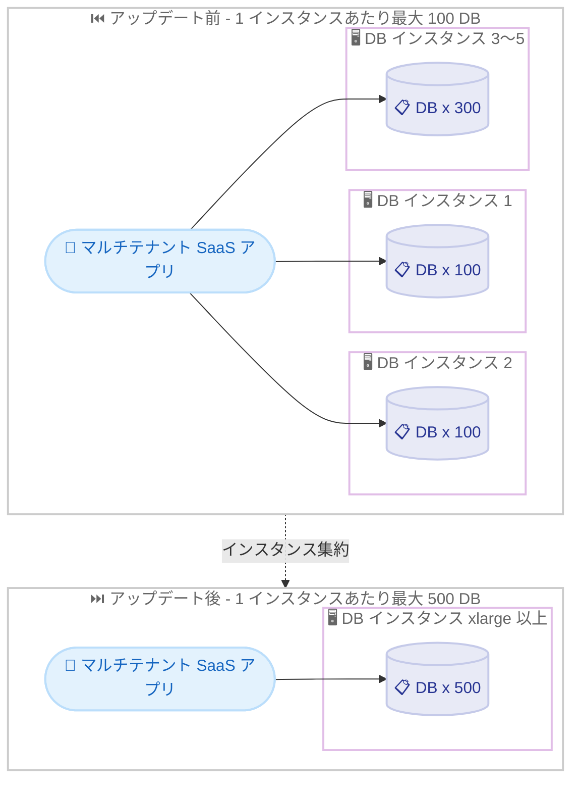

# Amazon RDS for SQL Server - 1 インスタンスあたり最大 500 データベースのサポート

**リリース日**: 2026 年 11 月 24 日
**サービス**: Amazon RDS for SQL Server
**機能**: 1 DB インスタンスあたりのデータベース数上限を 500 に拡大

📊 [このアップデートのインフォグラフィックを見る](https://takech9203.github.io/aws-news-summary/20261124-rds-sqlserver-supports-500-databases-per-instance.html)

## 概要

Amazon RDS for SQL Server が、1 つの DB インスタンスあたり最大 500 データベースをサポートするようになりました。従来の上限は 100 データベースであり、今回のアップデートで上限が 5 倍に拡大されました。新しい上限は、4 vCPU 以上の DB インスタンス (xlarge 以上、バースト可能インスタンスクラスを除く) に適用され、RDS がサポートするすべての SQL Server バージョンで利用できます。

このアップデートは、テナントごとにデータベースを分離する SaaS プロバイダーやマルチテナントアプリケーションの運用者にとって特に有益です。これまで 100 データベースの上限により複数の DB インスタンスにデータベースを分散配置する必要があったワークロードを、より少ないインスタンスに集約できるようになります。

データベースの集約により、管理の簡素化、監視やパッチ適用の対象となる DB インスタンス数の削減、そして SQL Server ライセンスコストとインフラストラクチャコストの低減が期待できます。

**アップデート前の課題**

このアップデート以前は、1 DB インスタンスあたりのデータベース数に 100 という上限がありました。

- テナント数が多い SaaS アプリケーションでは、100 データベースを超えるたびに新しい DB インスタンスを追加し、データベースを分散配置する必要があった
- DB インスタンス数の増加に伴い、監視、パッチ適用、バックアップ管理などの運用対象が増え、管理負荷が高くなっていた
- インスタンスごとに SQL Server ライセンス費用とインフラストラクチャ費用が発生し、集約率の低さがコスト増につながっていた

**アップデート後の改善**

今回のアップデートにより、対象構成では 1 インスタンスに最大 500 データベースを配置できます。

- 従来 5 台前後の DB インスタンスに分散していたデータベース群を、1 台に集約することが可能になった
- 監視・パッチ適用の対象インスタンス数が減り、運用管理が簡素化された
- インスタンス集約により、SQL Server ライセンスコストとインフラストラクチャコストを削減できるようになった

## アーキテクチャ図



従来は 500 データベースを運用するために 5 台の DB インスタンスが必要でしたが、今回のアップデートにより xlarge 以上の 1 台の DB インスタンスに集約できることを示しています。

## サービスアップデートの詳細

### 主要機能

1. **データベース数上限の 5 倍への拡大**
   - 1 DB インスタンスあたりのデータベース数上限が 100 から 500 に拡大
   - RDS がサポートするすべての SQL Server バージョンで利用可能
   - 追加の設定や有効化作業は不要で、対象構成であれば新しい上限が適用される

2. **幅広いエディションとデプロイ構成のサポート**
   - Single-AZ 構成: Enterprise、Enterprise Developer、Standard、Standard Developer、Web の各エディションで 500 データベースをサポート
   - Multi-AZ 構成: Always On 可用性グループを使用する Enterprise および Enterprise Developer エディションと、Web エディションでサポート

3. **対象インスタンスクラスの明確な要件**
   - 4 vCPU 以上の DB インスタンス (xlarge 以上) が対象
   - バースト可能インスタンスクラス (db.t 系) は対象外
   - 対象外の構成は従来の上限が引き続き適用される

## 技術仕様

### 新しい上限の適用条件

| 項目 | 詳細 |
|------|------|
| 新しい上限 | 1 DB インスタンスあたり最大 500 データベース |
| 従来の上限 | 1 DB インスタンスあたり最大 100 データベース |
| 対象インスタンスクラス | 4 vCPU 以上 (xlarge 以上、バースト可能インスタンスクラスを除く) |
| 対象 SQL Server バージョン | RDS がサポートするすべてのバージョン |
| Single-AZ 対応エディション | Enterprise、Enterprise Developer、Standard、Standard Developer、Web |
| Multi-AZ 対応エディション | Enterprise、Enterprise Developer (Always On 可用性グループ使用時)、Web |

### 従来の上限が引き続き適用される構成

| 構成 | 理由・備考 |
|------|------------|
| Database Mirroring を使用した Multi-AZ 構成 | 新しい上限の対象外 |
| Standard エディションの Multi-AZ 構成 | 新しい上限の対象外 |
| xlarge 未満のインスタンス | 4 vCPU 未満のため対象外 (バースト可能インスタンスクラスを含む) |

## 設定方法

### 前提条件

1. Amazon RDS for SQL Server の DB インスタンスが xlarge 以上 (4 vCPU 以上、バースト可能インスタンスクラス以外) であること
2. 利用するエディションとデプロイ構成 (Single-AZ / Multi-AZ) が新しい上限の対象であること
3. Multi-AZ で 500 データベースを利用する場合は、Always On 可用性グループを使用する Enterprise / Enterprise Developer エディション、または Web エディションであること

### 手順

#### ステップ 1: 現在のインスタンスクラスとエンジン情報を確認する

```bash
aws rds describe-db-instances \
  --db-instance-identifier my-sqlserver-instance \
  --query "DBInstances[0].{Class:DBInstanceClass,Engine:Engine,MultiAZ:MultiAZ}"
```

DB インスタンスのインスタンスクラス、エンジン (エディション)、Multi-AZ 設定を確認しています。インスタンスクラスが xlarge 以上であれば新しい上限の対象です。

#### ステップ 2: 必要に応じてインスタンスクラスを変更する

```bash
aws rds modify-db-instance \
  --db-instance-identifier my-sqlserver-instance \
  --db-instance-class db.m6i.xlarge \
  --apply-immediately
```

現在のインスタンスが large 以下またはバースト可能インスタンスクラスの場合に、xlarge 以上のインスタンスクラスへ変更しています。変更時には再起動が発生するため、メンテナンスウィンドウの利用も検討してください。

#### ステップ 3: データベースを作成して集約する

```sql
-- SQL Server クライアントから接続してデータベースを作成
CREATE DATABASE tenant_101;
CREATE DATABASE tenant_102;
-- 最大 500 データベースまで作成可能
```

対象構成のインスタンスでは、追加設定なしで最大 500 データベースまで作成できます。既存の複数インスタンスからの集約には、ネイティブバックアップ / リストア機能などを使用してデータベースを移行します。

## メリット

### ビジネス面

- **ライセンスコストの削減**: DB インスタンス数を減らすことで、SQL Server ライセンス費用を抑えられる
- **インフラストラクチャコストの削減**: インスタンス集約により、コンピューティングリソースの総量と費用を最適化できる
- **SaaS ビジネスのスケーラビリティ向上**: テナントごとの DB 分離モデルを維持したまま、1 インスタンスあたり 5 倍のテナントを収容できる

### 技術面

- **運用管理の簡素化**: 監視、パッチ適用、バックアップなどの運用対象インスタンス数が削減される
- **追加設定が不要**: 対象構成であれば自動的に新しい上限が適用され、有効化作業や移行作業は発生しない
- **幅広い構成のサポート**: Single-AZ は主要 5 エディション、Multi-AZ も Always On 可用性グループ構成などでサポートされる

## デメリット・制約事項

### 制限事項

- xlarge 未満のインスタンスおよびバースト可能インスタンスクラスでは、従来の上限が引き続き適用される
- Database Mirroring を使用した Multi-AZ 構成は新しい上限の対象外
- Standard エディションの Multi-AZ 構成は新しい上限の対象外

### 考慮すべき点

- 集約によりデータベース数が増えると、1 インスタンス障害時の影響範囲 (ブラストラディウス) が大きくなるため、Multi-AZ 構成やバックアップ戦略の見直しが重要
- 多数のデータベースを 1 インスタンスに集約する場合、CPU、メモリ、IOPS などのリソース競合を考慮したインスタンスサイズとストレージ設定が必要
- テナント間のパフォーマンス干渉 (ノイジーネイバー問題) への対策として、リソース使用状況の監視を強化することが望ましい

## ユースケース

### ユースケース 1: SaaS プロバイダーのテナント DB 集約

**シナリオ**: テナントごとに独立したデータベースを提供する SaaS プロバイダーが、400 テナントを 4 台の DB インスタンスで運用している。

**実装例**:
```
1. 集約先となる xlarge 以上のインスタンスを準備 (例: db.m6i.2xlarge)
2. ネイティブバックアップ / リストアで各テナント DB を集約先へ移行
3. アプリケーションの接続文字列を集約先インスタンスへ更新
4. 旧インスタンスを削除
```

**効果**: 4 台のインスタンスを 1 台に集約し、ライセンス費用・インフラ費用・運用負荷を削減。さらに 100 テナント分の増加余地を確保。

### ユースケース 2: 部門別データベースの統合管理

**シナリオ**: 企業内で部門ごと・アプリケーションごとに小規模な SQL Server データベースが乱立し、複数の RDS インスタンスに分散している。

**実装例**:
```
1. 現在の各インスタンスのデータベース数とリソース使用率を棚卸し
2. 統合先インスタンス (Enterprise エディション、Multi-AZ、Always On 可用性グループ) を設計
3. 部門 DB を段階的に統合先へ移行し、監視を一元化
```

**効果**: パッチ適用やバックアップ管理の対象が一元化され、ガバナンスと運用効率が向上。

### ユースケース 3: 開発・テスト環境の集約

**シナリオ**: 開発者ごと・ブランチごとにテスト用データベースを払い出しており、上限 100 に達するたびにインスタンスを追加していた。

**実装例**:
```
1. 開発用インスタンスを xlarge 以上 (Developer エディション) に統一
2. CI/CD パイプラインから 1 インスタンス上にテスト DB を動的に作成・削除
3. 不要になった追加インスタンスを削減
```

**効果**: 開発・テスト環境のインスタンス数を削減し、コストを抑えながら最大 500 の一時 DB を柔軟に払い出し可能。

## 料金

今回のアップデートによる追加料金はありません。データベース数上限の拡大は、対象構成の DB インスタンスに自動的に適用されます。料金は従来どおり、インスタンスクラス、ストレージ、ライセンスモデル (ライセンス込み / BYOL) などに基づく Amazon RDS for SQL Server の標準料金体系が適用されます。

むしろ、複数インスタンスを 1 台に集約することで、インスタンス費用とライセンス費用の削減が期待できます。たとえば 500 データベースの運用に従来 5 台のインスタンスが必要だった場合、適切なサイズの 1 台に集約することで総コストを下げられる可能性があります。具体的な料金は [Amazon RDS for SQL Server の料金ページ](https://aws.amazon.com/rds/sqlserver/pricing/) を参照してください。

## 利用可能リージョン

Amazon RDS for SQL Server が利用可能なすべての AWS リージョンで利用できます。

## 関連サービス・機能

- **Amazon RDS Multi-AZ 配置**: Always On 可用性グループを使用する Multi-AZ 構成では、Enterprise / Enterprise Developer エディションで 500 データベースをサポート。集約後の可用性確保に重要
- **Amazon CloudWatch / Performance Insights**: 多数のデータベースを集約したインスタンスのリソース使用状況やパフォーマンスの監視に活用
- **RDS ネイティブバックアップ / リストア**: 既存インスタンスから集約先インスタンスへのデータベース移行手段として利用可能

## 参考リンク

- 📊 [インフォグラフィック](https://takech9203.github.io/aws-news-summary/20261124-rds-sqlserver-supports-500-databases-per-instance.html)
- [公式発表 (What's New)](https://aws.amazon.com/about-aws/whats-new/2026/11/rds-sqlserver-supports-500-databases-per-instance)
- [Amazon RDS for SQL Server 製品ページ](https://aws.amazon.com/rds/sqlserver/)
- [Amazon RDS for Microsoft SQL Server ユーザーガイド](https://docs.aws.amazon.com/AmazonRDS/latest/UserGuide/CHAP_SQLServer.html)
- [Amazon RDS for SQL Server 料金ページ](https://aws.amazon.com/rds/sqlserver/pricing/)

## まとめ

Amazon RDS for SQL Server の 1 インスタンスあたりのデータベース数上限が 100 から 500 に拡大され、SaaS プロバイダーやマルチテナントアプリケーションのデータベース集約が大幅に容易になりました。追加料金や設定作業は不要で、xlarge 以上の対象構成であれば自動的に適用されます。複数の SQL Server インスタンスを運用している場合は、集約によるライセンス・インフラコスト削減と運用簡素化の効果を試算し、Multi-AZ 構成や監視体制とあわせて集約計画を検討することをお勧めします。
