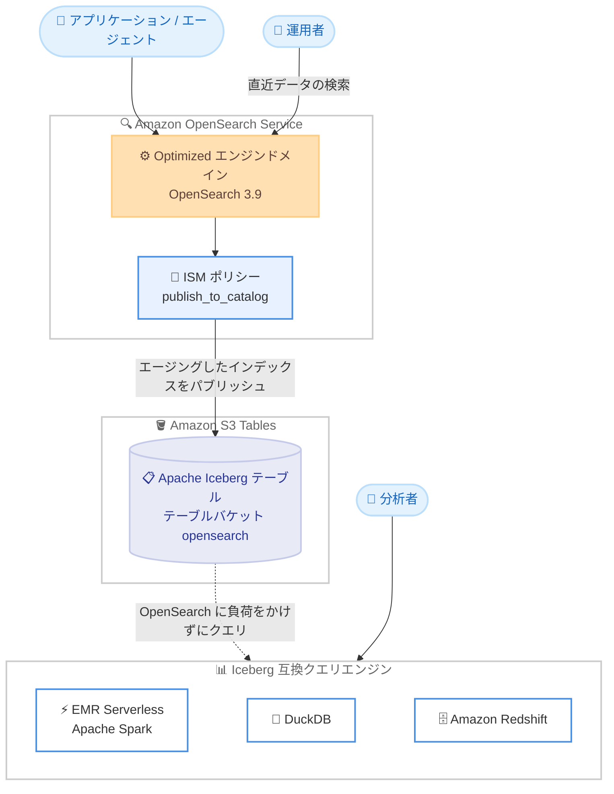

# Amazon OpenSearch Service - Optimized エンジンから Amazon S3 Tables へのデータパブリッシュ

**リリース日**: 2026 年 11 月 25 日
**サービス**: Amazon OpenSearch Service
**機能**: カタログパブリッシング (Optimized エンジンのインデックスを Amazon S3 Tables に Apache Iceberg テーブルとしてパブリッシュ)

📊 [このアップデートのインフォグラフィックを見る](https://takech9203.github.io/aws-news-summary/20261125-amazon-opensearch-service-publish-s3-tables.html)

## 概要

Amazon OpenSearch Service の observability 向け Optimized エンジンが、OpenSearch に直接取り込まれた observability データを Amazon S3 Tables にパブリッシュできるようになりました。Publish ポリシーを設定することで、選択したインデックスが AWS アカウント内の Apache Iceberg テーブルとして利用可能になります。データの取り込み方法を変更することなく、オープンテーブル形式でのデータ再利用パスを提供するインテグレーションです。

パブリッシュされたテーブルは、Amazon EMR Serverless 上の Apache Spark や DuckDB などの Iceberg 互換ツールから、OpenSearch ドメインにクエリ負荷をかけずにクエリできます。履歴調査、クロスデータセット分析、監査、長期トレンド分析といったユースケースで、同じデータを低コストで長期保持しながら活用できます。

Optimized エンジンは各インデックスをもともと Apache Parquet 形式で保存しているため、パブリッシュ時の再エンコードは不要で、ファイルのコピーのみで完了します。また、Index State Management (ISM) ポリシーと組み合わせることで、一定期間が経過したインデックスを自動的にテーブルへパブリッシュし、ドメインから削除する「コールドティア」として運用できます。

**アップデート前の課題**

- OpenSearch の observability データを他の分析ツールや AI ツールで再利用するには、並行したインジェストパイプラインやカスタムエクスポートパイプラインの構築が必要だった
- 履歴調査や長期トレンド分析のために古いデータを OpenSearch ドメイン上に保持し続けると、ストレージコストが増大した
- 外部ツールから過去データを分析する際、OpenSearch ドメインに直接クエリ負荷がかかっていた

**アップデート後の改善**

- Publish ポリシーの設定のみで、選択したインデックスを Apache Iceberg テーブルとして AWS アカウント内に公開できるようになった
- Iceberg 互換の任意のエンジン (Amazon EMR Serverless、DuckDB など) から、OpenSearch にクエリ負荷をかけずに同じデータをクエリできるようになった
- ISM ポリシーによる自動パブリッシュとドメインからの削除により、低コストな長期保持とドメインのストレージ最適化を両立できるようになった

## アーキテクチャ図



直近のデータは OpenSearch ドメイン上で検索可能なまま維持され、エージングしたインデックスは ISM ポリシーにより Amazon S3 Tables 上の Apache Iceberg テーブルへ自動的にパブリッシュされます。パブリッシュされたテーブルは Iceberg 互換の各種エンジンから OpenSearch を経由せずにクエリできます。

## サービスアップデートの詳細

### 主要機能

1. **カタログパブリッシング (Publish ポリシー)**
   - 選択したインデックスを AWS アカウント内の Apache Iceberg テーブルとして公開する
   - Optimized エンジンは各インデックスを Apache Parquet で保存しているため、パブリッシュは再エンコードではなくファイルコピーで実行される
   - パブリッシュは冪等かつ増分的で、既にパブリッシュ済みのファイルは保持され、新しいファイルのみが追加される
   - テーブルへの最初のパブリッシュ時にテーブルが自動作成される

2. **Iceberg v3 形式でのオープンな読み取り**
   - テーブルは Iceberg テーブルフォーマット v3 を使用する
   - DuckDB 1.5.1 以降、Amazon EMR リリース 7.12 以降の Apache Spark、AWS Glue ETL 5.1 以降、Amazon Redshift patch 204 以降、S3 Tables Iceberg REST エンドポイントなどで読み取り可能
   - クエリは IAM 権限に基づいて実行され、OpenSearch のコンポーネントは関与しない
   - 各テーブルにはインデックスのフィールドに加え、`index_name`、`_index_uuid`、`_shard_id`、`_start_time`、`_end_time` のパーティション列が含まれる

3. **ISM によるコールドティアの自動化**
   - `publish_to_catalog` と `delete_from_catalog` が ISM アクションとして追加された (OpenSearch 3.9 以降の Optimized ドメイン)
   - エージングした世代をテーブルへパブリッシュし、テーブルコミット成功後にドメインから削除、保持期間終了時にテーブルからも削除するライフサイクルを自動化できる
   - パブリッシュが失敗した場合、インデックスはドメイン上に残り、ISM がアクションをリトライする

4. **カタログ管理用 REST API**
   - ドメインエンドポイント上の `_catalog` API により、パブリッシュ実行、ステータス確認、テーブル / インデックス一覧、統計取得、テーブルからのインデックス削除、テーブル削除を操作できる
   - ドメイン名から導出された名前空間 (例: `my-logs` → `my_logs`) がカタログ名として使用される

## 技術仕様

### 前提条件と主な仕様

| 項目 | 詳細 |
|------|------|
| バージョン | OpenSearch 3.9 以降 |
| エンジンモード | Optimized エンジン (observability 向け) |
| 保存時の暗号化 | 有効化が必須 (Optimized ドメインでは常に有効) |
| テーブル形式 | Apache Iceberg テーブルフォーマット v3 (`date_nanos` は `timestamp_ns` として保存) |
| テーブルバケット | アカウント / リージョンごとに `opensearch` という名前のテーブルバケットを 1 つ使用 (全ドメインで共有) |
| 対象インデックス | 追記専用 (append-only) インデックスのみ (データストリームのバッキングインデックス、または `index.append_only.enabled: true` のインデックス) |
| テーブル所有権 | OpenSearch Service がテーブルを管理。読み取りと読み取り権限の付与は可能だが、直接書き込みは不可 |
| 暗号化 | カスタマーマネージド AWS KMS キーによるテーブル暗号化に対応 (有効化後の変更は不可) |

### API 変更履歴

| 日付 | サービス | 変更内容 |
|------|----------|----------|
| 2026/11/27 | [Amazon OpenSearch Service](https://awsapichanges.com/archive/changes/f55894-es.html) | 7 updated api methods - Optimized エンジンドメイン向けカタログ API。`CreateDomain`、`UpdateDomainConfig`、`DescribeDomain` などに `CatalogOptions` (ServiceManagedS3Tables、EncryptionConfiguration) が追加 |

### インデックスとテーブルのバインド設定

インデックステンプレートでインデックスをテーブルにバインドします。

```json
PUT _index_template/web-logs
{
  "index_patterns": ["web-logs*"],
  "data_stream": {},
  "template": {
    "settings": {
      "index.append_only.enabled": true,
      "index.catalog.table": "web_logs",
      "index.catalog.strict_mapping": true
    }
  }
}
```

| 設定 | 説明 | デフォルト |
|------|------|-----------|
| `index.catalog.table` | パブリッシュ先の Iceberg テーブル名 | なし |
| `index.catalog.name` | パブリッシュ先のカタログ | ドメインのカタログ |
| `index.catalog.strict_mapping` | テーブルスキーマと競合するマッピング変更をマッピング時に拒否 | false |
| `index.catalog.time_field` | 時間範囲パーティションに使用するルートレベルの date / date_nanos フィールド | データストリームのタイムスタンプフィールド、次に @timestamp |
| `index.catalog.timestamp_epoch` | ファイルを hour / day / month / year の時間範囲でグループ化 | インデックスごとに 1 範囲 |
| `index.append_only.enabled` | インデックスを追記専用にする (バインドに必須) | false |

## 設定方法

### 前提条件

1. OpenSearch 3.9 以降の Optimized エンジンドメイン (observability ユースケース) であること
2. カタログパブリッシングを有効化するプリンシパルに、`es:CreateDomain` または `es:UpdateDomainConfig` に加えて、`opensearch` テーブルバケットに対する S3 Tables 権限 (`s3tables:CreateTableBucket`、`s3tables:PutTableBucketPolicy` など) があること
3. ドメイン名が有効な S3 Tables 名前空間にマッピングできること
4. ファイングレインドアクセスコントロールを使用する場合、非管理者ユーザーにカタログ権限を付与すること

### 手順

#### ステップ 1: カタログパブリッシングを有効化する

```bash
aws opensearch update-domain-config \
  --domain-name my-logs \
  --catalog-options '{"Enabled":true,"Catalog":{"ServiceManagedS3Tables":{}}}' \
  --region us-east-1
```

既存の Optimized ドメインでカタログパブリッシングを有効化します。初回有効化時にアカウント / リージョンに `opensearch` テーブルバケットが作成されます。ドメイン新規作成時は `create-domain` に同じ `--catalog-options` を指定します。コンソールの場合は [Catalog publishing] で [Enable catalog publishing] を選択します。

#### ステップ 2: 設定状態を確認する

```bash
aws opensearch describe-domain-config \
  --domain-name my-logs \
  --query 'DomainConfig.CatalogOptions'
```

`CatalogOptions` の `State` フィールドを確認します。適用中は `Processing`、適用完了後は `Active` と表示されます。

#### ステップ 3: インデックスをテーブルにバインドしてパブリッシュする

```json
POST _catalog/my_logs/web_logs/.ds-web-logs-000001/_publish?wait_for_completion=true
```

「技術仕様」セクションのインデックステンプレートでバインドを設定した後、`_publish` API でバッキングインデックスをテーブルへパブリッシュします。テーブルへの最初のパブリッシュでテーブルが作成され、レスポンスでパブリッシュ結果 (追加ファイル数、テーブルスナップショット ID など) を確認できます。運用では ISM ポリシーの `publish_to_catalog` アクション (`delete_index: true` でドメインからの削除も自動化) による自動実行を推奨します。

#### ステップ 4: Iceberg 互換エンジンからクエリする

```sql
INSTALL iceberg; LOAD iceberg; INSTALL httpfs; LOAD httpfs; INSTALL aws; LOAD aws;
CREATE SECRET (TYPE s3, PROVIDER credential_chain, REGION 'us-east-1');
ATTACH 'arn:aws:s3tables:us-east-1:111122223333:bucket/opensearch' AS s3t (TYPE iceberg, ENDPOINT_TYPE s3_tables);
SELECT service.name, count(*) FROM s3t.my_logs.web_logs
WHERE "@timestamp" >= TIMESTAMP '2026-11-22 06:00:00' GROUP BY 1;
```

DuckDB からテーブルバケットにアタッチしてクエリする例です。クエリを実行する IAM ロール / ユーザーには `s3tables:GetTableData` などの読み取り権限が必要です。Amazon EMR Serverless の場合は、SigV4 署名を使用する Iceberg REST カタログを Spark に設定します。

## メリット

### ビジネス面

- **ストレージコストの削減**: エージングしたデータを低コストな S3 Tables に保持しながら、ドメイン上には直近のデータのみを残すことで、OpenSearch ドメインのコストを最適化できる
- **追加料金なし**: カタログパブリッシング自体に OpenSearch Service の追加料金はなく、S3 Tables のストレージとクエリに使用するサービスの標準料金のみで利用できる
- **データ活用範囲の拡大**: observability データを監査、長期トレンド分析、クロスデータセット分析など、検索以外の分析用途にも活用できる

### 技術面

- **パイプライン構築が不要**: 並行インジェストやカスタムエクスポートパイプラインを構築せずに、オープンテーブル形式でデータを再利用できる
- **再エンコード不要の効率的なパブリッシュ**: Optimized エンジンは Parquet でデータを保存しているため、パブリッシュはファイルコピーのみで高速に完了する
- **クエリ負荷の分離**: 外部エンジンからのクエリは OpenSearch ドメインを経由しないため、本番の検索ワークロードに影響を与えない
- **ライフサイクルの自動化**: ISM ポリシーでホット → ウォーム → コールド (S3 Tables) → 削除までのライフサイクルを宣言的に管理できる

## デメリット・制約事項

### 制限事項

- カタログパブリッシングは一度有効化すると無効化できない。ドメインの保存時暗号化オプションとテーブルの KMS キーも変更できない
- 追記専用インデックスのみがバインド / パブリッシュの対象。フィールド変更は互換性のある追加に限られ、型の競合は拒否される
- テーブルバケット名は `opensearch` に固定。OpenSearch Service 以外が作成した同名のテーブルバケットが既に存在する場合、有効化は失敗する
- テーブルは OpenSearch Service が管理し、ユーザーは直接書き込めない
- ドメインはテーブルを読み戻さない。ドメイン上の検索はドメインに残っているデータのみを対象とする
- Amazon Athena は Iceberg V3 テーブルを読み取れないため、クエリエンジンとして使用できない

### 考慮すべき点

- テーブルはドメインより長く存続する。ドメインを削除してもテーブルは削除されず、テーブルを削除 (drop) するまで S3 Tables の課金が継続する
- テーブルからインデックスを削除しても、古いスナップショット (タイムトラベル) には S3 Tables のスナップショット有効期限 (デフォルト 120 時間) が切れるまでデータが残る
- クエリエンジンには Iceberg V3 メタデータとナノ秒タイムスタンプ (`timestamp_ns`) のサポートが必要
- EMR Serverless からクエリする場合、S3 Tables のインターフェイスエンドポイントまたは NAT ゲートウェイを持つ VPC でアプリケーションを実行する必要がある
- ISM は `publish_to_catalog` などのアクションをポリシー作成者の権限で実行するため、ポリシー作成者に必要なクラスター / インデックス権限を付与する必要がある

## ユースケース

### ユースケース 1: ログデータのコールドティア化と低コスト長期保持

**シナリオ**: Web アプリケーションのログを OpenSearch で監視しており、直近 30 日はダッシュボードで検索したいが、コンプライアンス要件により 300 日の保持が必要。

**実装例**:
```json
PUT _plugins/_ism/policies/web-logs-lifecycle
{
  "policy": {
    "default_state": "hot",
    "ism_template": [{ "index_patterns": ["web-logs*"], "priority": 100 }],
    "states": [
      { "name": "hot",
        "actions": [{ "rollover": { "min_index_age": "1d", "min_primary_shard_size": "30gb" } }],
        "transitions": [{ "state_name": "warm", "conditions": { "min_index_age": "7d" } }] },
      { "name": "warm",
        "actions": [{ "warm_migration": {} }],
        "transitions": [{ "state_name": "cold", "conditions": { "min_index_age": "30d" } }] },
      { "name": "cold",
        "actions": [
          { "read_only": {} },
          { "publish_to_catalog": { "table": "web_logs", "delete_index": true },
            "retry": { "count": 3, "backoff": "exponential", "delay": "10m" } } ],
        "transitions": [{ "state_name": "expired", "conditions": { "min_index_age": "300d" } }] },
      { "name": "expired",
        "actions": [{ "delete_from_catalog": {} }],
        "transitions": [] }
    ]
  }
}
```

**効果**: 30 日経過したログは自動的に S3 Tables へ移動してドメインのストレージを解放し、300 日まで低コストで保持。保持期間終了後はテーブルからも自動削除される。

### ユースケース 2: インシデントの履歴調査と長期トレンド分析

**シナリオ**: 数か月前のインシデントの再発調査や、サービスのレイテンシーの長期トレンド分析を、本番の OpenSearch ドメインに負荷をかけずに実施したい。

**実装例**:
```sql
-- DuckDB からパブリッシュ済みテーブルを直接クエリ
ATTACH 'arn:aws:s3tables:ap-northeast-1:111122223333:bucket/opensearch'
  AS s3t (TYPE iceberg, ENDPOINT_TYPE s3_tables);
SELECT date_trunc('day', "@timestamp") AS day,
       avg(latency_ms) AS avg_latency
FROM s3t.my_logs.web_logs
WHERE "@timestamp" BETWEEN TIMESTAMP '2026-08-01 00:00:00'
                       AND TIMESTAMP '2026-11-01 00:00:00'
GROUP BY 1 ORDER BY 1;
```

**効果**: 本番ドメインにクエリ負荷をかけることなく、数か月分の履歴データに対する調査・分析を Iceberg 互換ツールで実行できる。

### ユースケース 3: EMR Serverless によるクロスデータセット分析

**シナリオ**: observability データをデータレイク上の他の業務データ (売上データ、顧客データなど) と組み合わせて、Spark で横断的に分析したい。

**実装例**:
```bash
--conf spark.sql.catalog.s3t=org.apache.iceberg.spark.SparkCatalog
--conf spark.sql.catalog.s3t.type=rest
--conf spark.sql.catalog.s3t.uri=https://s3tables.ap-northeast-1.amazonaws.com/iceberg
--conf spark.sql.catalog.s3t.warehouse=arn:aws:s3tables:ap-northeast-1:111122223333:bucket/opensearch
--conf spark.sql.catalog.s3t.rest.auth.type=sigv4
--conf spark.sql.catalog.s3t.rest.signing-name=s3tables
--conf spark.sql.catalog.s3t.rest.signing-region=ap-northeast-1
```

**効果**: OpenSearch に取り込んだ observability データを、データレイク上の他の Iceberg テーブルと JOIN するなど、クロスデータセット分析に活用できる。

## 料金

カタログパブリッシング機能自体に OpenSearch Service の追加料金はありません。以下の標準料金が適用されます。

- **Amazon S3 Tables**: テーブルのストレージ、リクエスト、メンテナンスに対して課金。ドメイン削除後もテーブルを削除するまで課金が継続する
- **クエリに使用するサービス**: Amazon EMR Serverless、AWS Glue、Amazon Redshift など、クエリに使用する各サービスの標準料金
- **AWS KMS**: カスタマーマネージドキーを使用する場合の KMS 料金

## 利用可能リージョン

OpenSearch 3.9 の新しい observability エンジンで、以下の 12 リージョンで利用可能です。

- 米国東部 (バージニア北部)
- 米国東部 (オハイオ)
- 米国西部 (オレゴン)
- カナダ (中部)
- アジアパシフィック (ムンバイ)
- アジアパシフィック (シンガポール)
- アジアパシフィック (シドニー)
- アジアパシフィック (東京)
- 欧州 (フランクフルト)
- 欧州 (アイルランド)
- 欧州 (ロンドン)
- 欧州 (スペイン)

## 関連サービス・機能

- **Amazon S3 Tables**: パブリッシュ先となるフルマネージドな Apache Iceberg テーブルストレージ。スナップショット有効期限や未参照ファイル削除などのメンテナンスを提供
- **Amazon EMR Serverless**: Apache Spark によるテーブルのクエリ実行基盤 (Amazon EMR リリース 7.12 以降で Iceberg V3 に対応)
- **AWS KMS**: カスタマーマネージドキーによるテーブルの暗号化
- **Index State Management (ISM)**: `publish_to_catalog` / `delete_from_catalog` アクションによるライフサイクル自動化
- **Amazon Redshift / AWS Glue / Amazon SageMaker Unified Studio**: Iceberg V3 テーブルを読み取り可能なその他の AWS 分析サービス

## 参考リンク

- 📊 [インフォグラフィック](https://takech9203.github.io/aws-news-summary/20261125-amazon-opensearch-service-publish-s3-tables.html)
- [公式発表 (What's New)](https://aws.amazon.com/about-aws/whats-new/2026/11/amazon-opensearch-service-publish-s3-tables)
- [ドキュメント: Publishing indices to Amazon S3 Tables](https://docs.aws.amazon.com/opensearch-service/latest/developerguide/publishing-indices-s3-tables.html)
- [ドキュメント: Optimized ドメインのセットアップ](https://docs.aws.amazon.com/opensearch-service/latest/developerguide/optimized-log-analytics.html)
- [ドキュメント: Working with Apache Iceberg V3](https://docs.aws.amazon.com/AmazonS3/latest/userguide/working-with-apache-iceberg-v3.html)
- [料金ページ (Amazon S3)](https://aws.amazon.com/s3/pricing/)

## まとめ

OpenSearch Service の Optimized エンジンから Amazon S3 Tables への直接パブリッシュにより、カスタムパイプラインなしで observability データをオープンな Apache Iceberg テーブルとして再利用できるようになりました。ドメインの検索性能を維持しながら、低コストな長期保持と外部分析エンジンによる柔軟な分析を両立できる重要なアップデートです。OpenSearch 3.9 の Optimized エンジンドメインを利用している場合は、有効化が不可逆である点とテーブルバケット名の固定を踏まえた上で、ISM ポリシーによるコールドティア構成の導入を検討することを推奨します。
