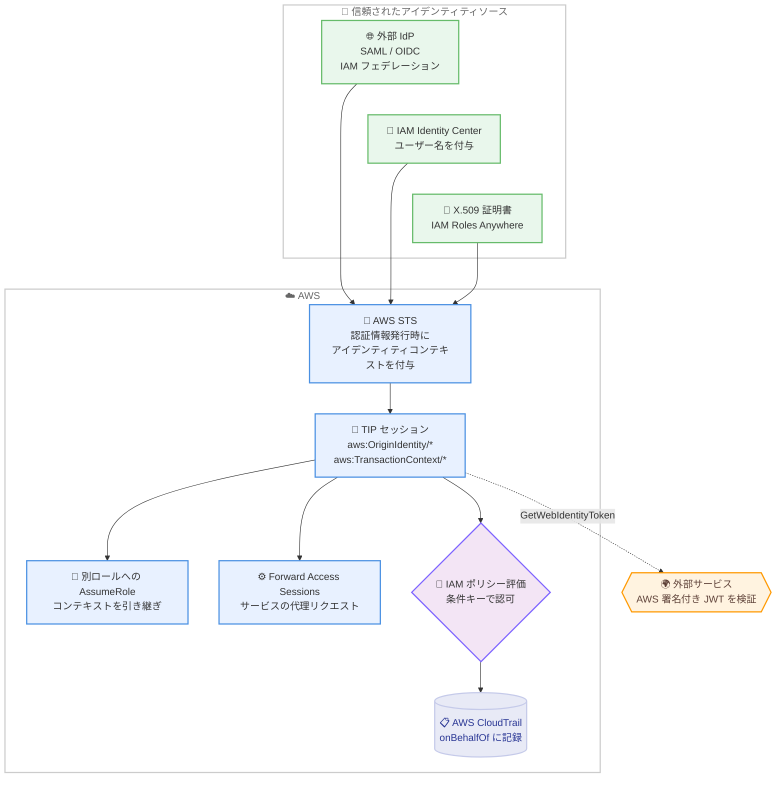

# AWS IAM - 信頼されたアイデンティティ伝播 (TIP) の IAM フェデレーションと IAM Roles Anywhere への拡張

**リリース日**: 2026 年 11 月 25 日
**サービス**: AWS Identity and Access Management (IAM)、AWS IAM Identity Center、IAM Roles Anywhere、AWS STS
**機能**: Trusted Identity Propagation (TIP) の IAM フェデレーション / IAM Roles Anywhere への拡張、IAM Identity Center での簡素化、IAM アウトバウンドアイデンティティフェデレーション

📊 [このアップデートのインフォグラフィックを見る](https://takech9203.github.io/aws-news-summary/20261125-aws-iam.html)

## 概要

AWS は、信頼されたアイデンティティ伝播 (Trusted Identity Propagation、TIP) を IAM フェデレーションと IAM Roles Anywhere に拡張し、あわせて IAM Identity Center での TIP をより簡単に使えるようにしたと発表しました。TIP は、IAM ロールの背後にいる人間のユーザーまたはワークロード (アプリケーション、サービス、自動化ワークフローなどの非人間の呼び出し元) のアイデンティティを AWS へのリクエストとともに伝播する仕組みです。これにより、IAM ポリシーの条件でそのアイデンティティに基づいたアクセス制御を行い、AWS CloudTrail でリクエスト元のユーザーやワークロードを追跡できます。

これまで TIP は IAM Identity Center 経由で AWS にアクセスするユーザーに限定されていましたが、今回のアップデートにより、SAML / OIDC で IAM ロールに直接フェデレーションするユーザーやワークロード、および X.509 証明書で AWS 認証情報を取得するワークロードでも TIP を利用できるようになりました。さらに、新しい IAM アウトバウンドアイデンティティフェデレーション機能により、TIP セッションのアイデンティティ情報を含む AWS 署名付き JSON Web Token (JWT) を取得し、外部サービスに呼び出し元を伝えることも可能になりました。

共有 IAM ロールを使う組織にとって、「誰がこのロールを使って操作したのか」という監査上の課題と、「ロール単位でしか権限を分けられない」というアクセス制御上の課題を同時に解決する、セキュリティ・ガバナンス観点で重要なアップデートです。

**アップデート前の課題**

このアップデート以前には、以下の課題がありました。

- アクセス制御の判断はロールに対して適用され、CloudTrail も各アクションをロールセッションに帰属させるため、共有ロールの背後にいる個々のユーザーやワークロードを特定しにくかった
- ユーザーやワークロードごとにアクセスを分けるには、ロールを分割する (ロールの乱立につながる) か、セッション属性をチェックするポリシーを書く必要があった
- セッション属性 (セッションタグなど) は追加の権限 (`sts:TagSession` など) を付与した場合のみロールセッション間で引き継がれ、誰がその属性を設定したかはセッションに記録されなかった
- TIP は IAM Identity Center 経由のアクセスでのみ利用可能で、IAM フェデレーションや IAM Roles Anywhere を使う環境では利用できなかった

**アップデート後の改善**

今回のアップデートにより、以下が可能になりました。

- **IAM フェデレーション**: SAML アサーションまたは OIDC トークンから、ユーザーやワークロードのアイデンティティと、リスクスコアや CI/CD ワークフロー名などのオプションのランタイムクレームをロールセッションにマッピングできるようになった
- **IAM Roles Anywhere**: X.509 証明書に由来するアイデンティティ (Subject の Common Name または URI Subject Alternative Name) をロールセッションに付与できるようになった
- **IAM Identity Center の簡素化**: Identity Center が生成するユーザー ID に加えて、アイデンティティソース由来のユーザー名が付与され、アプリケーションアクセスと AWS アカウントアクセスのどちらでも一貫して伝播されるようになった
- **IAM アウトバウンドアイデンティティフェデレーション**: TIP セッションのアイデンティティ情報を含む AWS 署名付き JWT をリクエストし、外部サービスに呼び出し元のユーザーやワークロードを伝えられるようになった
- ロールの信頼ポリシーをロールごとに更新することなく、リクエストが IAM ロールやサービスをまたいで伝わる際にアイデンティティが保持されるようになった

## アーキテクチャ図



3 つのフェデレーション経路 (IAM フェデレーション、IAM Identity Center、IAM Roles Anywhere) から取得した認証情報に、AWS が信頼できるアイデンティティコンテキストを付与し、ロールチェーンや Forward Access Sessions をまたいで IAM ポリシー評価と CloudTrail 記録に伝播される流れを示しています。

## サービスアップデートの詳細

### 主要機能

1. **IAM フェデレーションへの TIP 拡張**
   - SAML アサーションのフィールドまたは OIDC トークンのクレームから、ユーザーやワークロードを識別する値を選択してロールセッションに付与
   - リスクスコアや CI/CD ワークフロー名などのオプションの SAML 属性 / OIDC クレームを `aws:TransactionContext/IdentityProvider/*` 条件キーにマッピング可能
   - 新規に作成する IAM ID プロバイダーでは TIP がデフォルトで有効。既存のプロバイダーでも有効化可能

2. **IAM Roles Anywhere への TIP 拡張**
   - X.509 証明書に由来するアイデンティティをロールセッションに付与
   - 証明書をトラストアンカーで検証した後、デフォルトでは証明書の Subject Common Name、または URI Subject Alternative Name を `aws:OriginIdentity/Subject` に設定
   - プロファイルに `tipConfiguration` フィールドが追加され、新規プロファイルでは TIP がデフォルトで有効。既存プロファイルでも有効化可能

3. **IAM Identity Center での簡素化された TIP エクスペリエンス**
   - 従来の Identity Center 生成のアイデンティティストアユーザー ID に加えて、アイデンティティソース由来のユーザー名を付与
   - アプリケーションアクセス、許可セット経由のアカウントアクセス、IAM アカウントアクセスマネージャーなど、すべてのアクセス経路で一貫してアイデンティティ情報を伝播
   - 伝播されたユーザー名を `aws:OriginIdentity/Subject` 条件キーとして IAM ポリシー条件で使用でき、CloudTrail イベントでも確認可能
   - すべての IAM Identity Center インスタンスが簡素化されたエクスペリエンスにアップグレード可能

4. **IAM アウトバウンドアイデンティティフェデレーション**
   - TIP セッションから AWS STS の `GetWebIdentityToken` API を呼び出し、TIP セッションのアイデンティティコンテキストを含む AWS 署名付き JWT を取得
   - 外部サービスはトークンを検証し、リクエスト元のユーザーやワークロードを特定して独自の認可判断に利用可能

5. **一貫したアイデンティティ伝播モデル**
   - 認証情報発行時に付与されたアイデンティティコンテキストは、セッションの存続期間中は変更不可
   - TIP セッションが別のロールを引き受けると、AWS STS がコンテキストを新しいロールセッションに引き継ぎ、AWS サービスが代理で行うリクエスト (Forward Access Sessions) にも引き継がれる
   - ロール信頼ポリシーに `sts:SetContext` 権限を追加することなく、サポートされるワークフロー全体でコンテキストが伝播
   - 250 以上のサポート対象 AWS サービスで、ポリシー記述と CloudTrail 監査を同じモデルで実施可能

## 技術仕様

### TIP 条件キー

| 条件キー | 用途 |
|------|------|
| `aws:OriginIdentity/Subject` | リクエストを開始したユーザーまたはワークロードを識別 |
| `aws:OriginIdentity/SubjectType` | リクエスト元がユーザーかワークロードかを示す |
| `aws:OriginIdentity/Issuer` | アイデンティティを発行したソースを識別 |
| `aws:OriginIdentity/FederatedProviderArn` | 認証した IAM ID プロバイダーまたは IAM Roles Anywhere トラストアンカーの ARN (IAM フェデレーション / Roles Anywhere のみ) |
| `aws:TransactionContext/IdentityProvider/*` | IdP からのオプションクレーム (リスクスコア、CI/CD ワークフロー名など)。IAM フェデレーションのみ利用可能 |
| `aws:IdentityCenterInstanceArn`、`aws:IdentityStoreArn` | セッションの背後にある IAM Identity Center インスタンスとアイデンティティストアを識別 |

### CloudTrail への記録

| フィールド | 内容 |
|------|------|
| `userIdentity.onBehalfOf` | `aws:OriginIdentity` 条件キーに対応するユーザー / ワークロードのアイデンティティ (subject、subjectType、issuer、federatedProviderArn) |
| `userIdentity.transactionContext` | `aws:TransactionContext/IdentityProvider` 条件キーに対応する IdP クレーム |

### API変更履歴

| 日付 | サービス | 変更内容 |
|------|----------|----------|
| 2026/11/19 | [AWS Identity and Access Management](https://awsapichanges.com/archive/changes/b8bc94-iam.html) | 1 new 7 updated api methods - IAM の SAML / OpenID Connect プロバイダーに対する TIP 設定の API サポートを追加 |
| 2026/11/19 | [IAM Roles Anywhere](https://awsapichanges.com/archive/changes/b8bc94-rolesanywhere.html) | 9 updated api methods - プロファイルに `tipConfiguration` フィールドを追加し、X.509 証明書のアイデンティティをオリジンアイデンティティ条件キーとしてセッションに付与 |
| 2026/11/19 | [AWS Security Token Service](https://awsapichanges.com/archive/changes/b8bc94-sts.html) | 1 new 3 updated api methods - TIP を IAM フェデレーションと IAM Roles Anywhere に拡張。`GetScopedCredentials` も追加 |

### ポリシー例: セッションのリスクスコアに基づく S3 アクセス制御

IdP が発行する OIDC トークンのリスクスコアクレームを TIP 条件キーにマッピングし、S3 バケットポリシーでセッション単位のアクセス判断を行う例です (AWS Security Blog より)。

```json
{
  "Version": "2012-10-17",
  "Statement": [
    {
      "Sid": "AllowLowRiskSensitiveDataRead",
      "Effect": "Allow",
      "Principal": {
        "AWS": "arn:aws:iam::111122223333:role/DataAccessRole"
      },
      "Action": "s3:GetObject",
      "Resource": "arn:aws:s3:::amzn-s3-demo-bucket/restricted/*",
      "Condition": {
        "StringEquals": {
          "aws:OriginIdentity/Issuer": "idp.example.com"
        },
        "NumericLessThanEquals": {
          "aws:TransactionContext/IdentityProvider/riskScore": "30"
        }
      }
    }
  ]
}
```

このポリシーは、アイデンティティが `idp.example.com` から発行され、かつセッションのリスクスコアが 30 以下の場合にのみ読み取りアクセスを許可します。Issuer 条件により、別の IdP の riskScore 値でポリシーを満たすことを防止します。

## 設定方法

### 前提条件

1. 利用するフェデレーション経路 (IAM フェデレーション、IAM Identity Center、IAM Roles Anywhere) が構成済みであること
2. IAM フェデレーションの場合、IdP が発行する SAML アサーション / OIDC トークンに、ユーザーやワークロードを識別するフィールド / クレームが含まれていること
3. TIP 条件キーを利用する対象の AWS サービスが TIP をサポートしていることを確認すること

### 手順

#### ステップ1: フェデレーション経路に応じて TIP を有効化する

- **IAM Identity Center**: すべてのインスタンスで簡素化されたエクスペリエンスへのアップグレードが可能。アップグレード前に考慮事項をドキュメントで確認する
- **IAM フェデレーション**: 新規 IAM ID プロバイダーは TIP がデフォルトで有効。既存プロバイダーでは TIP を有効化し、ユーザー / ワークロードを識別するクレームと、ポリシーで必要なオプションクレームを TIP 条件キーにマッピングする
- **IAM Roles Anywhere**: 新規プロファイルは TIP がデフォルトで有効。既存プロファイルではプロファイルに対して TIP を有効化する

#### ステップ2: IAM ポリシーに TIP 条件を追加する

```json
"Condition": {
  "StringEquals": {
    "aws:OriginIdentity/Issuer": "idp.example.com"
  }
}
```

リソースポリシーや IAM ポリシーの Condition ブロックに TIP 条件キーを追加し、呼び出し元のアイデンティティに基づくアクセス制御を定義します。Allow ステートメントでは、キーが存在しない場合に許可されないよう `StringEquals` など IfExists なしの演算子を使用します。

#### ステップ3: CloudTrail でアイデンティティを確認する

CloudTrail イベントの `userIdentity.onBehalfOf` セクションでリクエスト元のユーザー / ワークロード、`userIdentity.transactionContext` セクションで IdP クレームを確認し、ロールの背後にいるアイデンティティまで追跡できることを検証します。

## メリット

### ビジネス面

- **監査性の向上**: 共有ロール経由の操作であっても、CloudTrail でロールの背後にいるユーザーやワークロードまで追跡でき、インシデント調査やコンプライアンス対応が迅速になる
- **ロール数の削減**: ユーザーやワークロードごとにロールを分割する必要がなくなり、ロールの乱立と管理コストを抑制できる
- **リスクベースのアクセス制御**: IdP が評価したリスクスコアなどのランタイムシグナルをポリシー条件に組み込み、セッション単位できめ細かいアクセス判断ができる

### 技術面

- **改ざん不可のアイデンティティコンテキスト**: 認証情報発行時に信頼できるソースから付与され、セッションの存続期間中は変更できないため、ポリシーと監査レコードが安定した参照を持てる
- **ロールチェーンと FAS を越えた伝播**: ロールの引き受けや AWS サービスの代理リクエストでもコンテキストが自動的に引き継がれ、信頼ポリシーの個別更新が不要
- **統一されたモデル**: 3 つのフェデレーション経路すべてで共通の `aws:OriginIdentity` 条件キーを使用でき、250 以上のサポート対象サービスで一貫したポリシー記述と監査が可能
- **外部連携**: `GetWebIdentityToken` による AWS 署名付き JWT で、AWS 外のサービスにも検証可能な形でアイデンティティを伝達できる

## デメリット・制約事項

### 制限事項

- TIP コンテキストが新しいロールセッションに伝播するのは、ターゲットロールが ID プロバイダーを構成したアカウント内にあるか、同じ AWS Organizations 組織内の別アカウントにある場合のみ
- `aws:TransactionContext/IdentityProvider/*` へのオプションクレームのマッピングは IAM フェデレーションのみで利用可能 (IAM Identity Center や IAM Roles Anywhere では不可)
- TIP をサポートしない AWS サービスへのリクエストでは TIP 条件キーが存在しないため、条件を追加する前にサービスのサポート状況の確認が必要

### 考慮すべき点

- Allow ステートメントで `StringEqualsIfExists` などの IfExists 系演算子を使うと、キーが存在しない場合に true と評価されるため使用を避ける。Deny ステートメントでは、キーが存在しない場合にも拒否を適用したいときに IfExists を追加する
- Amazon SQS など一部のサービスは、同じ IAM ロールの異なるセッション間で AWS KMS データキーをキャッシュして再利用するため、後続セッションの TIP コンテキストが KMS で評価されない場合がある。暗号化データへのアクセス制御は KMS キーポリシーだけに依存せず、S3 バケットポリシーなど暗号化対象リソース側のポリシーで TIP 条件を適用する
- リスクスコアなどのランタイムクレームはセッションの存続期間中固定されるため、アクセスの機密性に応じて適切なセッション時間を選択する

## ユースケース

### ユースケース1: CI/CD デプロイの監査証跡強化

**シナリオ**: GitHub Actions が OIDC フェデレーションで共有の `CICDDeployRole` を引き受け、本番 Lambda 関数にコードをデプロイしている。従来の CloudTrail ではロールセッションしか記録されず、どのリポジトリ・ワークフロー実行によるデプロイかを特定できなかった。

**実装例**:
```
GitHub OIDC IdP で TIP を有効化し、以下をマッピングする。
- OIDC トークンの subject → aws:OriginIdentity/Subject
- aws:OriginIdentity/SubjectType → workload
- repository、workflow_ref、run_id クレーム → aws:TransactionContext/IdentityProvider/*
```

**効果**: CloudTrail の `UpdateFunctionCode` イベントにリポジトリ名、ワークフローファイル、実行 ID が記録され、本番変更を特定の GitHub Actions 実行まで即座に追跡できる。共有ロール、信頼ポリシー、権限は変更不要。

### ユースケース2: リスクスコアに基づく機密データアクセス制御

**シナリオ**: 従業員が OIDC IdP 経由で AWS にフェデレーションし、共有の `DataAccessRole` で S3 の機密データを読み取っている。認証時のリスク評価に応じてアクセスを動的に制限したい。

**実装例**:
```
1. IdP が認証ごとにリスクスコア 0〜100 をカスタムクレームとして OIDC トークンに追加
2. IAM OIDC IdP で TIP を有効化し、riskScore クレームを
   aws:TransactionContext/IdentityProvider/riskScore にマッピング
3. S3 バケットポリシーで Issuer と riskScore 30 以下を条件に読み取りを許可
```

**効果**: 同じロールを共有しながら、低リスクセッションのみに機密データへの読み取りアクセスを許可できる。リスクスコアが 30 を超えるセッション、スコアがないセッション、別の Issuer のセッションはアクセスが拒否される。

### ユースケース3: オンプレミスワークロードのアイデンティティ追跡

**シナリオ**: オンプレミスのサーバー群が IAM Roles Anywhere の X.509 証明書で AWS 認証情報を取得し、共有ロールで AWS リソースにアクセスしている。どのサーバーが操作を行ったかを特定したい。

**実装例**:
```
1. 既存の IAM Roles Anywhere プロファイルで TIP を有効化 (tipConfiguration)
2. 証明書の Subject Common Name または URI SAN が
   aws:OriginIdentity/Subject としてセッションに付与される
3. CloudTrail の userIdentity.onBehalfOf で呼び出し元の証明書アイデンティティを確認
```

**効果**: 共有ロールを使うオンプレミスワークロードでも、個々の証明書アイデンティティ単位での監査とポリシー条件によるアクセス制御が可能になる。

## 料金

公式発表に料金に関する記載はありません。TIP は IAM、IAM Identity Center、IAM Roles Anywhere、AWS STS の機能として提供され、これらのサービス自体は追加料金なしで利用できます。

## 利用可能リージョン

以下のリージョンで利用可能です。

- すべての AWS 商用リージョン
- AWS GovCloud (US) リージョン
- AWS European Sovereign Cloud (ドイツ) リージョン

## 関連サービス・機能

- **AWS IAM Identity Center**: TIP の従来からの提供基盤。今回の簡素化により、ユーザー名がすべてのアクセス経路で一貫して伝播されるようになった
- **IAM Roles Anywhere**: AWS 外のワークロードが X.509 証明書で一時認証情報を取得するサービス。今回 TIP の対象に追加
- **AWS STS**: TIP セッションのロールチェーンでのコンテキスト引き継ぎと、`GetWebIdentityToken` による AWS 署名付き JWT の発行を担当
- **AWS CloudTrail**: `userIdentity.onBehalfOf` と `userIdentity.transactionContext` に TIP のアイデンティティコンテキストを記録
- **AWS Lake Formation / Amazon S3 Access Grants**: IAM Identity Center 統合アプリケーションとして、TIP によるユーザー単位のアクセス制御・監査に対応

## 参考リンク

- 📊 [インフォグラフィック](https://takech9203.github.io/aws-news-summary/20261125-aws-iam.html)
- [公式発表 (What's New)](https://aws.amazon.com/about-aws/whats-new/2026/11/aws-iam/)
- [AWS Security Blog: Know the identity behind the role: Authorize and audit with trusted identity propagation](https://aws.amazon.com/blogs/security/know-the-identity-behind-the-role-authorize-and-audit-with-trusted-identity-propagation/)
- [ドキュメント: Trusted identity propagation for IAM (IAM User Guide)](https://docs.aws.amazon.com/IAM/latest/UserGuide/id_roles_tip.html)
- [ドキュメント: Simplified experience for trusted identity propagation (IAM Identity Center)](https://docs.aws.amazon.com/singlesignon/latest/userguide/simplified-tip-overview.html)
- [ドキュメント: Trusted identity propagation with IAM Roles Anywhere](https://docs.aws.amazon.com/rolesanywhere/latest/userguide/trusted-identity-propagation.html)

## まとめ

今回のアップデートにより、IAM フェデレーション、IAM Identity Center、IAM Roles Anywhere のどの経路で AWS にアクセスしても、共通の条件キーでロールの背後にいるユーザーやワークロードに基づく認可と監査が可能になりました。共有ロールの監査性に課題を感じている組織や、CI/CD パイプラインの変更追跡を強化したい組織は、まず自社のフェデレーション経路を確認し、新規の IAM ID プロバイダーや IAM Roles Anywhere プロファイルでデフォルト有効となった TIP の活用と、既存環境での有効化を検討することを推奨します。
