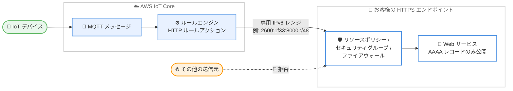

# AWS IoT Core - HTTP ルールアクション向け専用 IPv6 アドレスレンジ

**リリース日**: 2026 年 11 月 25 日
**サービス**: AWS IoT Core
**機能**: HTTP ルールアクションにおける専用 IPv6 アドレスレンジの利用

📊 [このアップデートのインフォグラフィックを見る](https://takech9203.github.io/aws-news-summary/20261125-aws-iot-core-dedicated-ipv6-ranges.html)

## 概要

AWS IoT Core のルールエンジンが、HTTP ルールアクションで HTTPS トラフィックを送信する際に、公開された専用の IPv6 アドレスレンジを使用するようになりました。HTTP ルールアクションは、IoT デバイスから送信されたデータを任意の HTTPS エンドポイント (アプリケーションサーバー、オンプレミスシステム、パートナーサービスなど) に転送する機能です。

今回のアップデートにより、お客様は Amazon API Gateway のリソースポリシー、セキュリティグループ、ファイアウォールルールに固定の IPv6 レンジを登録することで、HTTPS エンドポイントへのインバウンドトラフィックを AWS IoT Core のルールエンジンからのものだけに限定できます。これにより、エンドポイントがパブリックインターネットに公開される範囲を大幅に縮小し、ネットワークレイヤーでのアクセス制御が実現できます。

デバイスデータを自社の Web サービスや外部システムに直接ルーティングしている IoT システムの管理者やセキュリティ担当者にとって、エンドポイント保護を強化できる重要なアップデートです。

**アップデート前の課題**

- HTTP ルールアクションの送信元 IP アドレスが公開されていなかったため、送信元アドレスによるエンドポイントの保護ができなかった
- データ受信用の HTTPS エンドポイントをパブリックインターネットに広く公開する必要があり、不正アクセスやスキャンのリスクに晒されていた
- エンドポイント側での認証 (Sigv4 や独自ヘッダーなど) に加えて、ネットワークレイヤーでの多層防御を構成する手段が限られていた

**アップデート後の改善**

- リージョンごとに公開された固定の IPv6 アドレスレンジ (例: us-east-1 は 2600:1f33:8000::/48) からルールエンジンがトラフィックを送信するようになった
- API Gateway リソースポリシー、セキュリティグループ、AWS Network Firewall などで送信元レンジを許可するだけで、AWS IoT Core 以外からのアクセスを遮断できるようになった
- レンジはルールエンジンアクション専用で変更されないため、一度設定すれば安定して運用できる

## アーキテクチャ図



ルールエンジンは専用 IPv6 レンジからのみ HTTPS エンドポイントへデータを送信するため、エンドポイント側のファイアウォールやリソースポリシーでこのレンジだけを許可すれば、その他の送信元からのアクセスを遮断できます。

## サービスアップデートの詳細

### 主要機能

1. **専用 IPv6 アドレスレンジの公開**
   - ルールエンジンの HTTP アクションが使用する IPv6 アドレスレンジがリージョンごとに公開された
   - 各レンジは /48 の固定 CIDR で、ルールエンジンアクション専用であり変更されない
   - 新しいリージョンのレンジは、利用可能になり次第ドキュメントの表に追加される

2. **送信元アドレスによるエンドポイント保護**
   - API Gateway リソースポリシーの `aws:SourceIp` 条件でレンジ外からのアクセスを拒否可能
   - セキュリティグループのインバウンドルールで、該当リージョンのレンジからの TCP 443 番ポートのみを許可可能
   - AWS Network Firewall などのファイアウォールルールにも適用可能

3. **DNS レコードによる IPv6 配信の制御**
   - ルールエンジンはデフォルトで IPv4 を使用し、エンドポイントのホスト名が AAAA レコードのみを公開している場合に IPv6 で接続する
   - AWS IoT Core 側に IP バージョンを切り替える設定はなく、エンドポイントの DNS 設定で制御する
   - IPv4 の同等レンジは存在しないため、送信元による制限を行うにはエンドポイントを IPv6 のみで到達可能にする必要がある

## 技術仕様

### リージョン別 IPv6 アドレスレンジ (抜粋)

| リージョン | IPv6 アドレスレンジ |
|------|------|
| us-east-1 | 2600:1f33:8000::/48 |
| us-east-2 | 2600:1f33:6000::/48 |
| us-west-2 | 2600:1f33:4000::/48 |
| ap-northeast-1 | 2406:da33:4000::/48 |
| ap-northeast-2 | 2406:da33:2000::/48 |
| ap-southeast-1 | 2406:da33:8000::/48 |
| eu-central-1 | 2a05:d033:4000::/48 |
| eu-west-1 | 2a05:d033:8000::/48 |
| us-gov-east-1 | 2600:1f33:5000::/48 |
| us-gov-west-1 | 2600:1f33:2000::/48 |

全リージョンのレンジは [開発者ガイドの一覧表](https://docs.aws.amazon.com/iot/latest/developerguide/iot-create-role.html#rules-engine-ip-ranges) を参照してください。表に記載のないリージョンには、ルールエンジンの IPv6 レンジはありません。

### ネットワークアクセスの動作

| 項目 | 詳細 |
|------|------|
| デフォルトの接続 | IPv4 で HTTPS エンドポイントに接続 |
| IPv6 接続の条件 | エンドポイントのホスト名が AAAA レコードのみを公開 (A レコードなし) |
| 宛先確認 (Destination Confirmation) | 常に IPv4 を使用するため、確認時は IPv4 での到達性が必要 |
| 対象アクション | HTTP ルールアクションのみ (IPv6 のみで到達可能に構成できる唯一の宛先) |
| レンジの安定性 | ルールエンジンアクション専用で変更されない |

### API 変更履歴

本アップデートはネットワークインフラストラクチャレベルの変更であり、AWS IoT Core の API 変更は伴いません (AWS API Changes に本アップデートに関連する IoT の API 変更は確認されませんでした)。

### API Gateway リソースポリシーの設定例

ルールエンジンのレンジを許可し、それ以外を拒否する例です (us-east-1 の場合)。

```json
{
    "Version": "2012-10-17",
    "Statement": [
        {
            "Effect": "Allow",
            "Principal": "*",
            "Action": "execute-api:Invoke",
            "Resource": "execute-api:/*"
        },
        {
            "Effect": "Deny",
            "Principal": "*",
            "Action": "execute-api:Invoke",
            "Resource": "execute-api:/*",
            "Condition": {
                "NotIpAddress": {
                    "aws:SourceIp": ["2600:1f33:8000::/48"]
                }
            }
        }
    ]
}
```

## 設定方法

### 前提条件

1. AWS IoT Core を利用しており、HTTP ルールアクションでデータを HTTPS エンドポイントへ転送している (または転送を計画している)
2. HTTPS エンドポイントの DNS レコード (A / AAAA) を管理できる
3. エンドポイントが IPv6 で到達可能である

### 手順

#### ステップ1: エンドポイントを IPv6 のみで到達可能にする

まず A レコードと AAAA レコードの両方を公開した状態で HTTP アクションの宛先 (Topic Rule Destination) を作成し、確認プロセスを完了します。宛先確認は常に IPv4 で行われるためです。確認完了後に A レコードを削除し、AAAA レコードのみを残します。これ以降、ルールエンジンは IPv6 で接続します。

#### ステップ2: 公開された IPv6 レンジを許可する

利用リージョンのレンジを、エンドポイント側のアクセス制御に追加します。たとえばセキュリティグループの場合は以下のように設定します。

```bash
aws ec2 authorize-security-group-ingress \
    --group-id sg-0123456789abcdef0 \
    --ip-permissions 'IpProtocol=tcp,FromPort=443,ToPort=443,Ipv6Ranges=[{CidrIpv6=2406:da33:4000::/48,Description="AWS IoT Core rules engine ap-northeast-1"}]'
```

このコマンドは、東京リージョン (ap-northeast-1) のルールエンジン専用レンジ 2406:da33:4000::/48 からの TCP 443 番ポートへのインバウンド通信をセキュリティグループに許可します。API Gateway を使用する場合はリソースポリシーで、ファイアウォールを使用する場合はルールグループで同様にレンジを許可します。

#### ステップ3: HTTP ルールアクションを作成または更新する

```bash
aws iot create-topic-rule \
    --rule-name ForwardToMyEndpoint \
    --topic-rule-payload '{
        "sql": "SELECT * FROM '\''devices/+/data'\''",
        "ruleDisabled": false,
        "awsIotSqlVersion": "2016-03-23",
        "actions": [
            {
                "http": {
                    "url": "https://api.example.com/telemetry",
                    "confirmationUrl": "https://api.example.com"
                }
            }
        ]
    }'
```

このコマンドは、MQTT トピック devices/+/data に発行されたメッセージを HTTPS エンドポイントへ転送するトピックルールを作成します。宛先が確認済みで ENABLED 状態であれば、ルールエンジンは専用 IPv6 レンジからデータを送信します。

## メリット

### ビジネス面

- **セキュリティ体制の強化**: データ受信エンドポイントへのアクセス経路を AWS IoT Core のみに限定でき、攻撃対象領域を削減できる
- **コンプライアンス対応**: 送信元アドレスによるアクセス制御の要件を持つ業界やシステムでも、HTTP ルールアクションを採用しやすくなる
- **追加コストなし**: 本機能は追加料金なしで利用でき、既存構成のセキュリティを低コストで向上できる

### 技術面

- **ネットワークレイヤーでの多層防御**: Sigv4 認証やカスタムヘッダーによるアプリケーションレイヤーの認証に加えて、IP レンジによるネットワークレイヤーの制御を組み合わせられる
- **固定レンジによる運用の安定性**: レンジはルールエンジン専用で変更されないため、許可リストのメンテナンス負荷が小さい
- **既存のアクセス制御機構との統合**: API Gateway リソースポリシー、セキュリティグループ、AWS Network Firewall など標準的な仕組みでそのまま利用できる

## デメリット・制約事項

### 制限事項

- IPv4 の同等レンジは提供されないため、送信元による制限を行うにはエンドポイントを IPv6 のみ (AAAA レコードのみ) で到達可能にする必要がある
- 宛先確認 (Destination Confirmation) は常に IPv4 で行われるため、確認時には A レコードを公開して IPv4 で到達可能にしておく必要がある (確認後に A レコードを削除する)
- 対象は HTTP ルールアクションのみで、その他のルールアクションはデュアルスタック宛先に IPv4 で接続するため、許可すべきレンジは存在しない
- ドキュメントの表に記載のないリージョンには、ルールエンジンの IPv6 レンジがない

### 考慮すべき点

- 宛先の再確認 (ステータスを IN_PROGRESS に変更して確認リクエストを再送) を行う場合は、事前に A レコードを復元する必要がある
- エンドポイント側のインフラ (ロードバランサー、Web サーバー、DNS) が IPv6 に対応している必要がある
- リージョンごとにレンジが異なるため、複数リージョンで IoT Core を利用している場合は各リージョンのレンジをすべて許可する必要がある

## ユースケース

### ユースケース1: API Gateway で受けるテレメトリ収集 API の保護

**シナリオ**: IoT デバイスのテレメトリデータを HTTP ルールアクション経由で Amazon API Gateway の REST API に集約しているが、API がパブリックに公開されており、スキャンや不正リクエストが懸念される。

**実装例**:
```json
{
    "Effect": "Deny",
    "Principal": "*",
    "Action": "execute-api:Invoke",
    "Resource": "execute-api:/*",
    "Condition": {
        "NotIpAddress": {
            "aws:SourceIp": ["2406:da33:4000::/48"]
        }
    }
}
```

**効果**: 東京リージョンのルールエンジン以外からの API 呼び出しをネットワークレイヤーで拒否し、API の露出を最小化できる。

### ユースケース2: EC2 上の自社 Web サービスへの直接ルーティング

**シナリオ**: Application Load Balancer 配下の EC2 インスタンスで稼働する自社アプリケーションにデバイスデータを転送しており、セキュリティグループで送信元を限定したい。

**実装例**:
```bash
aws ec2 authorize-security-group-ingress \
    --group-id sg-0123456789abcdef0 \
    --ip-permissions 'IpProtocol=tcp,FromPort=443,ToPort=443,Ipv6Ranges=[{CidrIpv6=2600:1f33:8000::/48}]'
```

**効果**: セキュリティグループのインバウンドルールだけで AWS IoT Core 以外からの接続を遮断でき、WAF や追加の認証基盤を導入せずに防御レイヤーを追加できる。

### ユースケース3: オンプレミスシステムやパートナーサービスへの安全なデータ連携

**シナリオ**: 工場のオンプレミスシステムや外部パートナーの API にデバイスデータを連携しているが、受信側のファイアウォールで「どの送信元を許可すべきか」が明確でなく、広い範囲を開放していた。

**実装例**:
```text
ファイアウォールルール:
  許可: 送信元 2a05:d033:8000::/48 (eu-west-1 のルールエンジン)
        宛先 TCP 443
  拒否: その他すべてのインバウンド
```

**効果**: 受信側に伝えるべき送信元レンジが明確になり、パートナー側・オンプレミス側のファイアウォール設定を最小権限で構成できる。

## 料金

本機能は追加料金なしで利用できます。HTTP ルールアクション自体の利用には、AWS IoT Core のルールエンジンに関する標準料金 (およびリトライ時の標準データ転送料金) が適用されます。

## 利用可能リージョン

AWS IoT Core が提供されているすべての AWS グローバルリージョンおよび AWS GovCloud (US) で利用可能です。ただし、ルールエンジンの IPv6 レンジが公開されているのは開発者ガイドの表に記載されたリージョンのみです (東京リージョン ap-northeast-1 を含む)。

## 関連サービス・機能

- **Amazon API Gateway**: リソースポリシーの `aws:SourceIp` 条件でルールエンジンのレンジのみを許可し、API を保護できる
- **Amazon VPC セキュリティグループ**: インバウンドルールにレンジを追加することで、EC2 や ALB 上のエンドポイントへのアクセスを制限できる
- **AWS Network Firewall**: ルールグループで送信元レンジに基づくフィルタリングを構成し、オンプレミス連携などの境界防御に利用できる
- **AWS IoT ルールエンジン**: MQTT メッセージを SQL ライクな構文で処理し、HTTP アクションを含む各種アクションにルーティングする基盤機能

## 参考リンク

- 📊 [インフォグラフィック](https://takech9203.github.io/aws-news-summary/20261125-aws-iot-core-dedicated-ipv6-ranges.html)
- [公式発表 (What's New)](https://aws.amazon.com/about-aws/whats-new/2026/11/aws-iot-core-dedicated-ipv6-ranges/)
- [ドキュメント: ルールエンジン IPv6 レンジへの HTTP アクショントラフィックの制限](https://docs.aws.amazon.com/iot/latest/developerguide/iot-create-role.html#rules-engine-ip-ranges)
- [ドキュメント: HTTP ルールアクション](https://docs.aws.amazon.com/iot/latest/developerguide/https-rule-action.html)
- [ドキュメント: HTTP アクション宛先とネットワークアクセス](https://docs.aws.amazon.com/iot/latest/developerguide/http-action-destination.html#http-action-destination-network-access)
- [AWS IoT Core 製品ページ](https://aws.amazon.com/iot-core/)
- [料金ページ](https://aws.amazon.com/iot-core/pricing/)

## まとめ

AWS IoT Core の HTTP ルールアクションが専用 IPv6 レンジからトラフィックを送信するようになり、HTTPS エンドポイントを AWS IoT Core からのアクセスのみに限定できるようになりました。デバイスデータを外部の Web サービスやオンプレミスに転送している場合は、エンドポイントを AAAA レコードのみの構成に移行し、リージョンごとの公開レンジを許可リストに追加することで、追加コストなしでエンドポイントの露出を大幅に削減できます。まずは開発者ガイドのレンジ一覧と宛先確認時の IPv4 要件を確認し、段階的な移行を検討することを推奨します。
