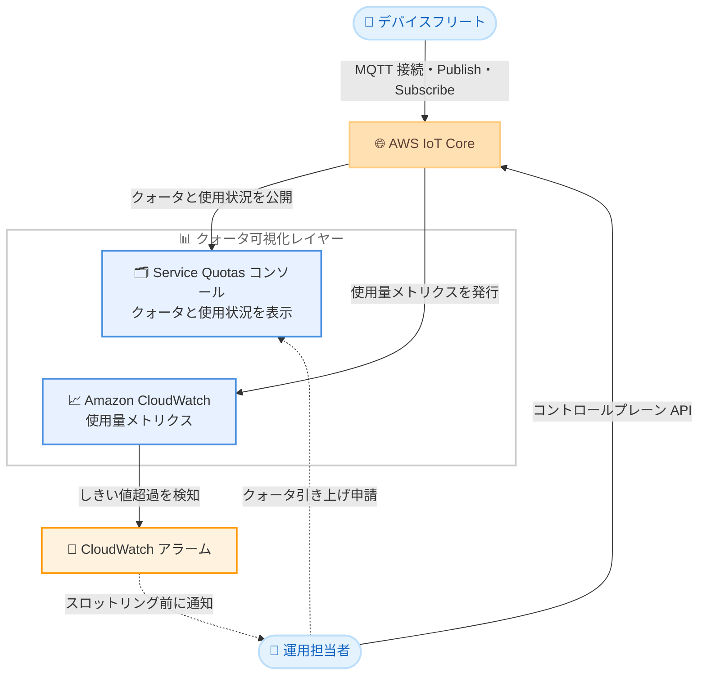

# AWS IoT Core - Service Quotas コンソールでのクォータと使用状況の可視化

**リリース日**: 2026 年 11 月 25 日
**サービス**: AWS IoT Core
**機能**: AWS Service Quotas コンソールでのクォータおよび使用状況モニタリング

📊 [このアップデートのインフォグラフィックを見る](https://takech9203.github.io/aws-news-summary/20261125-aws-iot-core-quota-usage-monitoring.html)

## 概要

AWS IoT Core は、最も利用頻度の高いサービスクォータとその現在の使用状況を AWS Service Quotas コンソールに公開するようになりました。これにより、API 制限とクォータに対するオブザーバビリティとモニタリングが大幅に向上します。デバイスメッセージングを担うデータプレーン API と、リソース管理を担うコントロールプレーン API の両方について、クォータと使用状況をコンソール上で確認できます。

さらに、Amazon CloudWatch の使用量メトリクスを利用してアラームを構築できるため、使用量がクォータ上限に近づいた時点で通知を受け取り、スロットリングが発生する前に対処できます。デバイスフリートの拡大に合わせて、クォータ引き上げを事前に申請するといったプロアクティブな運用が可能になります。

本機能は追加料金なしで利用でき、IoT ワークロードを運用するすべてのユーザー、特に大規模なデバイスフリートを管理する運用チームにとって価値のあるアップデートです。

**アップデート前の課題**

このアップデート以前は、AWS IoT Core のクォータ使用状況を把握する手段が限られていました。

- クォータと使用状況がコンソール上で可視化されておらず、現在の使用率を把握できなかった
- スロットリングが発生する前に現在の使用状況を知るには、AWS サポートへの問い合わせが必要だった
- 使用量がクォータ上限に近づいたことを検知する標準的な仕組みがなく、突発的なスロットリングによる障害リスクがあった

**アップデート後の改善**

今回のアップデートにより、以下が可能になりました。

- AWS Service Quotas コンソールで AWS IoT Core のクォータと現在の使用状況をセルフサービスで確認できるようになった
- CloudWatch 使用量メトリクスに基づくアラームを設定し、スロットリング発生前に通知を受け取れるようになった
- デバイスフリートの成長に合わせて、クォータ引き上げをプロアクティブに申請できるようになった

## アーキテクチャ図



AWS IoT Core がクォータと使用状況を Service Quotas コンソールと CloudWatch に公開し、運用担当者はアラーム通知を受けてスロットリング発生前にクォータ引き上げを申請できる流れを示しています。

## サービスアップデートの詳細

### 主要機能

1. **Service Quotas コンソールでのクォータ表示**
   - AWS IoT Core の最も利用頻度の高いサービスクォータがコンソールに表示される
   - 各クォータの現在の使用状況データも併せて確認できる
   - AWS サポートに問い合わせることなく、セルフサービスで使用率を把握できる

2. **データプレーンとコントロールプレーンの両方をカバー**
   - データプレーン API (デバイスメッセージング) のクォータと使用状況を確認できる
   - コントロールプレーン API (リソース管理) のクォータと使用状況を確認できる

3. **CloudWatch 使用量メトリクスによるアラーム**
   - 使用量がクォータ上限に近づいた際に通知するアラームを構築できる
   - スロットリングが発生する前に、クォータ引き上げなどの対処が可能になる

## 技術仕様

### 代表的な AWS IoT Core のクォータ (メッセージブローカー)

AWS 全般のリファレンスドキュメントに記載されている主なクォータの例です (標準リージョンのデフォルト値)。

| クォータ | デフォルト値 | 引き上げ可否 |
|------|------|------|
| アカウントあたりの接続リクエスト/秒 | 3,000 | 可 |
| アカウントあたりのインバウンド Publish リクエスト/秒 | 20,000 | 可 |
| アカウントあたりのアウトバウンド Publish リクエスト/秒 | 20,000 | 可 |
| アカウントあたりのサブスクリプション/秒 | 3,000 | 可 |
| アカウントあたりの最大同時接続数 | 500,000 | 可 |
| MQTT ペイロードサイズ | 128 KB | 不可 |

### 代表的なコントロールプレーン API のクォータ

| API | デフォルト TPS | 引き上げ可否 |
|------|------|------|
| CreateThing | 100 | 可 |
| UpdateThing | 100 | 可 |
| DescribeThing | 350 | 可 |
| CreateKeysAndCertificate | 10 | 可 |
| CreateTopicRule | 5 | 不可 |

一部のリージョンではデフォルト値が異なる場合があります。最新の値は公式ドキュメントおよび Service Quotas コンソールで確認してください。

## 設定方法

### 前提条件

1. AWS アカウントを保有し、AWS IoT Core を利用していること
2. Service Quotas コンソールおよび CloudWatch へのアクセス権限 (IAM ポリシー) があること

### 手順

#### ステップ 1: Service Quotas コンソールで AWS IoT Core を選択

AWS マネジメントコンソールから Service Quotas コンソールを開き、サービス一覧から「AWS IoT Core」を選択します。各クォータの適用値と使用状況が表示されます。

#### ステップ 2: CLI でクォータを確認

```bash
# AWS IoT Core の適用中のクォータ一覧を取得
aws service-quotas list-service-quotas \
  --service-code iotcore
```

Service Quotas API を使用して、AWS IoT Core に適用されているクォータの一覧 (クォータ名、適用値、引き上げ可否など) を取得しています。

#### ステップ 3: 使用状況に基づくアラームの作成

Service Quotas コンソールで対象クォータを選択し、Amazon CloudWatch アラームの作成画面からしきい値 (例: クォータ使用率 80%) を設定します。使用量がしきい値を超えると通知が送信され、スロットリング発生前に対処できます。

#### ステップ 4: クォータ引き上げの申請

使用量が上限に近づいている場合は、Service Quotas コンソールの対象クォータから引き上げをリクエストします。デバイスフリートの成長計画に合わせて事前に申請することが推奨されます。

## メリット

### ビジネス面

- **サポート問い合わせの削減**: 従来必要だった AWS サポートへの使用状況の問い合わせが不要になり、運用工数を削減できる
- **サービス停止リスクの低減**: スロットリングによるデバイス接続障害やメッセージ欠落を未然に防ぎ、IoT サービスの可用性を維持できる
- **追加コストなし**: 本機能は追加料金なしで利用できる

### 技術面

- **オブザーバビリティの向上**: データプレーンとコントロールプレーンの両方の API について、クォータと使用状況を一元的に可視化できる
- **プロアクティブな運用**: CloudWatch アラームにより、クォータ上限到達前に検知と対処が可能になる
- **キャパシティプランニングの精度向上**: 実際の使用状況データに基づいて、フリート拡大時のクォータ引き上げを計画できる

## デメリット・制約事項

### 制限事項

- Service Quotas コンソールに公開されるのは「最も利用頻度の高い」クォータであり、すべてのクォータが対象とは明記されていない
- 引き上げ不可のクォータ (MQTT ペイロードサイズ、接続あたりの Publish レート上限など) は、可視化されても上限自体の変更はできない

### 考慮すべき点

- アラームのしきい値は、クォータ引き上げ申請のリードタイムを考慮して余裕を持った値 (例: 70-80%) に設定することが望ましい
- アカウント単位のクォータだけでなく、接続あたり・クライアント ID あたりなどのきめ細かい制限はアプリケーション設計側での考慮が引き続き必要

## ユースケース

### ユースケース 1: デバイスフリート拡大時のキャパシティプランニング

**シナリオ**: コネクテッドカーやスマートホーム事業で、デバイス数が毎月増加している。接続数や Publish レートがいつクォータに到達するかを把握したい。

**実装例**:
```bash
# 現在のクォータと使用状況をコンソールまたは CLI で定期確認
aws service-quotas list-service-quotas --service-code iotcore
```

**効果**: 使用状況のトレンドを把握し、上限到達前に計画的にクォータ引き上げを申請できる。

### ユースケース 2: スロットリング発生前のアラート通知

**シナリオ**: ファームウェア一斉更新やキャンペーン時にデバイスの接続・メッセージ量が急増し、過去にスロットリングによる障害が発生したことがある。

**実装例**:
```
Service Quotas コンソール → AWS IoT Core → 対象クォータを選択
→ CloudWatch アラームを作成 (しきい値: 使用率 80%)
→ SNS トピック経由で運用チームに通知
```

**効果**: 急激な使用量増加をスロットリング発生前に検知し、障害を未然に防止できる。

### ユースケース 3: コントロールプレーン API を多用するプロビジョニング処理の監視

**シナリオ**: 製造ラインでデバイスを大量プロビジョニングしており、CreateThing や CreateKeysAndCertificate の API 呼び出しレートがクォータに近づくことがある。

**実装例**:
```
Service Quotas コンソールでコントロールプレーン API のクォータ使用状況を確認し、
プロビジョニングのバッチサイズ・レートを調整、必要に応じて引き上げを申請
```

**効果**: プロビジョニング処理のスロットリングによる製造ライン遅延を回避できる。

## 料金

本機能は追加料金なしで利用できます。AWS IoT Core、Service Quotas の利用自体に追加費用は発生しません。CloudWatch アラームを作成する場合は、CloudWatch の標準料金が適用されます。

## 利用可能リージョン

公式発表では対象リージョンの明記はありません。利用するリージョンの Service Quotas コンソールで AWS IoT Core を選択し、クォータと使用状況が表示されることを確認してください。

## 関連サービス・機能

- **AWS Service Quotas**: AWS サービスのクォータを一元管理するサービス。今回 AWS IoT Core のクォータと使用状況が公開された
- **Amazon CloudWatch**: 使用量メトリクスに基づくアラームを構築し、クォータ上限接近を通知する
- **AWS IoT Device Management**: 大規模デバイスフリートの管理。フリート拡大時のクォータ計画と併せて利用する

## 参考リンク

- 📊 [インフォグラフィック](https://takech9203.github.io/aws-news-summary/20261125-aws-iot-core-quota-usage-monitoring.html)
- [公式発表 (What's New)](https://aws.amazon.com/about-aws/whats-new/2026/11/aws-iot-core-quota-usage-monitoring/)
- [AWS IoT Core エンドポイントとクォータ (AWS 全般のリファレンス)](https://docs.aws.amazon.com/general/latest/gr/iot-core.html)
- [Service Quotas の表示とリクエスト (Service Quotas ユーザーガイド)](https://docs.aws.amazon.com/servicequotas/latest/userguide/gs-request-quota.html)
- [AWS IoT Core 製品ページ](https://aws.amazon.com/iot-core/)

## まとめ

AWS IoT Core のクォータと使用状況が Service Quotas コンソールで可視化され、従来は AWS サポートへの問い合わせが必要だった使用率の把握がセルフサービスで可能になりました。CloudWatch アラームと組み合わせることで、スロットリング発生前の検知とプロアクティブなクォータ引き上げが実現します。IoT ワークロードを運用しているチームは、主要クォータの使用状況確認とアラーム設定をまず実施することを推奨します。
