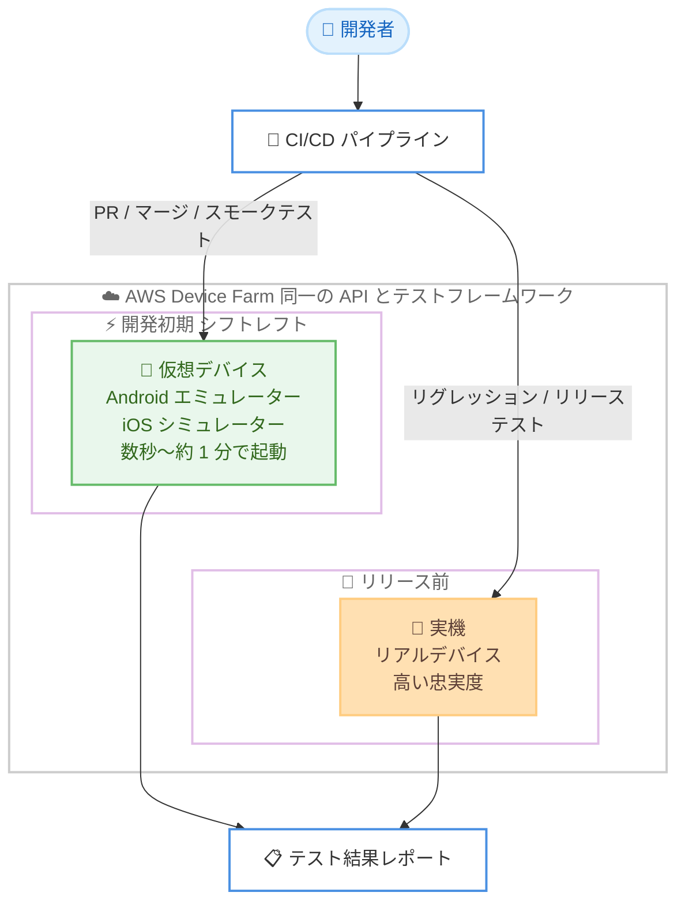

# AWS Device Farm - Android エミュレーターと iOS シミュレーターのサポート

**リリース日**: 2026 年 11 月 25 日
**サービス**: AWS Device Farm
**機能**: 仮想デバイス (Android エミュレーター / iOS シミュレーター) のサポート

📊 [このアップデートのインフォグラフィックを見る](https://takech9203.github.io/aws-news-summary/20261125-device-farm-virtual-devices.html)

## 概要

AWS Device Farm が、従来の実機 (リアルデバイス) に加えて、仮想デバイス (Android エミュレーターおよび iOS シミュレーター) をサポートしました。仮想デバイスは自動テストと手動テスト (リモートアクセスセッション) の両方で利用でき、実機と同じマネージド API、テスト環境、テストフレームワークをそのまま使用できます。

このアップデートの狙いは、モバイルアプリのテストにおける「シフトレフト」の実現です。プルリクエスト、コードマージ、スモークテストといった高速・高頻度が求められる開発初期段階のテストは仮想デバイスで実行し、リグレッションテストやリリース前テストといった高い忠実度が求められる段階では実機を使用する、という使い分けが単一のサービス内で完結します。最新のデバイス / OS の組み合わせの仮想デバイスは通常数秒 (ドキュメントでは 30 秒未満) で起動し、その他の OS バージョンでも約 1 分で起動します。

実機と仮想デバイスの切り替えはデバイスタイプの指定を変更するだけでよく、既存の CI/CD パイプラインやテストコードを変更する必要はありません。モバイルアプリ開発チームにとって、テストの速度・コスト・忠実度のバランスを柔軟に最適化できるアップデートです。

**アップデート前の課題**

このアップデート以前、エミュレーターやシミュレーターを使ったテストには以下の課題がありました。

- Device Farm は実機のみをサポートしていたため、エミュレーター / シミュレーターを使う場合は自前でインフラを構築する必要があった (特に iOS シミュレーターには Mac ホストが必要で、別途ツールやコンピューティングリソースの管理が発生)
- すべてのテストを実機で実行すると、起動が遅く、デバイスの空き状況に左右され、開発初期段階のテストとしてはコストが割高だった
- 自前のエミュレーター環境と Device Farm の実機環境でツールチェーンが分断され、テスト資産の二重管理が必要だった

**アップデート後の改善**

今回のアップデートにより、以下が可能になりました。

- Android エミュレーターと iOS シミュレーターを Device Farm のマネージドサービスとして利用でき、自前のインフラ構築・運用が不要になった
- 実機と仮想デバイスで同じ API、テスト環境、テストフレームワークを共用でき、デバイスタイプの変更だけで切り替えられるため、パイプラインやテストコードの変更が不要になった
- 最新 OS の仮想デバイスは数秒で起動するため、プルリクエストごとのテストなど高頻度なテストを高速かつ低コストで実行できるようになった

## アーキテクチャ図



CI/CD パイプラインの段階に応じて、高速・低コストな仮想デバイスと高忠実度な実機を同一の Device Farm API で使い分けるテスト戦略を示しています。

## サービスアップデートの詳細

### 主要機能

1. **仮想デバイスによる自動テスト**
   - Android エミュレーターと iOS シミュレーターで自動テストを実行可能
   - 標準テスト環境とカスタムテスト環境の両方をサポート
   - 各プラットフォームで実機と同じテストタイプ (テストフレームワーク) をサポート
   - カスタムテスト環境では、テストスペックファイルでテストホストと capabilities を設定

2. **仮想デバイスによる手動テスト (リモートアクセス)**
   - リモートアクセスセッションを開始すると、エミュレーター / シミュレーターが実機と同じデバイスリストに表示される
   - ブラウザから仮想デバイスを操作してインタラクティブに検証可能

3. **高速な起動時間**
   - 最新 OS バージョンの仮想デバイスは通常 30 秒未満で利用可能
   - その他の OS バージョンの仮想デバイスは通常約 1 分で起動
   - プルリクエストごとのテストなど、高頻度の実行に適した応答性

4. **既存ワークフローとの互換性**
   - 実機と同じ Device Farm のマネージド API を使用
   - デバイスプールのルールに `DEVICE_TYPE` 属性が追加され、実機 / 仮想デバイスを条件で選択可能
   - デバイスタイプの指定を変更するだけで切り替えでき、パイプラインやテストの変更は不要

## 技術仕様

### 仮想デバイスの仕様

| 項目 | 詳細 |
|------|------|
| 対象プラットフォーム | Android (エミュレーター)、iOS (シミュレーター) |
| テスト種別 | 自動テスト (標準 / カスタムテスト環境)、手動テスト (リモートアクセス) |
| デバイスタイプ識別 | デバイス名の末尾が `Emulator` または `Simulator`、`type` フィールドが `VIRTUAL` |
| 起動時間 | 最新 OS: 通常 30 秒未満、その他の OS: 通常約 1 分 |
| 課金方式 | メーター制 (iOS シミュレーターはメーター制のみ)。Android はアンメーター制スロットでも利用可能 |
| VPC エンドポイント | 仮想デバイスは VPC エンドポイント (VPCE) 接続をサポートしない |

### API 変更履歴

| 日付 | サービス | 変更内容 |
|------|----------|----------|
| 2026/11/20 | [devicefarm](https://awsapichanges.com/archive/changes/e9d2b3-devicefarm.html) | 19 updated api methods - 仮想デバイスのサポート追加 |

主な変更点は以下のとおりです。

- `Device` データ型に `type` フィールド (`PHYSICAL` / `VIRTUAL`) が追加
- `CreateDevicePool` / `UpdateDevicePool` のルール属性に `DEVICE_TYPE` が追加
- `ListDevices` のフィルター属性に `DEVICE_TYPE` が追加
- `GetDevice`、`GetRun`、`ScheduleRun`、`GetRemoteAccessSession` など計 19 の API メソッドが更新

### デバイスプールのルール例

```json
{
  "rules": [
    {
      "attribute": "DEVICE_TYPE",
      "operator": "EQUALS",
      "value": "\"VIRTUAL\""
    },
    {
      "attribute": "PLATFORM",
      "operator": "EQUALS",
      "value": "\"ANDROID\""
    }
  ]
}
```

## 設定方法

### 前提条件

1. AWS アカウントと Device Farm プロジェクトが作成済みであること
2. AWS CLI または SDK が設定済みであること (コンソールからの操作も可能)
3. テスト対象のアプリパッケージ (APK / IPA) とテストパッケージが準備済みであること

### 手順

#### ステップ1: 利用可能な仮想デバイスを確認する

```bash
aws devicefarm list-devices \
  --region us-west-2 \
  --filters '[{"attribute":"DEVICE_TYPE","operator":"EQUALS","values":["VIRTUAL"]}]'
```

`ListDevices` API に追加された `DEVICE_TYPE` フィルターを使用して、利用可能な仮想デバイス (エミュレーター / シミュレーター) の一覧を取得しています。デバイス名の末尾が `Emulator` または `Simulator` のデバイスが仮想デバイスです。

#### ステップ2: 仮想デバイスを含むデバイスプールを作成する

```bash
aws devicefarm create-device-pool \
  --region us-west-2 \
  --project-arn <プロジェクトの ARN> \
  --name "virtual-android-pool" \
  --rules '[{"attribute":"DEVICE_TYPE","operator":"EQUALS","value":"\"VIRTUAL\""},{"attribute":"PLATFORM","operator":"EQUALS","value":"\"ANDROID\""}]'
```

`DEVICE_TYPE` 属性のルールを使用して、Android エミュレーターのみで構成されるデバイスプールを作成しています。既存のテストはデバイスプールを差し替えるだけで仮想デバイス上で実行できます。

#### ステップ3: テストランをスケジュールする

```bash
aws devicefarm schedule-run \
  --region us-west-2 \
  --project-arn <プロジェクトの ARN> \
  --app-arn <アップロード済みアプリの ARN> \
  --device-pool-arn <ステップ 2 で作成したデバイスプールの ARN> \
  --name "pr-smoke-test" \
  --test type=APPIUM_PYTHON,testPackageArn=<テストパッケージの ARN>
```

作成した仮想デバイスプールを指定してテストランを実行しています。API の使い方は実機の場合と同一で、デバイスプールの指定を変えるだけで実機 / 仮想デバイスを切り替えられます。カスタムテスト環境を使用する場合は、テストスペックファイルでテストホストと capabilities を設定します。

## メリット

### ビジネス面

- **コスト最適化**: 開発初期の高頻度テストを低コストの仮想デバイスで実行し、高価な実機テストをリリース前の重要な段階に集中できる。Android では既存のアンメーター制スロットで実機と仮想デバイスのどちらも追加料金なしで実行可能
- **開発速度の向上**: 数秒で起動する仮想デバイスにより、プルリクエストごとのフィードバックループが短縮され、問題の早期発見 (シフトレフト) が実現する
- **運用負荷の削減**: Mac ホストの調達やエミュレーター基盤の構築・運用が不要になり、チームはテストの作成と改善に集中できる

### 技術面

- **単一のツールチェーン**: 実機と仮想デバイスで同じ API、テスト環境、テストフレームワークを共用でき、テスト資産の二重管理が解消される
- **パイプライン変更不要**: デバイスタイプの指定を変更するだけで切り替えられるため、既存の CI/CD パイプラインやテストコードに手を入れる必要がない
- **柔軟なデバイス選択**: `DEVICE_TYPE` 属性によるデバイスプールのルールやフィルターで、テスト段階に応じたデバイス構成をコードで管理できる

## デメリット・制約事項

### 制限事項

- 仮想デバイスは VPC エンドポイント (VPCE) 接続をサポートしない (プライベートネットワーク経由のテストが必要な場合は実機を使用する)
- iOS シミュレーターはメーター制の課金方式のみをサポートする (アンメーター制スロットは利用不可)
- 最新 OS 以外の仮想デバイスは起動に約 1 分かかる

### 考慮すべき点

- エミュレーター / シミュレーターは実機のハードウェア特性 (カメラ、センサー、実際のパフォーマンス特性、キャリアネットワークなど) を完全には再現できないため、リグレッションテストやリリース前テストでは引き続き実機の使用が推奨される
- テスト戦略として、どの段階を仮想デバイスに移行するか (例: PR 時のスモークテストのみ仮想化する) をチームで設計する必要がある

## ユースケース

### ユースケース1: プルリクエストごとのスモークテスト

**シナリオ**: モバイルアプリ開発チームが、プルリクエスト作成のたびに主要画面の起動確認と基本操作のテストを実行したい。実機では起動待ちとコストがボトルネックになっている。

**実装例**:
```yaml
# CI パイプラインの例 (擬似コード)
on: pull_request
steps:
  - run: |
      aws devicefarm schedule-run \
        --project-arn $PROJECT_ARN \
        --app-arn $APP_ARN \
        --device-pool-arn $VIRTUAL_POOL_ARN \
        --name "pr-${PR_NUMBER}-smoke" \
        --test type=APPIUM_PYTHON,testPackageArn=$TEST_PKG_ARN
```

**効果**: 数秒で起動する仮想デバイスにより PR ごとのテストが高速化され、マージ前に問題を検出できる。実機スロットを消費しないためコストも抑制できる。

### ユースケース2: 段階的なテストパイプラインの構築

**シナリオ**: マージ後のテストは仮想デバイスで幅広い OS バージョンをカバーし、リリース前には実機で忠実度の高い最終確認を行いたい。

**実装例**:
```bash
# マージ後: 仮想デバイスプールで実行
aws devicefarm schedule-run --device-pool-arn $VIRTUAL_POOL_ARN ...

# リリース前: 実機デバイスプールで実行 (同じテストパッケージを使用)
aws devicefarm schedule-run --device-pool-arn $PHYSICAL_POOL_ARN ...
```

**効果**: 同じテストパッケージとパイプラインのまま、デバイスプールの指定だけでテスト段階ごとの速度・コスト・忠実度を最適化できる。

### ユースケース3: 手動テスト環境の即時払い出し

**シナリオ**: QA 担当者やサポート担当者が、不具合報告の再現確認のために特定の OS バージョンの端末をすぐに操作したいが、手元に該当端末がない。

**実装例**:
```
Device Farm コンソール → Remote access → Start a new session
→ デバイスリストから末尾が Emulator / Simulator のデバイスを選択
```

**効果**: 実機の空き状況を待たずに、ブラウザからすぐに仮想デバイスのリモートアクセスセッションを開始して再現確認ができる。

## 料金

仮想デバイスは既存のメーター制 (従量課金) の料金モデルで利用できます。

- **メーター制**: テスト実行時間 (デバイス分) に応じた従量課金。iOS シミュレーターはメーター制のみをサポート
- **アンメーター制 (Android)**: 既存のアンメーター制スロットで、実機と Android エミュレーターのどちらも追加料金なしで実行可能

最新の料金は [Device Farm 料金ページ](https://aws.amazon.com/device-farm/pricing/) を参照してください。

## 利用可能リージョン

AWS Device Farm が提供されているすべての AWS リージョンで利用可能です。詳細は [リージョン別サービス一覧](https://aws.amazon.com/about-aws/global-infrastructure/regional-product-services/) を参照してください。

## 関連サービス・機能

- **AWS CodePipeline / CodeBuild**: CI/CD パイプラインから Device Farm のテストランを呼び出すことで、仮想デバイスによるシフトレフトテストを自動化できる
- **Device Farm リモートアクセス**: 仮想デバイスも実機と同じデバイスリストに表示され、ブラウザから手動テストが可能
- **Device Farm デスクトップブラウザテスト**: モバイルアプリだけでなく Web アプリのクロスブラウザテストにも Device Farm を活用できる

## 参考リンク

- 📊 [インフォグラフィック](https://takech9203.github.io/aws-news-summary/20261125-device-farm-virtual-devices.html)
- [公式発表 (What's New)](https://aws.amazon.com/about-aws/whats-new/2026/11/device-farm-virtual-devices/)
- [ドキュメント: Testing on virtual devices in Device Farm](https://docs.aws.amazon.com/devicefarm/latest/developerguide/virtual-devices.html)
- [AWS Device Farm 製品ページ](https://aws.amazon.com/device-farm/)
- [料金ページ](https://aws.amazon.com/device-farm/pricing/)
- [API 変更履歴 (awsapichanges.com)](https://awsapichanges.com/archive/changes/e9d2b3-devicefarm.html)

## まとめ

AWS Device Farm の仮想デバイスサポートにより、エミュレーター / シミュレーター基盤の自前運用が不要になり、実機と同じ API とテスト資産のままテストのシフトレフトを実現できます。まずは PR 時のスモークテストなど高頻度なテスト段階を仮想デバイスに移行し、実機はリグレッションテストやリリース前の最終確認に集中させるテスト戦略の見直しを推奨します。
