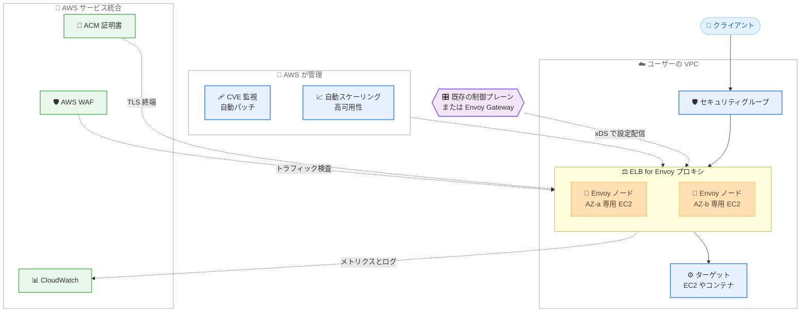

# Elastic Load Balancing - ELB for Envoy の一般提供開始

**リリース日**: 2026 年 11 月 25 日
**サービス**: Elastic Load Balancing (ELB)
**機能**: ELB for Envoy (一般提供開始)

📊 [このアップデートのインフォグラフィックを見る](https://takech9203.github.io/aws-news-summary/20261125-elastic-load-balancing-for-envoy-generally-available.html)

## 概要

AWS は、Elastic Load Balancing ファミリーの新しいロードバランサータイプである ELB for Envoy の一般提供を開始しました。ELB for Envoy は、オープンソースの Envoy プロキシを AWS 管理のインフラストラクチャ上で実行するマネージドサービスです。ユーザーは Envoy のブートストラップ設定 (YAML) を提供するだけで、プロキシのプロビジョニング、トラフィックに応じたスケーリング、OS パッチ適用、複数アベイラビリティゾーンにまたがる高可用性の維持を AWS に任せることができます。

各ロードバランサーのプロキシは、AWS Nitro System によるハードウェア分離を備えた専用 EC2 インスタンス上で動作します。これにより、万一 Envoy にゼロデイ脆弱性が発見された場合でも、影響は自身のロードバランサー内に封じ込められます。AWS は CVE を監視し、Envoy バイナリと OS のパッチを自動的に適用します。また、各 Envoy バージョンはアップストリームの 1 年に対して 2 年間サポートされます。

既存の Envoy 設定、拡張機能、制御プレーンを変更なしでそのまま持ち込める点が大きな特徴です。Kubernetes 環境では、ELB for Envoy リモートインフラストラクチャプロバイダーを通じて Envoy Gateway と連携でき、Gateway API リソースを変更することなくデータプレーンを AWS 管理のプロキシに移行できます。カスタムロジックは WebAssembly、Lua スクリプト、外部処理で実装可能です。大規模な Envoy フリートを自己管理しているプラットフォームチームや、Envoy のフル機能とプログラマブルなデータプレーンを必要とするユーザーが主な対象です。

**アップデート前の課題**

このアップデート以前は、Envoy を本番環境で利用する際に以下の課題がありました。

- Envoy のバージョンアップグレード、CVE 対応、OS パッチ適用をプラットフォームチームが自ら実施する必要があった
- 複数アベイラビリティゾーンにまたがるキャパシティ管理とスケーリングを自前で設計・運用する必要があった
- ALB や NLB では Envoy のフル機能セット (カスタムフィルター、xDS による動的設定など) を利用できず、高度なトラフィック制御には自己管理の Envoy フリートが必要だった

**アップデート後の改善**

今回のアップデートにより、以下が可能になりました。

- 既存の Envoy 設定、拡張機能、制御プレーンを変更なしで AWS 管理のインフラストラクチャに移行できるようになった
- CVE 監視、Envoy バイナリ更新、OS パッチ適用が自動化され、運用負荷が大幅に軽減された
- ACM による TLS 終端、AWS WAF によるトラフィック検査、CloudWatch によるモニタリングを最小限の設定で利用できるようになった
- Envoy Gateway を利用する Kubernetes クラスターで、Gateway API リソースを変更せずにデータプレーンのみを AWS 管理に移行できるようになった

## アーキテクチャ図



ELB for Envoy プロキシはユーザーの VPC 内の専用 EC2 インスタンス上で動作し、セキュリティグループで保護されます。設定は静的なブートストラップ YAML のほか、既存の制御プレーンや Envoy Gateway から xDS 経由で動的に配信でき、スケーリングやパッチ適用は AWS が担当します。

## サービスアップデートの詳細

### 主要機能

1. **専用インフラストラクチャによる分離**
   - 各ロードバランサーのプロキシは、AWS Nitro System のハードウェア分離を備えた専用 EC2 インスタンス上で実行される
   - シングルテナントアーキテクチャにより、Envoy のゼロデイ脆弱性の影響が自身のロードバランサー内に封じ込められる
   - プロキシはユーザーの VPC 内で動作し、セキュリティグループ、IAM 権限、VPC 暗号化によるネットワーク制御を維持できる

2. **自動メンテナンスと拡張バージョンサポート**
   - AWS が CVE を監視し、Envoy バイナリと OS のパッチを自動的に適用する
   - 各 Envoy バージョンはアップストリームの 1 年に対して 2 年間サポートされる
   - アップグレード時にトラフィックの劣化を検知すると自動的にロールバックする
   - Envoy バージョンがサポート終了に近づくと AWS Health Dashboard で通知される

3. **既存 Envoy 資産の持ち込み**
   - Envoy のブートストラップ設定ファイル (YAML) と、参照する補助ファイルをまとめた設定アーカイブ (ZIP) を提供して利用する
   - 既存の制御プレーンから xDS プロトコル経由で動的に設定を配信できる
   - Lua スクリプトと WebAssembly (Wasm) フィルターによるカスタムロジック、外部処理 (External Processing) をサポートする

4. **AWS サービスとの統合**
   - AWS Certificate Manager (ACM) の証明書を関連付けて TLS を終端できる
   - AWS WAF の Web ACL を関連付けてプロキシのトラフィックを検査できる
   - メトリクスは Amazon CloudWatch へ、Envoy ログは Amazon CloudWatch Logs へ発行される
   - 設定はデフォルトで AWS 所有キーで暗号化され、AWS KMS カスタマーマネージドキーも選択できる

5. **Kubernetes との連携**
   - ELB for Envoy リモートインフラストラクチャプロバイダー (GitHub で公開) を Envoy Gateway と併用できる
   - プロバイダーは Envoy Gateway の Pod 内でサイドカーとして動作し、ELBProxyConfiguration が付与された Gateway ごとに AWS 管理のプロキシをプロビジョニングする
   - 制御プレーン (Envoy Gateway) はクラスター内に残り、データプレーンのみ AWS 管理のプロキシへ移行するため、Gateway API リソースの変更は不要

### 責任分担

| 担当 | 内容 |
|------|------|
| ユーザー | Envoy 設定の正しさの確認、デバッグと可視化ツールのセットアップ、パフォーマンスチューニング |
| AWS | 負荷の計測とスケーリング、高可用性の維持、OS パッチの定期適用、新しいオープンソース Envoy リリースの検証 |

## 技術仕様

### プロキシの構成要素

プロキシ作成時には以下を指定します。

| 項目 | 詳細 |
|------|------|
| 設定ファイル | Envoy のブートストラップ YAML |
| 設定アーカイブ (オプション) | 設定が参照する補助ファイルをまとめた ZIP ファイル |
| プロキシバージョン | プロキシが実行する Envoy のバージョン |
| プロキシロール | ログの発行や他の AWS サービス呼び出しに使用する IAM ロール |
| サブネット | 同一 VPC 内の異なるアベイラビリティゾーンにある 2 つ以上のサブネット |
| セキュリティグループ | 1 つ以上のセキュリティグループ |
| IP アドレス設定 | IPv4 と IPv6 を個別に設定可能 (インターネット向け / 内部向け、デュアルスタック対応) |

### API 変更履歴

| 日付 | サービス | 変更内容 |
|------|----------|----------|
| 2026/11/25 | [elb-proxy](https://awsapichanges.com/archive/changes/7567ad-elb-proxy.html) | 18 new api methods - CreateProxy、GetProxy、DeleteProxy、ListProxies、UpdateProxyConfiguration、AssociateCertificate など ELB for Envoy の新規 API |
| 2026/11/25 | [wafv2](https://awsapichanges.com/archive/changes/7567ad-wafv2.html) | 1 updated api method - AssociateWebACL などで ELB PROXY リソースタイプをサポートし、AWS WAF でプロキシを保護可能に |

### 主な新規 API

```text
CreateProxy / GetProxy / DeleteProxy / ListProxies
GetProxyConfigurationContents / UpdateProxyConfiguration
UpdateProxyNetworkConfiguration
GetProxyAttributes / UpdateProxyAttributes
ListProxyVersions / GetProxyUpdate / ListProxyUpdates
AssociateCertificate / DisassociateCertificate / ListCertificateAssociations
TagResource / UntagResource / ListTagsForResource
```

## 設定方法

### 前提条件

1. 同一 VPC 内の異なるアベイラビリティゾーンにある 2 つ以上のサブネット
2. プロキシに適用するセキュリティグループ
3. プロキシがログ発行などに使用する IAM ロール (プロキシロール)
4. Envoy のブートストラップ設定ファイル (YAML)

### 手順

#### ステップ 1: Envoy 設定を準備する

```yaml
# bootstrap.yaml の例 (既存の Envoy 設定をそのまま利用可能)
static_resources:
  listeners:
    - name: http_listener
      # リスナー定義
  clusters:
    - name: backend
      # クラスター定義
```

既存の Envoy ブートストラップ設定を用意します。補助ファイルがある場合は ZIP 形式の設定アーカイブにまとめます。動的設定を使う場合は、自身の制御プレーンから xDS で配信するように構成します。

#### ステップ 2: プロキシを作成する

```bash
# 利用可能な Envoy バージョンを確認
aws elb-proxy list-proxy-versions

# プロキシを作成 (引数の詳細は API リファレンスを参照)
aws elb-proxy create-proxy ...
```

AWS CLI の `aws elb-proxy` コマンド、または Amazon EC2 コンソールのナビゲーションペインにある [プロキシ] から作成します。設定ファイル、プロキシバージョン、プロキシロール、サブネット、セキュリティグループ、IP アドレス設定を指定します。作成後、プロキシには VPC 内の IP アドレスを指す一意の DNS 名が付与されます。

#### ステップ 3: ACM 証明書と AWS WAF を関連付ける

```bash
# ACM 証明書の関連付け
aws elb-proxy associate-certificate ...
```

TLS を終端する場合は ACM 証明書をプロキシに関連付け、リスナー設定から参照します。トラフィック検査が必要な場合は AWS WAF の Web ACL を関連付けます。

#### ステップ 4: Kubernetes で利用する場合

Envoy Gateway を利用しているクラスターでは、ELB for Envoy リモートインフラストラクチャプロバイダーを Envoy Gateway の Pod にサイドカーとしてインストールし、対象の Gateway に ELBProxyConfiguration を付与します。プロバイダーがプロキシをプロビジョニングし、プロキシの DNS 名を Gateway のアドレスとして公開します。

## メリット

### ビジネス面

- **運用コストの削減**: Envoy のアップグレード、CVE 対応、パッチ適用、キャパシティ管理を AWS に任せることで、プラットフォームチームの運用負荷を大幅に削減できる
- **移行リスクの低減**: 既存の Envoy 設定、拡張機能、制御プレーンを変更なしで持ち込めるため、アプリケーションやルーティングロジックの書き換えが不要
- **長期サポート**: 各 Envoy バージョンがアップストリームの 2 倍の 2 年間サポートされ、アップグレード計画に余裕が生まれる

### 技術面

- **セキュリティの強化**: Nitro System によるハードウェア分離とシングルテナントアーキテクチャにより、脆弱性の影響範囲を自身のロードバランサー内に限定できる
- **プログラマブルなデータプレーン**: WebAssembly、Lua、外部処理により、カスタム認証やリクエスト変換などの高度なロジックを実装できる
- **AWS ネイティブ統合**: ACM、AWS WAF、CloudWatch、KMS、セキュリティグループといった AWS サービスと最小限の設定で統合できる
- **安全なアップグレード**: トラフィック劣化を検知すると自動ロールバックするため、バージョン更新時のリスクが低い

## デメリット・制約事項

### 制限事項

- Lua スクリプトは制限された標準ライブラリセットで実行される
- WebAssembly は V8 ランタイムのみをサポートする
- 異なるアベイラビリティゾーンにある 2 つ以上のサブネットが必要
- 提供リージョンは 14 リージョンに限定される (2026 年 11 月時点)

### 考慮すべき点

- 標準的な負荷分散の用途には、引き続き ALB や NLB が推奨される。ELB for Envoy は Envoy のフル機能セットとプログラマブルなデータプレーンが必要な場合の選択肢
- Envoy 設定の正しさの確認、デバッグ、パフォーマンスチューニングはユーザーの責任範囲
- 独自の Envoy 設定を実行するため、フィルターや拡張機能の内容によって vCPU やメモリの使用量が増え、課金対象の LCU ディメンションが変動する可能性がある
- Kubernetes 向けリモートインフラストラクチャプロバイダーの API は v1alpha1 であり、早期段階にある

## ユースケース

### ユースケース 1: 自己管理 Envoy フリートからの移行

**シナリオ**: 100 台を超える自己管理 Envoy プロキシを Kubernetes の Ingress として運用しており、アップグレードとパッチ適用の負荷が課題になっている。

**実装例**:
```text
1. Envoy Gateway を利用中のクラスターに ELB for Envoy
   リモートインフラストラクチャプロバイダーをインストール
2. 対象の Gateway に ELBProxyConfiguration を付与
3. Gateway API リソースは変更せず、データプレーンのみ
   AWS 管理のプロキシへ移行
```

**効果**: ルーティングロジックの制御をクラスター内に残したまま、データプレーンの運用 (スケーリング、パッチ、高可用性) を AWS に委任できる。

### ユースケース 2: カスタム認証とリクエスト変換

**シナリオ**: 独自の認証プロトコルやリクエスト変換ロジックが必要で、ALB の標準機能では要件を満たせない。

**実装例**:
```text
1. Rust または Go で WebAssembly フィルターを実装、
   もしくは Lua スクリプトや外部処理を利用
2. Envoy ブートストラップ設定にフィルターを組み込み
3. 設定アーカイブとともにプロキシを作成
```

**効果**: マネージドサービスの運用性を維持しながら、Envoy のプログラマブルなデータプレーンで独自のトラフィック処理を実現できる。

### ユースケース 3: 独自制御プレーンによる動的トラフィック制御

**シナリオ**: サービスメッシュや独自の制御プレーンから xDS でルーティング設定を動的に配信しており、データプレーンの運用だけを手放したい。

**実装例**:
```text
1. ブートストラップ設定に既存の制御プレーンへの
   xDS 接続を定義
2. ELB for Envoy プロキシを作成
3. 制御プレーンからルートやクラスターを動的に配信
```

**効果**: 制御プレーンへの投資を活かしたまま、プロキシ本体のスケーリングとメンテナンスを AWS に任せられる。

## 料金

ELB for Envoy は、ロードバランサーが稼働した時間 (1 時間未満は 1 時間に切り上げ) に対する時間課金と、分単位で計測される LCU (Load Balancer Capacity Unit) 使用量に対する課金の組み合わせです。LCU は以下の 4 つのディメンションのうち最も使用量が多いものに対してのみ課金されます。

| ディメンション | 1 LCU あたりの容量 |
|----------------|--------------------|
| 処理バイト数 | 1 時間あたり 1 GB |
| フロー数 | 1 分あたり 3,000 フロー |
| コンピューティング | 0.05 vCPU |
| メモリ | 0.1 GiB |

### 料金例 (米国東部オハイオリージョン)

| 項目 | 料金 |
|------|------|
| ロードバランサー時間課金 | 0.0275 USD/時間 |
| LCU 課金 | 0.01 USD/LCU |
| アイドル状態の月額 (トラフィックなし、30 日) | 19.80 USD |

東京リージョンを含む各リージョンの最新料金は [Elastic Load Balancing 料金ページ](https://aws.amazon.com/elasticloadbalancing/pricing/) を確認してください。独自のフィルターや拡張機能の利用により vCPU とメモリの使用量が増加し、課金対象のディメンションが変わる可能性がある点に注意が必要です。

## 利用可能リージョン

以下の 14 リージョンで利用可能です。

- 米国東部 (バージニア北部、オハイオ)
- 米国西部 (オレゴン)
- 欧州 (アイルランド、フランクフルト、ストックホルム、スペイン)
- アジアパシフィック (東京、シドニー、香港、シンガポール、ムンバイ、マレーシア、タイ)

## 関連サービス・機能

- **Application Load Balancer / Network Load Balancer**: 標準的な負荷分散の用途にはこれらが推奨される。ELB for Envoy は同じ Elastic Load Balancing ファミリーの新しいタイプとして位置づけられる
- **AWS Certificate Manager**: プロキシに証明書を関連付けて TLS を終端できる
- **AWS WAF**: Web ACL をプロキシに関連付けてトラフィックを検査できる (ELB PROXY リソースタイプが追加)
- **Amazon CloudWatch / CloudWatch Logs**: プロキシのメトリクスと Envoy ログの収集先
- **AWS KMS**: プロキシ設定の暗号化にカスタマーマネージドキーを利用できる
- **Envoy Gateway**: Kubernetes の Gateway API 実装。リモートインフラストラクチャプロバイダー経由で ELB for Envoy と連携できる

## 参考リンク

- 📊 [インフォグラフィック](https://takech9203.github.io/aws-news-summary/20261125-elastic-load-balancing-for-envoy-generally-available.html)
- [公式発表 (What's New)](https://aws.amazon.com/about-aws/whats-new/2026/11/elastic-load-balancing-for-envoy-generally-available)
- [製品ページ](https://aws.amazon.com/elasticloadbalancing/elbproxy/)
- [ドキュメント (What is ELB for Envoy)](https://docs.aws.amazon.com/elasticloadbalancing/latest/elbproxy/what-is.html)
- [API リファレンス](https://docs.aws.amazon.com/elasticloadbalancing/elb-proxy/latest/APIReference/)
- [GitHub: ELB for Envoy リモートインフラストラクチャプロバイダー](https://github.com/aws/elb-envoy-remote-infra-provider)
- [料金ページ](https://aws.amazon.com/elasticloadbalancing/pricing/)

## まとめ

ELB for Envoy は、オープンソース Envoy のフル機能とプログラマブルなデータプレーンを、AWS のマネージドインフラストラクチャ上で利用できる新しいロードバランサータイプです。自己管理の Envoy フリートを運用しているチームにとって、設定を変更せずに運用負荷を大幅に削減できる有力な移行先となります。東京リージョンでも利用可能なため、まずは開発環境で既存の Envoy 設定を持ち込み、Envoy Gateway との連携や ACM、AWS WAF との統合を検証することを推奨します。
