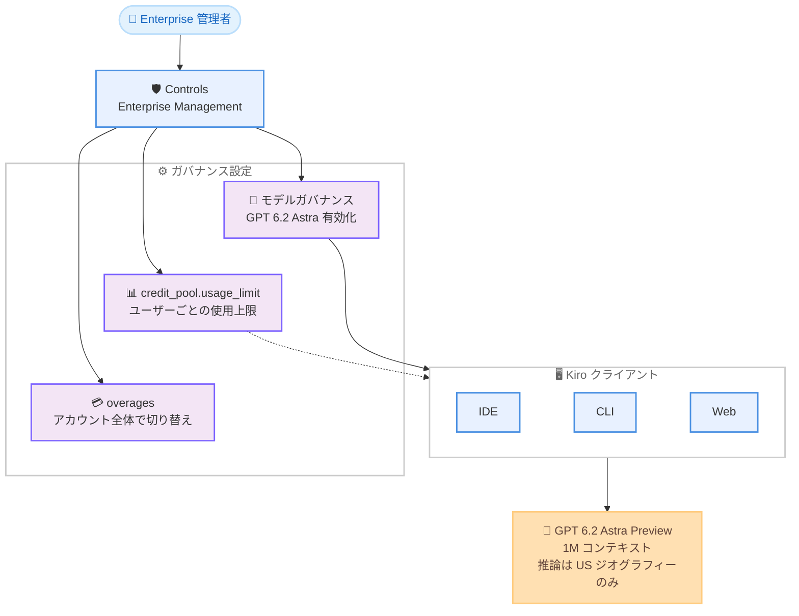

# Kiro - GPT 6.2 Astra Preview、クレジットプーリング使用上限とオーバーエイジ、CLI 3.6 パッチ

**リリース日**: 2026 年 11 月 25 日
**サービス**: Kiro
**機能**: GPT 6.2 Astra Preview (Kiro Enterprise 向け)、クレジットプーリング使用上限とオーバーエイジ (Enterprise Management)、CLI 3.6 (SubagentStop フックとガイド付きコンパクション) のパッチ 3.6.1 / 3.6.2

📊 [このアップデートのインフォグラフィックを見る](https://takech9203.github.io/aws-news-summary/20261125-kiro-changelog-2026-11-25.html)

## 概要

2026 年 11 月 25 日付の Kiro Changelog では、Models、General、CLI の 3 つのカテゴリでアップデートが発表されました。Kiro Enterprise 組織向けの新しいフロンティアモデルの提供開始と、エンタープライズ管理機能の強化が中心です。

**GPT 6.2 Astra** が、Kiro Enterprise 組織向けに全 Kiro クライアントで Preview としてロールアウトを開始しました。既存コードベースでの変更の実装とテストなど、複雑でマルチステップのプロジェクトに向けた OpenAI のフロンティアモデルで、1M トークンのコンテキストウィンドウを備えます。クレジット倍率は 7.2 倍で、272K トークンを超えるリクエストでは 14.4 倍になります。推論は US ジオグラフィーのみで実行されます。

また、**Enterprise Management** では、Enterprise 管理者が Controls でクレジットプーリングの使用上限 (`credit_pool.usage_limit`) とオーバーエイジ (`overages`) を設定できるようになりました。さらに、**Kiro CLI 3.6** (SubagentStop フック、Hook 出力の完全保存、ガイド付きコンパクションを追加したリリース) に、パッチ 3.6.1 と 3.6.2 が同日付で公開されています。

**アップデート前の課題**

- 以前は Kiro Enterprise で GPT 6.2 Astra を利用できず、1M コンテキストウィンドウを持つ OpenAI のフロンティアモデルを組織で検証する手段がなかった
- 以前は Controls でプールされたクレジットのユーザーごとの使用上限を設定できず、Kiro コンソールの Credit sharing ページでの設定に依存していた
- 以前はアカウント全体のオーバーエイジ (上限超過時の追加利用) の有効 / 無効を Controls のプロファイルで一括制御できなかった

**アップデート後の改善**

- 今回のアップデートにより、アクセスが許可された Kiro Enterprise 組織はモデルガバナンス経由で GPT 6.2 Astra を有効化し、全 Kiro クライアントで Preview 利用できるようになった
- 今回のアップデートにより、`credit_pool.usage_limit` で請求サイクルごとにユーザーが使用できるプールクレジットの上限を、プロファイル / グループ / ユーザーの各レベルで設定できるようになった
- 今回のアップデートにより、プロファイルの control の `overages` でアカウント全体のオーバーエイジのオン / オフを切り替えられるようになった
- 今回のアップデートにより、CLI 3.6 系の最新パッチ 3.6.1 / 3.6.2 が利用できるようになった

## アーキテクチャ図



Enterprise 管理者は Controls でモデルガバナンス、クレジットプーリングの使用上限、オーバーエイジを一元管理し、各 Kiro クライアントから GPT 6.2 Astra を Preview 利用できます。GPT 6.2 Astra の推論は US ジオグラフィーのみで実行されます。

## サービスアップデートの詳細

### 主要機能

1. **GPT 6.2 Astra Preview (Models)**
   - Kiro Enterprise 組織向けに、全 Kiro クライアントで Preview としてロールアウトを開始
   - 既存コードベースでの変更の実装とテストなど、複雑でマルチステップのプロジェクトに向けた OpenAI のフロンティアモデル
   - 1M トークンのコンテキストウィンドウを搭載
   - クレジット倍率は 7.2 倍。272K トークンを超えるリクエストでは 14.4 倍に上昇
   - 推論は US ジオグラフィーのみで実行される
   - Preview 期間中はアクセスが制限されており、アクセスを持つ組織はモデルガバナンス経由で有効化できる

2. **クレジットプーリング使用上限とオーバーエイジ (General / Enterprise Management)**
   - Enterprise 管理者が Controls でクレジットプーリングの使用上限とオーバーエイジを設定できるようになった
   - `credit_pool.usage_limit` で、各ユーザーが請求サイクルごとに使用できるプールクレジットの上限を設定する
   - プロファイルの control に設定すると各ユーザーのデフォルト上限になり、グループまたはユーザーに割り当てた control にも設定できる
   - 優先順位は、ユーザー自身の上限が最優先、次にユーザーが所属するグループの中で最も高い上限、最後にプロファイルの上限
   - プロファイルの control の `overages` で、アカウント全体のオーバーエイジのオン / オフを切り替えられる
   - Controls に移行していないプロファイルは、引き続き Kiro コンソールの Credit sharing ページで使用上限を設定する

3. **CLI 3.6 パッチ 3.6.1 / 3.6.2 (CLI)**
   - SubagentStop フック、Hook 出力の完全保存、ガイド付きコンパクションを追加した CLI 3.6 リリースに対し、パッチ 3.6.1 と 3.6.2 が 2026 年 11 月 25 日付で公開された
   - CLI 3.6 リリースには、V3 セッションでサブエージェント終了時に追加指示を 1 回送信できる `SubagentStop` フック、3,000 文字を超える Hook 出力の完全保存、`/compact` にサマリーへ残す内容を指示できるガイド付きコンパクションが含まれる
   - このほか、会話のリキャップ、通知コントロール、マネージド V2 コントロール、全ユーザー向け Windows インストーラーも追加されている

## 技術仕様

### GPT 6.2 Astra の仕様

| 項目 | 詳細 |
|------|------|
| 提供元 | OpenAI |
| 位置づけ | 複雑でマルチステップのプロジェクト向けフロンティアモデル |
| コンテキストウィンドウ | 1M トークン |
| クレジット倍率 | 7.2 倍 (272K トークン超のリクエストは 14.4 倍) |
| 推論実行場所 | US ジオグラフィーのみ |
| 提供状況 | Preview (アクセス制限あり) |
| 有効化方法 | モデルガバナンス経由 |
| 対象 | Kiro Enterprise 組織 (全 Kiro クライアント) |

### クレジットプーリング使用上限の設定

| 項目 | 詳細 |
|------|------|
| 設定場所 | Controls (Enterprise Management) |
| 設定キー | `credit_pool.usage_limit` |
| 設定単位 | 請求サイクルごとのユーザーあたりプールクレジット上限 |
| 設定レベル | プロファイル (デフォルト)、グループ、ユーザー |
| 優先順位 | ユーザー自身の上限 > 所属グループの最も高い上限 > プロファイルの上限 |
| オーバーエイジ | プロファイルの control の `overages` でアカウント全体のオン / オフを設定 |
| Enterprise Management の提供リージョン | 米国東部 (バージニア北部) `us-east-1`、欧州 (フランクフルト) `eu-central-1` (プレビュー) |
| Controls 未移行のプロファイル | Kiro コンソールの Credit sharing ページで使用上限を設定 |

## 設定方法

### 前提条件

1. GPT 6.2 Astra を利用するには、Kiro Enterprise 組織であり、Preview アクセスが許可されていること
2. クレジットプーリングの使用上限とオーバーエイジを Controls で設定するには、Enterprise Management (プレビュー、`us-east-1` または `eu-central-1`) を利用し、プロファイルが Controls に移行済みであること
3. CLI 3.6 の新機能を使用するには、Kiro CLI を 3.6 系 (最新パッチは 3.6.2) へ更新し、V3 セッションを利用すること

### 手順

#### ステップ 1: モデルガバナンスで GPT 6.2 Astra を有効化する

Preview アクセスを持つ組織の管理者は、モデルガバナンスで GPT 6.2 Astra を有効化します。有効化後、ユーザーは IDE、CLI、Web などの各 Kiro クライアントでモデルを選択できます。

#### ステップ 2: クレジットプーリングの使用上限を設定する

Controls でプロファイルの control に `credit_pool.usage_limit` を設定し、各ユーザーのデフォルト上限を定義します。特定のグループやユーザーに異なる上限を適用する場合は、グループまたはユーザーに割り当てた control に設定します。ユーザー自身の上限、所属グループの最も高い上限、プロファイルの上限の順に適用されます。

#### ステップ 3: オーバーエイジを設定する

プロファイルの control で `overages` を設定し、アカウント全体のオーバーエイジのオン / オフを切り替えます。

#### ステップ 4: CLI を最新パッチへ更新する

Kiro CLI を 3.6.2 へ更新し、V3 セッションで `SubagentStop` フックやガイド付きコンパクション (`/compact` に続けて指示を記述) を利用します。

## メリット

### ビジネス面

- **大規模プロジェクトへの適用**: 1M コンテキストウィンドウを持つ GPT 6.2 Astra により、既存コードベースでの変更の実装とテストのような複雑でマルチステップの作業を組織で検証できる
- **コスト管理の強化**: `credit_pool.usage_limit` により、ユーザーごとのプールクレジット消費を請求サイクル単位で制御し、予算超過を防げる
- **柔軟なガバナンス**: オーバーエイジのオン / オフをアカウント全体で一括制御でき、組織のコストポリシーに合わせた運用ができる

### 技術面

- **モデル選択肢の拡大**: Anthropic のモデルに加えて OpenAI のフロンティアモデルを同じ Kiro クライアントとガバナンスの枠組みで利用できる
- **きめ細かな上限設定**: プロファイル / グループ / ユーザーの 3 レベルで上限を設定でき、明確な優先順位に基づいて適用される
- **CLI の安定性向上**: CLI 3.6 系にパッチ 3.6.1 / 3.6.2 が提供され、SubagentStop フックやガイド付きコンパクションを含む最新機能を安定した環境で利用できる

## デメリット・制約事項

### 制限事項

- GPT 6.2 Astra は Preview であり、アクセスが制限されている。利用にはアクセス許可とモデルガバナンスでの有効化が必要
- GPT 6.2 Astra の推論は US ジオグラフィーのみで実行される
- GPT 6.2 Astra は Kiro Enterprise 組織向けであり、個人プランでは利用できない
- Enterprise Management はプレビューで、米国東部 (バージニア北部) `us-east-1` と欧州 (フランクフルト) `eu-central-1` のみで提供される
- Controls に移行していないプロファイルでは、使用上限は従来どおり Kiro コンソールの Credit sharing ページで設定する

### 考慮すべき点

- GPT 6.2 Astra のクレジット倍率は 7.2 倍と高く、272K トークンを超えるリクエストでは 14.4 倍になるため、1M コンテキストを活用する長大なリクエストはクレジット消費が大きい
- データレジデンシー要件がある組織は、推論が US ジオグラフィーのみで実行される点を確認する必要がある
- 使用上限はユーザー > グループ > プロファイルの優先順位で適用されるため、複数の control を併用する場合は意図した上限が適用されるか確認が必要

## ユースケース

### ユースケース 1: 既存コードベースの大規模改修を GPT 6.2 Astra で実行する

**シナリオ**: 大規模なモノレポで、複数モジュールにまたがる変更の実装とテストをエージェントに任せたい。

**実装例**:
```text
1. 管理者がモデルガバナンスで GPT 6.2 Astra を有効化
2. 開発者が Kiro クライアントで GPT 6.2 Astra を選択
3. 1M コンテキストウィンドウを活用して、関連モジュールを
   広くコンテキストに含めたマルチステップの改修を依頼
```

**効果**: 広いコンテキストを必要とする複雑な改修タスクを、コンテキストの分割を最小限にして実行できる。

### ユースケース 2: 部門ごとにクレジット消費を統制する

**シナリオ**: 全社でクレジットプールを共有しつつ、部門やロールごとに使用上限を変えたい。

**実装例**:
```text
1. プロファイルの control に credit_pool.usage_limit を設定し、
   全ユーザーのデフォルト上限を定義
2. ヘビーユーザーのグループには、より高い上限の control を割り当て
3. プロファイルの control の overages でアカウント全体の
   オーバーエイジをオフにし、上限超過時の追加消費を防止
```

**効果**: プールクレジットの消費を請求サイクル単位で統制し、部門ごとの柔軟な配分と全体の予算管理を両立できる。

### ユースケース 3: モデル検証をガバナンス配下で段階的に進める

**シナリオ**: 新モデルの GPT 6.2 Astra を、まず一部チームで評価してから全社展開したい。

**実装例**:
```text
1. Preview アクセスを取得し、モデルガバナンスで有効化
2. 評価チームのユーザーに高めの使用上限を設定して検証を実施
3. クレジット倍率 7.2 倍 (272K トークン超は 14.4 倍) を踏まえて
   コストを試算し、全社展開の判断材料とする
```

**効果**: ガバナンスとコスト統制を効かせたまま、新モデルの評価と展開判断を段階的に進められる。

## 料金

GPT 6.2 Astra のクレジット倍率は **7.2 倍**で、272K トークンを超えるリクエストでは **14.4 倍**に上昇します。1M コンテキストウィンドウを活用する長大なリクエストはクレジット消費が大きくなるため、使用上限 (`credit_pool.usage_limit`) やオーバーエイジ設定と組み合わせたコスト管理を推奨します。

クレジットプーリング使用上限とオーバーエイジの設定、および CLI 3.6 のパッチ自体に追加料金はありません。詳細は [Kiro の料金ページ](https://kiro.dev/pricing/)を参照してください。

## 利用可能リージョン

Kiro はグローバルに利用可能です。ただし、以下の点に注意が必要です。

- GPT 6.2 Astra の推論は US ジオグラフィーのみで実行される
- Enterprise Management はプレビューで、米国東部 (バージニア北部) `us-east-1` と欧州 (フランクフルト) `eu-central-1` で提供される

## 関連サービス・機能

- **Kiro モデルガバナンス**: Enterprise 組織で利用可能なモデルを管理する機能。GPT 6.2 Astra の有効化に使用する
- **Kiro Controls (Enterprise Management)**: 組織のプロファイル / グループ / ユーザー単位の設定を一元管理する機能。今回 `credit_pool.usage_limit` と `overages` の設定が追加された
- **Kiro クレジットプーリング**: 組織でクレジットを共有する仕組み。今回ユーザーごとの使用上限を Controls で設定できるようになった
- **Kiro Hooks**: エージェントのライフサイクルに処理を差し込む仕組み。CLI 3.6 で `SubagentStop` タイプが追加された

## 参考リンク

- 📊 [インフォグラフィック](https://takech9203.github.io/aws-news-summary/20261125-kiro-changelog-2026-11-25.html)
- [Kiro Changelog](https://kiro.dev/changelog/)
- [Changelog: GPT 6.2 Astra Preview Begins Rolling Out to Kiro Enterprise](https://kiro.dev/changelog/models/gpt-6-2-astra-for-enterprise/)
- [Changelog: Credit Pooling Usage Limits and Overages in Enterprise Management](https://kiro.dev/changelog/general/enterprise-management-credit-pooling-controls/)
- [Changelog: CLI 3.6 - Subagent Stop Hooks and Guided Compaction](https://kiro.dev/changelog/cli/3-6/)
- [ドキュメント: 利用可能なモデル - GPT 6.2 Astra](https://kiro.dev/docs/models/available-models/#gpt-62-astra)
- [ドキュメント: クレジットプーリングの使用上限設定](https://kiro.dev/docs/enterprise/credit-pooling/manage-usage-limits/#set-usage-limits-in-controls)
- [ドキュメント: Enterprise Management の提供状況](https://kiro.dev/docs/enterprise/enterprise-management/#availability)
- [ドキュメント: SubagentStop フック](https://kiro.dev/docs/hooks/types/#subagent-stop-cli-v3-only)
- [ドキュメント: コンパクション](https://kiro.dev/docs/compaction/)

## まとめ

2026 年 11 月 25 日の Kiro Changelog は、Kiro Enterprise 向けの GPT 6.2 Astra Preview の提供開始、Controls によるクレジットプーリング使用上限とオーバーエイジの管理、CLI 3.6 のパッチ提供と、エンタープライズでのモデル選択肢とガバナンスを強化するアップデートです。GPT 6.2 Astra はクレジット倍率が高く推論が US ジオグラフィーに限定されるため、組織はコストとデータレジデンシーの要件を確認したうえで、モデルガバナンスでの有効化と `credit_pool.usage_limit` によるコスト統制をあわせて検討することを推奨します。
