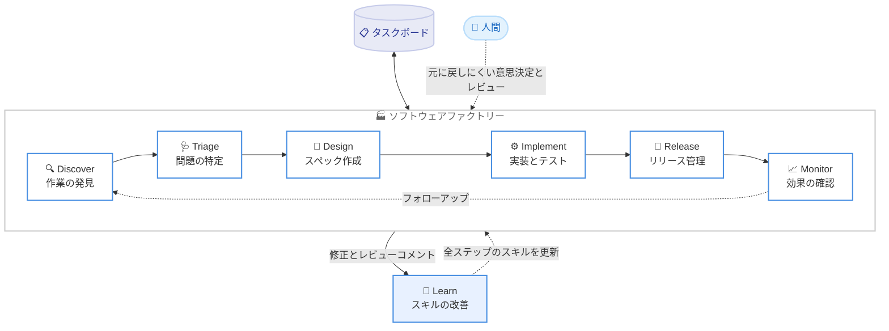

# Kiro - 人間の注意力を中心に据えたソフトウェアファクトリーの構築 (Building a software factory around human attention)

**リリース日**: 2026 年 11 月 25 日
**サービス**: Kiro
**機能**: ソフトウェアファクトリーの運用手法「Manual」のオープンソース公開

📊 [このアップデートのインフォグラフィックを見る](https://takech9203.github.io/aws-news-summary/20261125-kiro-software-factory-human-attention.html)

## 概要

Kiro チーム (Kiro 内のエージェントを開発しているチーム) が、自分たち自身のソフトウェアファクトリーの構築方法をブログで公開しました。ソフトウェアファクトリーとは、タスクボード上の作業項目をリリース済みの変更へと変換する仕組みで、トリアージ、設計、実装、リリース、モニタリングといったソフトウェア開発ライフサイクル全体をエージェントが自律的に進め、人間は意思決定が必要な場面でのみ関与します。

この記事の中心的な主張は「エージェントに任せられる量の上限は人間の注意力 (attention) で決まる」という点です。エージェントがコードを書く速度は人間がレビューする速度を上回り、プルリクエストは大きく、速く届くようになりました。ライフサイクルの自動化を進めるほどコードレビューがボトルネックになるため、Kiro チームは「人間の注意力をどこに、どのように使うか」を中心にファクトリーを設計しました。

あわせて、このファクトリーの運用方法をプロンプトとスキルのセットとしてまとめた「Manual」を、GitHub リポジトリ `kirodotdev-labs/sample-kiro-factory-manual` でオープンソースとして公開しました。各チームは Manual の上に独自の設定とスキル (インスタンス) を記述することで、自分たちのリポジトリ、タスクボード、ホスティング環境に接続して利用できます。

**アップデート前の課題**

ブログでは、エージェント活用を進めるチームが共通して直面する課題が挙げられています。

- エージェントがコードを書く速度にレビューが追いつかず、レビューが滞留するか、流し読みになるかの二択になっていた
- レビューには、コードベースへの理解や変化し続けるチームプラクティスの知識が必要で、レビューエージェントやスキルだけではカバーしきれなかった
- チームメンバーごとにエージェントのセットアップが異なり、チーム全体で頼れる統一された品質基準がなかった
- タスクを 1 件ずつエージェントに手渡して開始し、進捗を見守るという運転作業に多くの時間が取られていた

**アップデート後の改善**

今回公開されたソフトウェアファクトリーと Manual により、以下が可能になりました。

- Discover から Learn までの 7 つのステップをエージェントのワーカーが自律的に実行し、人間は重要な意思決定のみに集中できるようになった
- 各ステップが検証ループで自己チェックし、人間が確認できる検証可能なアウトプットを残すため、レビューの負荷が下がった
- 人間が行ったすべての修正を Learn ステップが読み取り、スキルの改善を提案することで、ファクトリー自体がチーム全体から学習するようになった
- Manual がオープンソースで公開され、Kiro CLI と GitHub リポジトリがあれば、どのチームでも自分たちのバックログで試せるようになった

## アーキテクチャ図



6 つのステップが閉じたループを構成し、Learn が外側からすべてのステップのスキルを改善します。人間は、元に戻しにくい意思決定とマージ前のレビューでのみ関与します。

## サービスアップデートの詳細

### 主要機能

1. **ライフサイクル全体を分担する 7 つのステップ**
   - **Discover**: 新しい作業をタスクボードに起票する
   - **Triage**: コードを読んで問題を特定し、エンジニア、プロダクト、デザイナーの誰の判断が必要かを決める
   - **Design**: 変更に必要な場合はスペックを作成し、チームが求める場合は人間が承認する
   - **Implement**: テスト付きで変更を実装し、スペックとの整合、レビューコメントや CI への対応まで自分で行う
   - **Release**: 変更をユーザーに届けるリリース作業を管理する
   - **Monitor**: 変更が効果を上げたかを確認し、問題があればフォローアップを起票する
   - **Learn**: すべてのステップが使うスキルを改善する

2. **スケジュール実行される自律ワーカー**
   - 各ステップには専用のワーカー (エージェント) があり、チーム共有のホスト上でスケジュール実行される
   - 誰かがセッションを開始しなくても、前のステップが残した作業項目を自動的に拾って処理する
   - ワーカーは実行間で状態を保持しないため、必要な情報はすべてボード項目やプルリクエスト上に残される

3. **各ステップの検証ループと検証可能なアウトプット**
   - 各ステップは成果物の候補を作成し、ビルド、テスト、レビューエージェント、チームで合意したプラクティスなど、チームが信頼するシグナルと照合する
   - 基準を満たさなければ再試行し、堅実な収束が見込めない場合は停止する
   - 通常の変更で取り消せる選択は自分で決定し、永続化データ、公開インターフェース、セキュリティ動作の変更など、元に戻しにくい選択のみ人間に確認を求める
   - プルリクエストには、何をなぜ変えたか、検討した代替案、各チェックの結果と未実行のチェックをまとめたページが添付され、人間はコード全行ではなくこのページを読んでレビューできる

4. **チーム全体からの学習**
   - ボード項目やプルリクエスト上で人間が行った修正を Learn ステップがすべて読み取り、既存スキルへの変更を提案する
   - 個人がメモリーやカスタムスキルに記録する方式と異なり、誰かが教訓に気づいて書き留める必要がない

5. **Manual のオープンソース公開**
   - ファクトリーの運用方法をプロンプトとスキルのセット「Manual」として `kirodotdev-labs/sample-kiro-factory-manual` で公開
   - 各チームは Manual の上にインスタンス (独自の設定とスキル) を書き、自分たちのリポジトリ、ボード、ホスティングに接続する
   - インスタンスにはゴールを定義でき、ファクトリーの挙動とすべての学習サイクルに反映される

## 技術仕様

### Kiro チームによる運用構成

| 項目 | 詳細 |
|------|------|
| エージェントハーネス | Kiro CLI (ワーカーはヘッドレスで実行) |
| 実行環境 | Lambda MicroVM 上でスケジュール実行 (ラップトップを閉じても稼働) |
| 作業項目の管理 | チームのタスクボード |
| 変更の管理 | GitHub 上のプルリクエストと CI |
| 安全策 | メインブランチは人間のレビューなしには何もリリースされない |
| 実験環境 | 未マージの変更を含む内部向け edge ビルドでファクトリーの失敗を観察 |

### これまでの運用で確認された数値

| 指標 | 値 |
|------|-----|
| プルリクエストが既に存在するボード上のオープン項目 | 約 85% |
| ファクトリーが人間の判断待ちとしてフラグした項目 | 14% |
| マージ前に必須としている人間レビュー待ちの項目 | 上記の 2 倍以上 |

## 設定方法

### 前提条件

1. Kiro CLI がインストールされていること
2. GitHub リポジトリと GitHub CLI が利用できること
3. ワーカーはスケジュールに従って稼働しクレジットを消費するため、小さく始めること
4. ファクトリー専用のアカウントを用意し、対象リポジトリのみへのアクセスに限定すること (セットアップとセキュリティの詳細は README に記載)

### 手順

#### ステップ 1: Manual リポジトリの確認

```bash
# Manual のリポジトリを取得する
git clone https://github.com/kirodotdev-labs/sample-kiro-factory-manual
```

オープンソースとして公開されている Manual (プロンプトとスキルのセット) を取得します。ボード、コードホスト、ホスティングはインテグレーションとして自分たちの環境に向けられます。

#### ステップ 2: インスタンスの作成

既存のプロジェクトを選び、エージェントにリポジトリ内の `factory-setup` スキルを指定して、自分たちのチーム用のインスタンス (設定とスキル) を一緒に作成します。インスタンスは Manual をチームのリポジトリ、タスクボード、ホスティングに接続し、必要に応じてゴールも定義します。

#### ステップ 3: バックログの項目を投入

バックログからいくつかの作業項目をファクトリーに渡して処理させます。ワーカーがスケジュールに従って項目を拾い、各ステップを進め、人間の判断が必要な場合はボード項目やプルリクエスト上のコメントとして通知します。

## メリット

### ビジネス面

- **人間の時間を高価値な意思決定へ集中**: エージェントの起動や監視に使っていた時間を、何を作るべきか、それが正しいかの判断に振り向けられる
- **スループットの向上**: 多数の項目が誰も運転することなく同時に進行し、ボード上のオープン項目の約 85% に既にプルリクエストが存在する状態を実現
- **リリース後の効果検証の定着**: Monitor ステップがすべての変更の効果を確認し、その結果がファクトリーの学習にフィードバックされる

### 技術面

- **レビュー負荷の軽減**: 各ステップの検証ループと検証可能なアウトプットにより、レビュアーはチェック済みの要約ページを起点に判断できる
- **品質基準の統一**: すべての変更が同じ基準を満たすため、レビュアーは何を期待すべきか分かり、個人の実験が有効ならファクトリーのスキルとしてチーム全体に展開できる
- **継続的な自己改善**: 人間の修正がすべて学習の入力となり、どこで人間の注意を減らしても安全かの証拠が時間とともに蓄積される
- **オープンな構成**: Manual はオープンソースで、ボード、コードホスト、ホスティングを自分たちの環境に差し替えられる

## デメリット・制約事項

### 制限事項

- 現時点でファクトリーが扱うのはバックログ内の単発タスクとバグであり、設計と分割が必要な大規模機能はまだ対象外
- 意図的にセミオートマチックな運用であり、メインブランチへのマージには必ず人間のレビューが必要
- ワーカーは実行間で何も記憶しないため、必要なコンテキストはすべてボード項目やプルリクエスト上に残す必要がある
- 大規模な既存リポジトリでは新しいファクトリーはコールドスタートとなり、スキルとメモリーを超えるコードベースの永続的な表現が必要 (Kiro チームが検討中の領域)

### 考慮すべき点

- 意思決定をライフサイクル全体に分散させると判断の回数自体は増え、無関係なタスク間を行き来することになる (ブログでは「人間向けの宿題生成器」のように感じる日もあると率直に述べられている)
- スループット優先の設計のため、単一の項目は自分で作業するより時間がかかる場合がある (急ぎの項目は人間がワーカーを個別に起動可能)
- 問い合わせの頻度が高すぎるとファクトリー自体が停滞するため、エスカレーション条件の調整が必要 (Kiro チームは「元に戻しにくい選択のみ人間に確認」へと調整した)
- ワーカーは誰も見ていなくてもクレジットを消費するため、コスト管理の観点から小さく始めることが推奨されている

## ユースケース

### ユースケース 1: バックログの単発タスクとバグの自動処理

**シナリオ**: チームのバックログに小規模な修正タスクやバグ報告が溜まっており、エージェントへの手渡しとレビューに時間を取られている。

**実装例**:
```
1. factory-setup スキルでチーム用のインスタンスを作成
2. バックログから数件の項目をファクトリーに投入
3. Implement が実装、テスト、CI 対応まで完了したプルリクエストを作成
4. 人間は検証可能なアウトプットのページを確認してマージを判断
```

**効果**: エージェントの起動と監視の作業がなくなり、レビューはチェック済みの要約を起点に行えるため、人間の時間が意思決定に集中する。

### ユースケース 2: リリース後の効果検証とフォローアップの自動化

**シナリオ**: 変更をリリースした後、それが実際に効果を上げたかの確認が徹底されておらず、問題の発見が遅れる。

**実装例**:
```
1. インスタンスのスキルで Monitor が参照する本番テレメトリーを定義
2. Release が各クライアントとチャネルへの展開を追跡
3. Monitor が効果を確認し、問題があれば Discover 経由でボードに起票
```

**効果**: すべての変更について効果が確認され、その結果が Learn を通じてファクトリーの改善に還元される。

### ユースケース 3: レビューで得た知見のチーム全体への展開

**シナリオ**: レビューで繰り返し同じ指摘をしているが、その知見が個人のメモやスキルにしか残らず、チーム全体の品質基準に反映されない。

**実装例**:
```
1. レビュアーはボード項目やプルリクエスト上で通常どおり修正を指摘
2. Learn ステップが定期実行時にすべての修正を読み取る
3. 既存スキルへの変更が提案され、以後すべてのステップに反映される
```

**効果**: 誰かが教訓を書き留めなくても、チーム全体の修正がファクトリーの品質基準として蓄積される。

## 料金

Manual 自体はオープンソースとして無償で公開されています。ただし、ワーカーは Kiro CLI 上で動作し、スケジュールに従って稼働する間 Kiro のクレジットを消費します。ブログでは、小さく始めることと、ファクトリー専用アカウントを用意することが推奨されています。

### Kiro の料金プラン (kiro.dev 掲載情報)

| プラン | 月額料金 | 含まれるクレジット |
|--------|----------|--------------------|
| Kiro Free | $0 | 50 クレジット |
| Kiro Pro | $20 | 1,000 クレジット |
| Kiro Pro+ | $40 | 2,000 クレジット |
| Kiro Pro Max | $100 | 5,000 クレジット |
| Kiro Power | $200 | 10,000 クレジット |

追加クレジットは $0.04 / クレジットで購入できます。最新の情報は [Kiro の料金ページ](https://kiro.dev/pricing/) を参照してください。

## 利用可能リージョン

グローバル (Kiro はグローバルに提供されるサービスです)

## 関連サービス・機能

- **Kiro CLI**: Manual がハーネスとして同梱する CLI。ワーカーはこの上でヘッドレス実行される
- **Kiro スキルとメモリー**: ファクトリーの各ステップの振る舞いを定義し、Learn ステップによる改善の対象となる仕組み
- **Kiro Crew**: Kiro Crew チームは 1 週間で 1,000 件のプルリクエストをマージするソフトウェアファクトリーを構築しており、本記事はその流れに続く取り組み
- **AWS Lambda**: Kiro チームのインスタンスは Lambda MicroVM 上でスケジュール実行されている
- **GitHub / GitHub CLI**: 変更の管理はプルリクエストと CI で行われ、ファクトリーの試用にも GitHub リポジトリと GitHub CLI が必要

## 参考リンク

- 📊 [インフォグラフィック](https://takech9203.github.io/aws-news-summary/20261125-kiro-software-factory-human-attention.html)
- [Kiro Blog: Building a software factory around human attention](https://kiro.dev/blog/software-factory-human-attention/)
- [Manual リポジトリ: kirodotdev-labs/sample-kiro-factory-manual](https://github.com/kirodotdev-labs/sample-kiro-factory-manual)
- [Frontier engineering ガイド](https://kiro.dev/topics/frontier-engineering/)
- [Kiro CLI](https://kiro.dev/cli/)
- [関連記事: How we built a software factory with Kiro Crew to merge 1,000 PRs in a week](https://kiro.dev/blog/software-factory-1000-prs/)
- [関連記事: Keeping a software factory stable at 1,000 PRs a week](https://kiro.dev/blog/software-factory-stability/)
- [Kiro 料金ページ](https://kiro.dev/pricing/)

## まとめ

本記事は、エージェント時代の開発ボトルネックが「人間の注意力」に移ったことを明確にし、注意力を中心に設計したソフトウェアファクトリーの実践と数値、未解決の課題までを率直に共有するものです。運用手法の Manual がオープンソースで公開されたため、Kiro CLI と GitHub リポジトリがあれば自分たちのバックログで試すことができます。エージェントによる開発自動化を進めるチームは、まず小規模な単発タスクから導入し、専用アカウントとアクセス制限を設定した上で検証を始めることを推奨します。
