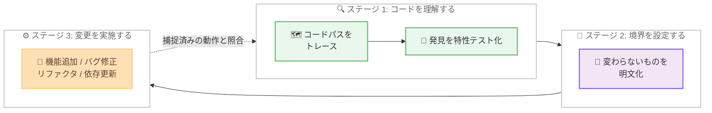

# Kiro - 未知のコードベースでコーディングエージェントを活用する手法

**リリース日**: 2026 年 11 月 25 日
**サービス**: Kiro
**機能**: 未知のコードベースにおけるエージェント活用手法 (トレース、特性テスト、変更境界の定義)

📊 [このアップデートのインフォグラフィックを見る](https://takech9203.github.io/aws-news-summary/20261125-kiro-unfamiliar-codebase.html)

## 概要

Kiro チーム (Customer Success の Suruchi Saxena 氏、Burhan Khalid 氏) は、自分が書いていない未知のコードベースでコーディングエージェントを安全に活用するための体系的な手法を解説するブログ記事を公開しました。3 年前から存在し 200 ファイル以上に及ぶリポジトリで最初のチケットに取り組む、という具体的なシナリオ (請求書の支払い失敗時にメールを送信する機能の追加) を題材に、エージェントにコードを書かせる前に「検証可能な証拠」を作らせるワークフローを提示しています。

記事の中核となる主張は、エージェントは人間より高速に検索できるものの、「どの詳細が重要か」は速度だけでは分からないという点です。`legacy` とマークされた関数が本番トラフィックの大半を処理していたり、奇妙に見えるテストアサーションが顧客の依存する動作を保護していたりしますが、通常それらは文書化されていません。そこで、エージェントにコードを書かせる前に、(1) 影響を受けるコードパスのトレース、(2) 現在の動作を捉える特性テスト (characterization test) の作成、(3) 変更境界の明文化、という 3 段階を踏ませ、証拠が確認できた分だけエージェントの自律性を拡大していくアプローチを推奨しています。

この記事は特定の新機能のリリースではなく、Kiro の既存機能 (スキル、ステアリング、フック、メモリ、ワークフロー、クラウドセッションなど) を組み合わせた実践手法 (technique) の解説であり、IDE、CLI、Web のすべての Kiro 利用形態に適用できます。

**アップデート前の課題**

未知のコードベースでエージェントを使う際、以下の課題がありました。

- 成熟したリポジトリには、暗黙の要件や長年の設計判断が人の頭の中にしか存在せず、エージェントは正しく見えるコードを書いても、それらの暗黙のルールを壊してしまう可能性があった
- リポジトリ全体の説明をエージェントに求めても、パッケージの概観や README の言い換えが返ってくるだけで、チケットの背後にある問いには答えられなかった
- 2018 年の実務開発者 78 名を対象とした調査では、作業時間の約 58% がプログラムの理解に費やされており、AI がこのコストを削減できるかは依然として測定が難しい (METR の 2025 年の研究では、既知のリポジトリで作業する熟練開発者が当時の AI ツールにより 19% 遅くなったと報告され、2026 年の追跡調査でも効果の信頼区間は「効果なし」を含む)

**アップデート後の改善**

本記事の手法に従うことで、以下が可能になります。

- エージェントにコードパスのトレースと特性テストの作成を先行させることで、エージェントの「信念」をコードに対して検証でき、レビュー可能な証拠に基づいて自律性を段階的に委譲できる
- 変更境界 (Goal / Change / Preserve / Validate) を事前に文書化することで、テストがグリーンのままでもスコープ外の変更が紛れ込むリスクを抑制できる
- 「証拠 (evidence)」と「影響範囲 (reach)」の 2 軸でタスクごとの監督レベルを決定する実践的な判断基準が得られる

## アーキテクチャ図



トレースと特性テストで変更境界を確立してから実装を開始するワークフローです。コードパスマップと矛盾する動作が見つかった場合は、前のステージに戻って証拠を更新します。

## サービスアップデートの詳細

### 主要なステップ

1. **重要なコードパスをトレースする**
   - チケットの 1 段階上のレベルから開始し、「請求イベントと顧客通知を所有するパッケージはどれか」「各パッケージの公開エントリポイントはどこか」を質問する
   - すべての主張にファイル引用 (citation) を必須とし、この段階では変更提案を禁止する。引用があることで、エージェントの要約を人間が実際のファイルを開いて検証できる
   - 次に、同じパスを使う既存機能 (例: すでにメールを送信している `invoice.paid` イベント) にトレースを絞り込む
   - 自分がすでに答えを知っているケース (例: 支払いリトライが 2 回目で成功した場合の挙動) を説明させ、エージェントが本番のコードパスを実際に追ったのか、もっともらしいストーリーをパターンマッチで作ったのかを確認する

2. **トレースを特性テストに変換する**
   - トレースは「エージェントが信じていること」の記録であり、特性テストはその信念をコードに対して検証し、一見間違って見える部分も含めて現在のシステムの動作を捕捉する
   - テスト実行結果とコードパスマップの差分を最初にレビューする。差分はマップの誤りか、実装内の文書化されていないルールのどちらかであり、後者の場合はコードオーナーへの質問 (バグか、誰かが依存する契約か) になる
   - エージェントに「観察したこと」と「推論したこと」の分離を求める。推論 (例: リトライは請求イベント ID で重複排除される) には追加のテストまたはオーナーの回答が必要
   - 安定したインターフェースでテストできないパスは、隠れた副作用や関数内部で構築される依存関係のサインであり、変更リスクが高いため自律性の委譲を減らす

3. **変更境界を定義する**
   - 特性テストが保護するのは「動作」であって「スコープ」ではない。エージェントは全テストをグリーンに保ったまま、型のリネームやインターフェースの再構成、言及していないファイルの変更を行い得る
   - コードを依頼する前に、Goal (目的)、Change (変更内容)、Preserve (維持するもの)、Validate (検証方法) を Markdown で明文化する
   - 「既存テストを実装に合わせて書き換えない」というルールが重要。グリーンなテストスイートに最適化するエージェントは、意図した動作をエンコードしたアサーションを平気で書き換えるため
   - エージェントは人間の約 2 倍の頻度で防御的なエラーハンドリングを追加する傾向があり、制約がないと会話が長くなるほど元の意図から逸脱する
   - バグの場合は、Kiro の Bugfix Spec が現在の動作・期待される動作・変更しない動作を分割し、それぞれからテストを導出して境界を自動生成する

4. **証拠と影響範囲に応じて自律性を設定する**
   - 「証拠 (evidence)」はエージェントを検証するために構築したもの (トレース、特性テスト、バグの場合は失敗する再現テスト)。証拠が薄い場合は、実装開始前にテストを追加するかオーナーに確認する
   - 「影響範囲 (reach)」は誤った変更がどこまで波及するか。プライベートなテンプレートリゾルバーは遠くまで波及しないが、共有イベントスキーマやデータベースマイグレーションの誤りは、編集していない呼び出し元や保存済みデータにまで波及する
   - この基準では、完全なインベントリを備えた大規模な機械的変更の方が、誰もトレースしていない共有コードの 1 行編集よりも委譲が安全なことが多い

5. **有用な証拠を保持し、Kiro の機能で再利用する**
   - プルリクエストを開く前に、意図した動作を保護する特性テストは残し、探索用のテストは破棄する。チケット専用に書いたステアリングは作業の出荷後に削除する
   - Kiro のフック (hooks) で、エージェントが該当ファイルを保存するたびに影響を受けるテストを自動実行できる
   - プロンプトと境界テンプレートを Kiro スキルとしてパッケージ化できる。スキルはオープンな Agent Skills 標準に準拠しており、同じパッケージが Kiro Crew でも動作する
   - リポジトリの規約はステアリングまたは AGENTS.md に保持し、小さな発見 (例: ローカルサービス起動後にのみ通るテスト) はメモリ機能に記録する

## 技術仕様

### タスク別の証拠・影響範囲・エージェント運用方法

記事では、タスクの種類ごとに「先に作るべき証拠」「誤った変更の影響範囲」「エージェントの運用方法」を整理した表が示されています。

| タスク | 先に作る証拠 | 誤った変更の影響範囲 | エージェントの運用方法 |
|------|------|------|------|
| 既存パターンに従う機能追加 | 最も近い動作例と関連テスト | 拡張ポイントが保たれれば限定的 | 境界の承認後は自律実行 |
| 未知のコードのバグ修正 | 安定インターフェース経由の失敗テスト | パスが共有されているかに依存 | 原因確定まで監督下で実行 |
| 動作維持リファクタリング | モジュール境界でのテスト | プライベートインターフェース内に限定 | テスト済みの小さなステップで自律実行 |
| 依存関係のアップグレード | 呼び出し箇所のインベントリと移行メモ | リポジトリ全体 | パッケージ単位で自律実行、デフォルト値の変更はレビュー |
| 公開 API・マイグレーション・セキュリティ・並行性の変更 | トレース済みの呼び出し元とオーナーレビュー済み設計 | 広範囲 (呼び出し元と保存済みデータに到達) | 全工程を監督下で実行 |

### プロンプト例: コードパスのトレース

```text
Trace how an existing `invoice.paid` event becomes an email.

Show the call path from event ingestion to delivery and cite the files you read.
List the tests for routing, preferences, retries, and templates.
Mark external calls and shared types. Skip unrelated implementations.

Then explain what happens when a payment retry succeeds on the second attempt.
I know that behavior and will use it to check your code-path map.
```

既存イベントがメールになるまでの呼び出しパスをファイル引用付きで示させ、最後に「自分が答えを知っている挙動」の説明を要求することで、エージェントが実際のコードを追ったかを検証するプロンプトです。

### 変更境界テンプレートの例

```markdown
## Goal

Send an email for `invoice.payment_failed` events.

## Change

- Reuse the existing billing-event consumer and notification pipeline.
- Add the minimum template and routing code for the new event.
- Add tests for preferences, retries, and delivery records.

## Preserve

- Public event and notification interfaces.
- Existing retry behavior for every billing event.
- Current package boundaries and dependency direction.

## Validate

- Run affected tests, type checks, and linting.
- Do not modify an existing test to make the implementation pass.
- Report required changes outside this scope before making them.
```

目的・変更・維持・検証の 4 セクションで変更境界を明文化し、スコープ外の変更は実施前に報告させるテンプレートです。

## 設定方法

### 前提条件

1. Kiro (IDE、CLI、または Web) を利用できること
2. 対象モジュールに実行可能なテストが存在すること
3. エージェントのスコープを対象モジュールに限定できること

### 手順

#### ステップ 1: パッケージレベルの地図を作る

```text
Read the repository-level architecture documents, package manifests, and build files.
Identify the packages involved in billing events and customer notifications.
For each package, state its responsibility and its public entry points.
Cite the files that support each conclusion. Do not propose changes yet.
```

チケットの 1 段階上のレベルで、関係するパッケージの責務と公開エントリポイントをファイル引用付きで特定させます。この段階では変更提案を禁止します。

#### ステップ 2: 特性テストを作成する

```text
Add characterization tests for the current `invoice.paid` notification path.

Cover recipient selection, preference checks, template selection, and retries.
Do not change production code.

Run the tests against the unmodified code.
Report anything that differs from your code-path map.
```

本番コードを変更せずに現在の通知パスの特性テストを追加させ、未変更のコードに対して実行し、コードパスマップとの差分を報告させます。

#### ステップ 3: バグの場合は安定インターフェースで再現する

```text
Write a failing test that sends the same `invoice.payment_failed` event twice
through the public consumer interface and asserts that one email is sent.

Do not fix anything yet. Report which component should have deduplicated
the event and what evidence supports that conclusion.
```

公開インターフェース経由で失敗する再現テストを書かせ、修正の前に重複排除を担うべきコンポーネントと証拠を報告させます。安定インターフェースで再現を書けば、修正によってテストが壊れることを防げます。

#### ステップ 4: 大きなタスクは Kiro ワークフローとして実行する

1 セッションに収まらないチケットでは、スキルのステップを Kiro ワークフローとして実行します。ワークフローはトークン消費と引き換えに各ステップで新しいセッションを得られます。バンドルされている `investigate` レシピは、バックグラウンドで読み取り専用の調査を行い、次のステップが利用できる引用付きレポートを返します。長いテストループは、ローカルサービスやステップごとの承認が不要であれば、ラップトップではなくクラウドセッションで実行できます。

## メリット

### ビジネス面

- **オンボーディングコストの削減**: 新メンバーや未経験のモジュールへの着手時に、暗黙知の学習をエージェントのトレースと特性テストで加速し、属人化された知識を検証可能なテストとして資産化できる
- **変更リスクの低減**: 動作を壊す「正しく見えるコード」の混入を、実装前の証拠作成とレビューで抑止できる
- **自動化の段階的拡大**: 証拠と影響範囲に基づく明確な委譲基準により、リスクに応じてエージェントの自律性を安全に拡大できる。Kiro Crew チームは週 1,000 件のプルリクエストをマージするソフトウェアファクトリーにおいて、テストカバレッジを 90% 以上に引き上げ、時間の約 20% を自動化を進めるインフラに投資している

### 技術面

- **検証可能性**: ファイル引用の必須化により、エージェントの要約や主張を人間が実ファイルで確認できる
- **観察と推論の分離**: エージェントに観察した事実と推論を区別させることで、追加のテストやオーナー確認が必要な箇所を特定できる
- **再利用可能なパッケージ化**: プロンプトと境界テンプレートを Agent Skills 標準準拠のスキルとして保存でき、Kiro 本体と Kiro Crew の両方で動作する。フック、ステアリング、AGENTS.md、メモリと組み合わせて継続的に活用できる

## デメリット・制約事項

### 制限事項

- オーナーにしか答えられない質問が残る。モジュール間の設計差異の「理由」(Chesterton's fence 問題) は、通常、歴史を知る人間にしか答えられない
- ユニットテストでは観測できない実行順序や副作用はエージェントも見逃す。重要な場合は、オーナーの回答をステアリングに記録し、最寄りの安定インターフェースで統合テストを追加する必要がある
- セキュリティバグ (誰もテストを書いていない入力に依存) や競合状態 (テストスイートが再現できないタイミングに依存) を含む変更は、良い証拠があっても監督下に置き続ける必要がある

### 考慮すべき点

- 公開 API、マイグレーション、セキュリティ、並行性に関わる変更では、トレースとテストでレビューは速くなるものの、最終判断はシステムのオーナーが行うべき。呼び出し元をトレースし、再現を書いた上で、計画段階でオーナーにレビューを依頼する
- 小さなチケットに対してトレースとテストの先行作成は手間に感じられるが、自動化されたソフトウェアデリバリーへの布石として位置づけられている
- ワークフロー実行は各ステップで新しいセッションを使うため、トークン消費が増える

## ユースケース

### ユースケース 1: 未知のコードベースへの機能追加

**シナリオ**: 新しいチームでの最初のチケットとして、請求書の支払い失敗時 (`invoice.payment_failed`) にメールを送信する機能を、200 ファイル以上の 3 年もののリポジトリに追加する。

**実装例**:
```text
1. パッケージレベルの地図作成 (請求イベントと顧客通知の所有パッケージを引用付きで特定)
2. 既存の類似パス (invoice.paid) のトレースと検証
3. 現在の通知パスの特性テスト作成
4. Goal / Change / Preserve / Validate の境界テンプレート作成
5. 境界承認後にエージェントへ実装を委譲
```

**効果**: 既存のリトライ動作やパッケージ境界を壊さずに新機能を追加でき、レビューは証拠に対する確認作業になる。

### ユースケース 2: 本番バグの原因特定と修正

**シナリオ**: 請求プロバイダーのイベント再送により、支払い失敗メールが顧客に 2 通届くようになった。

**実装例**:
```text
Write a failing test that sends the same `invoice.payment_failed` event twice
through the public consumer interface and asserts that one email is sent.

Do not fix anything yet. Report which component should have deduplicated
the event and what evidence supports that conclusion.
```

**効果**: トレース段階で重複排除が「推論」としてフラグ済みのため、調査箇所と再現すべき動作が明確になる。安定インターフェースでの再現テストにより、修正後もテストが有効であり続ける。

### ユースケース 3: 手法のチーム資産化

**シナリオ**: この手法が自チームのリポジトリで有効だったため、チーム全体で再利用できるようにする。

**実装例**:
```text
- トレース用プロンプトと境界テンプレートを Kiro スキルとしてパッケージ化
- リポジトリ規約をステアリング / AGENTS.md に記録
- フックで保存時に影響テストを自動実行
- 大きなチケットは workflow + investigate レシピで調査を自動化
```

**効果**: Agent Skills 標準準拠のため Kiro Crew でも同じスキルが動作し、個人の手法がチーム・組織の自動化資産になる。

## 利用可能リージョン

グローバル (Kiro は IDE、CLI、Web で利用可能なサービスであり、特定リージョンに依存しません)

## 関連サービス・機能

- **Kiro スキル / Agent Skills**: プロンプトとテンプレートをパッケージ化し、タスクがスキルの説明に一致したときに読み込む。オープン標準準拠で Kiro Crew でも動作
- **Kiro Bugfix Spec**: バグ修正時に現在の動作・期待される動作・変更しない動作を分割し、変更境界とテストを自動生成
- **Kiro フック / ステアリング / メモリ**: ファイル保存時のテスト自動実行、リポジトリ規約の保持、小さな発見の記録に活用
- **Kiro ワークフロー / クラウドセッション**: 複数セッションにまたがる大きなタスクの分割実行と、ラップトップに依存しない長時間テストループの実行
- **Kiro Crew**: 週 1,000 件のプルリクエストをマージしたソフトウェアファクトリーの基盤。本手法の証拠駆動アプローチはその安定運用の中核

## 参考リンク

- 📊 [インフォグラフィック](https://takech9203.github.io/aws-news-summary/20261125-kiro-unfamiliar-codebase.html)
- [Kiro Blog: How to use a coding agent in an unfamiliar codebase](https://kiro.dev/blog/unfamiliar-codebase/)
- [Kiro Docs: Skills](https://kiro.dev/docs/skills/)
- [Kiro Docs: Steering](https://kiro.dev/docs/steering/)
- [Kiro Docs: Workflows](https://kiro.dev/docs/workflows/)
- [Kiro Blog: The bug fix paradox](https://kiro.dev/blog/bug-fix-paradox/)
- [Kiro Blog: How we built a software factory with Kiro Crew to merge 1,000 PRs in a week](https://kiro.dev/blog/software-factory-1000-prs/)
- [METR: Measuring the Impact of Early-2025 AI on Experienced Open-Source Developer Productivity](https://metr.org/blog/2025-07-10-early-2025-ai-experienced-os-dev-study/)

## まとめ

本記事は、未知のコードベースでコーディングエージェントを使う際に「コードを書かせる前に検証可能な証拠を作らせる」という規律あるワークフロー (トレース → 特性テスト → 変更境界 → 証拠と影響範囲に応じた自律性設定) を提示しています。実行可能なテストがあるモジュールのチケットを 1 つ選び、コードを依頼する前にトレース用プロンプトを送り、既知の動作 1 つと照合してから重要な仮定をテスト化する、という小さな一歩から試すことが推奨されています。
