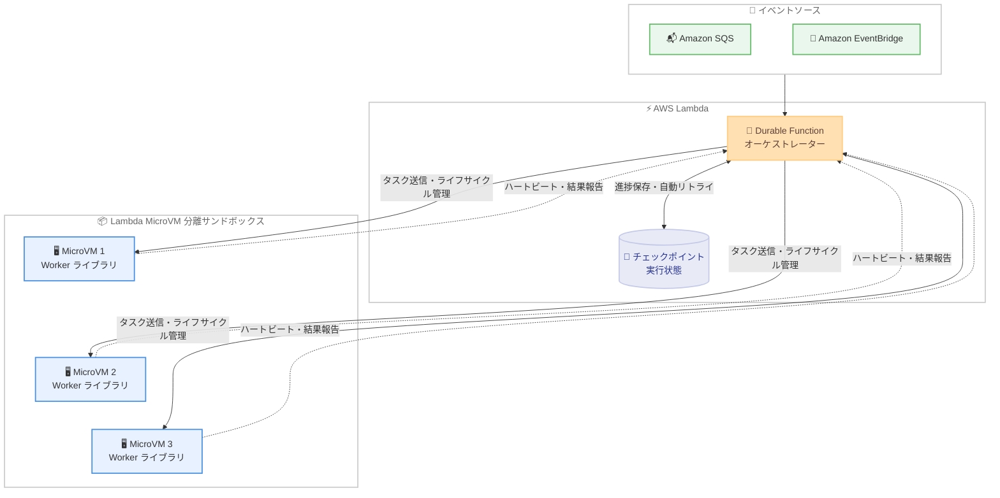

# AWS Lambda - Lambda durable functions による MicroVM オーケストレーション (開発者プレビュー)

**リリース日**: 2026 年 11 月 25 日
**サービス**: AWS Lambda
**機能**: Lambda durable functions による Lambda MicroVM のオーケストレーション (開発者プレビュー)

📊 [このアップデートのインフォグラフィックを見る](https://takech9203.github.io/aws-news-summary/20261125-lambda-durable-microvm.html)

## 概要

AWS は、Lambda durable functions から Lambda MicroVM をオーケストレーションできる AWS Durable Execution SDK の拡張機能 (extensions) を開発者プレビューとして発表しました。この拡張機能は、MicroVM 上でタスクを実行するための durable オペレーションと、MicroVM のライフサイクル管理機能を追加します。

Lambda durable functions は、最長 1 年間実行可能なワークフローをコードで記述でき、チェックポイントと自動リトライが組み込まれた機能です。一方、Lambda MicroVM は VM レベルの分離とほぼ瞬時の起動・再開を提供するサーバーレスコンピュートプリミティブです。今回の拡張機能により、この 2 つを組み合わせて、durable function が MicroVM のライフサイクル全体を管理し、各タスクを durable オペレーションとして実行できるようになります。進捗のチェックポイント、失敗したタスクのリトライ、MicroVM トークンのリフレッシュは durable function 側が自動的に処理します。

主な対象ユーザーは、ソフトウェアファクトリー、セキュリティスキャナー、CI/CD ジョブなど、信頼できないコードや AI エージェントが生成したコードを分離されたサンドボックスで実行する必要がある開発者です。

**アップデート前の課題**

このアップデート以前は、MicroVM を使った長時間ワークフローの構築に次のような課題がありました。

- MicroVM の起動、監視、終了といったライフサイクル管理を自前のオーケストレーションロジックで実装する必要があった
- タスクが失敗した場合のリトライや、処理の途中状態の保存 (チェックポイント) を独自に作り込む必要があった
- 複数の MicroVM を並列に調整する処理や、長時間実行時の認証トークンのリフレッシュを自分で管理する必要があった

**アップデート後の改善**

今回のアップデートにより、以下が可能になりました。

- durable function の durable オペレーションとして MicroVM 上のタスク実行とライフサイクル管理を記述できるようになった
- チェックポイント、失敗タスクの自動リトライ、MicroVM トークンのリフレッシュが durable function によって自動的に処理されるようになった
- 単一タスクの実行に加え、複数タスクでファイルとメモリを共有するセッションモードが利用できるようになった
- 1 つの durable function から複数の MicroVM を並列にオーケストレーションできるようになった

## アーキテクチャ図



Amazon SQS や Amazon EventBridge などのイベントをトリガーに durable function が起動し、複数の MicroVM を並列にオーケストレーションします。durable function は進捗をチェックポイントに保存しながら、失敗タスクのリトライやトークンリフレッシュを自動的に処理します。

## サービスアップデートの詳細

### 主要機能

1. **MicroVM 向け durable オペレーション**
   - MicroVM 上でのタスク実行と MicroVM のライフサイクル管理を durable オペレーションとして記述可能
   - durable function が進捗のチェックポイント、失敗したタスクのリトライ、MicroVM トークンのリフレッシュを自動処理
   - オーケストレーションロジックを通常のコードとして記述できるため、独自のステート管理が不要

2. **2 つのタスク実行モード**
   - 個別タスクモード: 単一のタスクを MicroVM 上で実行
   - セッションモード: 複数のタスクが同一の MicroVM 上でファイルとメモリを共有しながら実行
   - ビルドの中間成果物を引き継ぐ CI/CD パイプラインなど、状態を保持したい処理に有効

3. **並列オーケストレーション**
   - 1 つの durable function から複数の MicroVM を同時に調整可能
   - 大量のスキャン対象やビルドジョブを並列化して処理時間を短縮

4. **イベント駆動連携**
   - Amazon SQS や Amazon EventBridge などのイベントソースと連携して起動可能
   - キューに投入されたジョブを順次 MicroVM で処理するワーカーパターンを構築できる

5. **Worker ライブラリ (オプション)**
   - MicroVM イメージ内にインストールして使用するライブラリ
   - タスクの受信、ハートビートの送信、結果の報告を担当
   - JS/TS 版と Python 版が GitHub で提供されている

## 技術仕様

### 提供形態

| 項目 | 詳細 |
|------|------|
| 提供ステータス | 開発者プレビュー (本番ワークロードでの利用は非推奨) |
| 対応言語 | TypeScript、Python |
| 提供パッケージ | AWS Durable Execution SDK の extensions パッケージ (GitHub) |
| Worker ライブラリ | aws-durable-execution-sdk-js-compute-worker / aws-durable-execution-sdk-python-compute-worker |
| 実行時間 | durable functions の仕様に準拠 (最長 1 年、チェックポイント・自動リトライ内蔵) |
| 分離レベル | MicroVM による VM レベルの分離 |

### API 変更履歴

今回のアップデートは AWS Durable Execution SDK の拡張パッケージとして提供されるものであり、この発表に伴う Lambda サービス API の新規追加は AWS API Changes では確認されていません。なお、関連サービスである Lambda MicroVMs では、2026 年 11 月 20 日に KMS カスタマーマネージドキー対応に伴う API 更新 ([lambda](https://awsapichanges.com/archive/changes/e9d2b3-lambda.html)、7 updated api methods) が行われています。

## 設定方法

### 前提条件

1. Lambda durable functions と Lambda MicroVMs の両方が利用可能なリージョンであること
2. TypeScript または Python で durable function を開発していること
3. MicroVM イメージの作成と実行に必要な IAM 権限が設定されていること

### 手順

#### ステップ 1: SDK extensions パッケージの導入

```bash
# TypeScript の場合 (パッケージ名は GitHub リポジトリを参照)
npm install @aws/durable-execution-sdk-js-extensions
```

durable function のプロジェクトに、MicroVM オーケストレーション用の durable オペレーションを提供する extensions パッケージを追加します。正確なパッケージ名とバージョンは GitHub リポジトリ (aws-durable-execution-sdk-js / aws-durable-execution-sdk-python) を確認してください。

#### ステップ 2: MicroVM イメージへの Worker ライブラリの組み込み (オプション)

```bash
# Python の場合 (パッケージ名は GitHub リポジトリを参照)
pip install aws-durable-execution-sdk-python-compute-worker
```

タスクの受信、ハートビート送信、結果報告を行う Worker ライブラリを MicroVM イメージに組み込みます。Worker ライブラリの利用はオプションです。

#### ステップ 3: durable function でオーケストレーションを実装

durable function のコード内で、extensions が提供する durable オペレーションを使用して MicroVM の起動、タスクの実行 (個別タスクまたはセッション)、終了を記述します。実装の詳細は GitHub の examples パッケージにあるサンプルアプリケーションを参照してください。

## メリット

### ビジネス面

- **開発工数の削減**: MicroVM のライフサイクル管理、リトライ、状態管理の作り込みが不要になり、ビジネスロジックの開発に集中できる
- **AI エージェント活用の安全性向上**: エージェントが生成したコードを VM レベルで分離されたサンドボックスで実行でき、セキュリティリスクを低減できる
- **スケーラブルなジョブ処理基盤**: ソフトウェアファクトリーや CI/CD など、大量のジョブを扱う基盤をサーバーレスで構築できる

### 技術面

- **耐久性のあるオーケストレーション**: チェックポイントと自動リトライにより、長時間ワークフローが障害から自動復旧できる
- **柔軟な実行モデル**: 個別タスクとセッションの 2 モードにより、ステートレスな処理と状態共有が必要な処理の両方に対応できる
- **並列処理**: 1 つの durable function から複数の MicroVM を同時に制御でき、スループットを向上できる
- **イベント駆動アーキテクチャとの統合**: Amazon SQS や Amazon EventBridge と組み合わせて疎結合な構成を実現できる

## デメリット・制約事項

### 制限事項

- 開発者プレビューのため、機能が変更される可能性があり、本番ワークロードでの利用は推奨されない
- 対応言語は TypeScript と Python に限定される
- Lambda durable functions と Lambda MicroVMs の両方が利用可能なリージョンでのみ使用できる

### 考慮すべき点

- プレビュー期間中は仕様変更に追従する必要があるため、検証環境での評価から始めることが推奨される
- 発表時点では料金に関する記載がないため、durable functions と MicroVMs それぞれの課金体系を事前に確認する必要がある
- Worker ライブラリを使用する場合は MicroVM イメージの再ビルドと管理が必要になる

## ユースケース

### ユースケース 1: AI エージェント生成コードの安全な実行基盤

**シナリオ**: AI コーディングエージェントが生成したコードを、本番環境や開発者の環境から分離した場所でビルド・テストしたい。

**実装例**:
```
1. エージェントがコードを生成し、Amazon SQS にジョブを送信
2. durable function がジョブを受信し、MicroVM を起動
3. セッションモードでビルドとテストを順次実行 (ファイル・メモリを共有)
4. 結果を report し、MicroVM を終了
```

**効果**: VM レベルの分離により、信頼できないコードが他のワークロードへ影響を与えるリスクを排除しながら、自動リトライで安定したパイプラインを実現できる。

### ユースケース 2: 大規模セキュリティスキャナー

**シナリオ**: 多数のリポジトリやアーティファクトに対して、マルウェアスキャンや脆弱性スキャンを並列実行したい。

**実装例**:
```
1. スキャン対象リストをもとに durable function がスキャンジョブを分割
2. 複数の MicroVM を並列に起動し、各 MicroVM に個別タスクとしてスキャンを割り当て
3. Worker ライブラリがハートビートを送信し、進捗を durable function が追跡
4. 失敗したスキャンは自動リトライし、全結果を集約
```

**効果**: 並列オーケストレーションにより大量の対象を短時間で処理でき、チェックポイントにより長時間のスキャンバッチも途中から再開できる。

### ユースケース 3: サーバーレス CI/CD ジョブ実行

**シナリオ**: ビルドサーバーを常時稼働させずに、コミットをトリガーとした CI/CD ジョブを分離環境で実行したい。

**実装例**:
```
1. リポジトリのイベントを Amazon EventBridge 経由で durable function に連携
2. MicroVM をほぼ瞬時に起動し、セッションモードでビルド、テスト、パッケージングを実行
3. 各ステップの完了をチェックポイントに記録
4. ジョブ完了後に MicroVM を終了し、アイドルコストを排除
```

**効果**: 常時稼働のビルドインフラが不要になり、ジョブ単位の分離とコスト効率を両立できる。

## 料金

発表時点では、この拡張機能に固有の料金に関する記載はありません。Lambda durable functions および Lambda MicroVMs それぞれの料金体系が適用されると考えられるため、利用前に AWS Lambda の料金ページで最新の課金情報を確認してください。

## 利用可能リージョン

Lambda durable functions と Lambda MicroVMs の両方が利用可能なすべてのリージョンで使用できます。各機能の対応リージョンは、それぞれの製品ページおよびドキュメントを確認してください。

## 関連サービス・機能

- **Lambda durable functions**: 最長 1 年間実行できるワークフローをチェックポイントと自動リトライ付きで記述できる Lambda の機能。本拡張機能のオーケストレーション基盤
- **Lambda MicroVMs**: VM レベルの分離とほぼ瞬時の起動・再開を提供するサーバーレスコンピュートプリミティブ。タスクの実行環境
- **Amazon SQS**: ジョブキューとして durable function のトリガーに利用可能
- **Amazon EventBridge**: イベント駆動で durable function を起動するイベントバスとして利用可能
- **AWS Step Functions**: 同様にワークフローオーケストレーションを提供するサービス。コード中心で MicroVM と密結合したオーケストレーションを行いたい場合に本機能が選択肢となる

## 参考リンク

- 📊 [インフォグラフィック](https://takech9203.github.io/aws-news-summary/20261125-lambda-durable-microvm.html)
- [公式発表 (What's New)](https://aws.amazon.com/about-aws/whats-new/2026/11/lambda-durable-microvm/)
- [Lambda MicroVMs 製品ページ](https://aws.amazon.com/lambda/lambda-microvms/)
- [Lambda durable functions 製品ページ](https://aws.amazon.com/lambda/lambda-durable-functions/)
- [SDK extensions パッケージ (TypeScript)](https://github.com/aws/aws-durable-execution-sdk-js/tree/main/packages/aws-durable-execution-sdk-js-extensions)
- [SDK extensions パッケージ (Python)](https://github.com/aws/aws-durable-execution-sdk-python/tree/main/packages/aws-durable-execution-sdk-python-extensions)
- [MicroVM Worker ライブラリ (JS/TS)](https://github.com/aws/aws-durable-execution-sdk-js/tree/main/packages/aws-durable-execution-sdk-js-compute-worker)
- [MicroVM Worker ライブラリ (Python)](https://github.com/aws/aws-durable-execution-sdk-python/tree/main/packages/aws-durable-execution-sdk-python-compute-worker)
- [サンプルアプリケーション (examples パッケージ)](https://github.com/aws/aws-durable-execution-sdk-js/tree/main/packages/aws-durable-execution-sdk-js-examples)

## まとめ

Lambda durable functions と Lambda MicroVMs を組み合わせることで、信頼できないコードや AI エージェント生成コードを分離サンドボックスで実行する長時間ワークフローを、独自のオーケストレーション基盤なしで構築できるようになりました。ソフトウェアファクトリー、セキュリティスキャナー、CI/CD 基盤を検討しているチームは、GitHub のサンプルアプリケーションを使った検証から始めることを推奨します。開発者プレビューのため、本番適用は GA を待ち、仕様変更の動向を注視してください。
