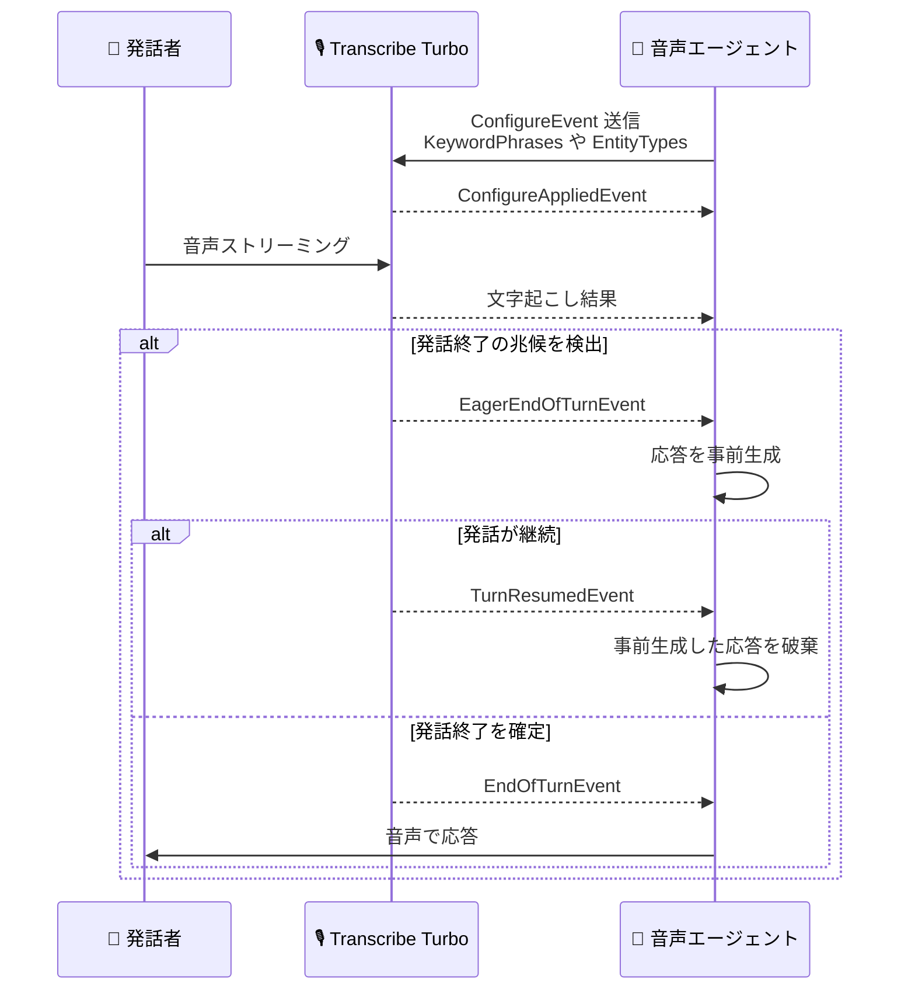

# Amazon Transcribe - Transcribe Turbo (パブリックプレビュー)

**リリース日**: 2026 年 11 月 25 日
**サービス**: Amazon Transcribe
**機能**: Amazon Transcribe Turbo (次世代音声認識モデルと音声エージェント向け機能)

📊 [このアップデートのインフォグラフィックを見る](https://takech9203.github.io/aws-news-summary/20261125-transcribe-turbo-preview.html)

## 概要

AWS は、Amazon Transcribe の次世代音声認識モデル「Amazon Transcribe Turbo」のパブリックプレビューを発表しました。Transcribe Turbo はバッチ処理とストリーミング処理の両方に対応し、ストリーミングでは英語で約 14%、その他の対応言語で約 11% の単語誤り率 (WER) の相対的な改善、バッチでは約 16% の単語誤り率の改善を実現します。また、数値、日付、通貨、電話番号、住所などのフォーマット精度も 20 ポイント以上向上しています。

さらに、音声エージェント (ボイスエージェント) 向けの新機能として「セマンティックターンテイキング」と「ランタイム ASR ヒント」の 2 つが追加されました。セマンティックターンテイキングは、無音時間だけでなく発話の意味と韻律から話者の発話終了を判定し、約 615 ミリ秒の応答時間と 5% の割り込み率を実現します。ランタイム ASR ヒントは、会話のターンごとに期待される語彙やエンティティタイプをクライアントアプリケーションから送信できる機能です。

本アップデートは、コンタクトセンターの自動応答、音声アシスタント、リアルタイム文字起こしなどを構築する開発者にとって重要なアップデートです。ベースモデルの利用に API、コード、SDK の変更は不要で、既存のインテグレーションがそのまま動作します。

**アップデート前の課題**

- 従来のモデルでは、ストリーミング認識の単語誤り率やエンティティのフォーマット精度に改善の余地があった
- 発話終了の判定が無音時間 (サイレンスタイムアウト) に依存しており、「はい」「いいえ」などの短い応答でも一定の無音を待つ必要があり、会話が不自然になっていた
- 逆に、話者が考えながら話している途中でエージェントが割り込んでしまうケースがあった
- カスタム語彙はセッション単位の静的な設定であり、会話の文脈 (直前に提示したメニュー選択肢など) に応じてターンごとに認識精度を調整できなかった

**アップデート後の改善**

- ストリーミングで約 14% (英語)、バッチで約 16% の単語誤り率の相対的な改善により、より正確な文字起こしが可能になった
- セマンティックターンテイキングにより、意味と韻律に基づく自然な発話終了判定が可能になり、約 615 ミリ秒の応答時間と 5% の割り込み率を実現した
- ランタイム ASR ヒントにより、ターンごとに文脈情報を送信でき、英語のカスタマーサービスデータにおけるメニュールーティング精度が 87% から 97% に向上した
- ベースモデルは API、コード、SDK の変更なしで利用でき、既存のワークロードをそのまま検証できる

## アーキテクチャ図



セマンティックターンテイキングとランタイム ASR ヒントを利用した音声エージェントの処理フローです。エージェントはターンごとにヒントを送信し、EagerEndOfTurnEvent で応答を事前生成することで低レイテンシーな会話を実現します。

## サービスアップデートの詳細

### 主要機能

1. **次世代音声認識モデル Transcribe Turbo**
   - ストリーミングで英語約 14%、その他の対応言語で約 11% の単語誤り率の相対的な改善
   - バッチで約 16% の単語誤り率の改善 (中国語、日本語、韓国語は約 6% の文字誤り率の改善)
   - 数値、日付、通貨、電話番号、住所などのロケールに応じたフォーマット精度が 20 ポイント以上向上 (エンティティの正確なフォーマット率は約 53% から約 78% に向上)
   - カスタム語彙に対応し、英語では約 40% の単語誤り率の改善
   - ベースモデルの利用に API、コード、SDK の変更は不要

2. **セマンティックターンテイキング (EndOfTurnDetection)**
   - 無音時間だけでなく、発話の意味と韻律に基づいて発話終了を判定
   - 文の途中での割り込みを回避しつつ、「はい」「いいえ」などの短い応答ではサイレンスタイムアウトを待たずに即座に応答可能
   - 約 615 ミリ秒の応答時間と 5% の割り込み率を実現し、しきい値はチューニング可能
   - EagerEndOfTurnEvent により、発話終了の兆候を早期に通知し、エージェント側で応答を事前生成可能

3. **ランタイム ASR ヒント (ConfigureEvent)**
   - セッション単位の静的なカスタム語彙とは異なり、会話のターンごとに文脈情報を送信可能
   - 直前に提示したメニュー選択肢、期待される名前、期待されるエンティティタイプ (日付、通貨など) をヒントとして指定
   - 英語のカスタマーサービスデータにおいて、メニュールーティング精度が 87% から 97% に向上
   - 音声エージェント向け機能はローンチ時点で英語に対応し、その他の言語は 2026 年 12 月末までに対応予定

## 技術仕様

### 対応言語と提供状況

| モード | 言語 | 提供状況 |
|------|------|------|
| バッチ | 英語 | GA (ほとんどの AWS リージョン) |
| バッチ | ポルトガル語、フランス語、イタリア語、ドイツ語、スペイン語、中国語、日本語、韓国語、アラビア語 | プレビュー (米国東部オハイオ) |
| ストリーミング | 英語、ポルトガル語、フランス語、イタリア語、ドイツ語、スペイン語 | プレビュー (米国東部オハイオ) |
| ターンテイキング + ASR ヒント | 英語 | プレビュー (米国東部オハイオ) |

### セマンティックターンテイキングのパラメータ

| パラメータ | 用途 | デフォルト |
|------|------|------|
| EndOfTurnThreshold | 発話終了と判定する信頼度のしきい値。上げると割り込みが減少 | 0.60 |
| EagerEndOfTurnThreshold | 発話終了の兆候を早期通知するしきい値。応答の事前生成に利用 | 無効 |
| EndOfTurnTimeout | この秒数の無音が続いた場合に発話終了と判定 | 5 秒 |

### ランタイム ASR ヒントの種類

| ヒントタイプ | 用途 | 上限 |
|------|------|------|
| KeywordPhrases | 直前に提示した選択肢などの短いフレーズ | 10 フレーズ |
| EntityTypes | 期待される回答のエンティティタイプ (SERIAL、CURRENCY など 10 種類) | 1 ターンあたり 1 つ |
| VocabularyPhrases | 製品名や人名などの珍しい語彙 (インラインカスタム語彙) | 200 フレーズ |

### ConfigureEvent の送信例

```json
{ "KeywordPhrases": [ { "Text": "checking" }, { "Text": "savings" }, { "Text": "HELOC" } ] }
```

```json
{ "KeywordPhrases": [], "EntityTypes": ["SERIAL"] }
```

空のリストを送信すると以前の設定がクリアされ、省略したフィールドは以前の設定が維持されます。Transcribe は ConfigureAppliedEvent で設定の適用を通知します。

## 設定方法

### 前提条件

1. AWS アカウントと Amazon Transcribe へのアクセス権限
2. プレビュー機能を利用する場合は米国東部 (オハイオ) リージョンを使用
3. ストリーミング機能を利用する場合は AWS SDK (ストリーミング対応)

### 手順

#### ステップ 1: ベースモデルの検証

既存の Transcribe API 呼び出しをそのまま米国東部 (オハイオ) リージョンに向けます。ベースモデルの利用に API、コード、SDK の変更は不要です。プレビューはテストトラフィック向けであり、本番環境での利用は想定されていません。

#### ステップ 2: セマンティックターンテイキングの有効化

ストリーミング開始時に `end-of-turn-detection=true` を設定します。電話番号や口座番号のように区切りながら話す入力が想定される場合は、しきい値を調整します。

```json
{ "EndOfTurnThreshold": 0.9, "EagerEndOfTurnThreshold": 0.6 }
```

EndOfTurnThreshold を高くすることで途中での割り込みを減らし、EagerEndOfTurnThreshold により応答の事前生成を有効化しています。

#### ステップ 3: ランタイム ASR ヒントの送信

エージェントが質問を提示するたびに ConfigureEvent を送信します。

```json
{ "EntityTypes": ["CURRENCY"] }
```

この例では、次の発話で金額が話されることをヒントとして送信しており、認識結果に通貨記号が付与されるなど適切なフォーマットが適用されます。イベントフローの実装例は AWS のサンプルリポジトリ (GitHub) を参照してください。

## メリット

### ビジネス面

- **顧客体験の向上**: 自然なターンテイキングにより、音声エージェントとの会話が人間同士の会話に近づき、顧客満足度の向上が期待できる
- **追加コストなし**: Turbo モデルと音声エージェント向け機能は、標準の Transcribe 料金に対する追加料金なしで利用できる
- **ルーティング精度の向上**: メニュールーティング精度が 87% から 97% に向上し、誤転送やリトライによるオペレーションコストを削減できる

### 技術面

- **移行コストの低さ**: ベースモデルは API、コード、SDK の変更なしで利用でき、既存ワークロードの検証が容易
- **低レイテンシー**: 約 615 ミリ秒の応答時間と EagerEndOfTurnEvent による応答の事前生成で、体感レイテンシーを短縮できる
- **ターン単位の文脈制御**: 静的なカスタム語彙では実現できなかった、会話の文脈に応じた動的な認識精度の調整が可能

## デメリット・制約事項

### 制限事項

- プレビュー機能は米国東部 (オハイオ) リージョンのみで提供され、テストトラフィック向けであり本番利用は想定されていない
- 音声エージェント向け機能 (ターンテイキング、ASR ヒント) はローンチ時点で英語のみ対応 (その他の言語は 2026 年 12 月末までに対応予定)
- ランタイム ASR ヒントには上限がある (KeywordPhrases は 10 フレーズ、EntityTypes は 1 ターンあたり 1 つ、VocabularyPhrases は 200 フレーズ)
- プレビュー段階では話者識別 (Speaker Diarization) と自動言語識別は無効であり、GA 時に有効化される予定

### 考慮すべき点

- EndOfTurnThreshold のチューニングはユースケースに依存する。しきい値設定により途中での打ち切りは 2% から 10% の範囲で変動するため、実際の会話データでの検証が必要
- EagerEndOfTurnEvent を利用した応答の事前生成では、TurnResumedEvent 受信時に事前生成した応答を破棄する実装が必要
- バッチの英語はすでに Turbo で GA となっているが、その他の言語やストリーミングの GA は 2026 年 12 月に予定されており、本番導入のスケジュールに考慮が必要

## ユースケース

### ユースケース 1: コンタクトセンターの音声エージェント

**シナリオ**: 銀行のコンタクトセンターで、口座種別の選択、口座番号の聞き取り、金額の確認を行う自動音声エージェントを構築する。

**実装例**:
```json
{ "KeywordPhrases": [ { "Text": "checking" }, { "Text": "savings" }, { "Text": "HELOC" } ] }
{ "KeywordPhrases": [], "EntityTypes": ["SERIAL"] }
{ "EntityTypes": ["CURRENCY"] }
```

**効果**: メニュールーティング精度が 87% から 97% に向上し、10 桁の口座番号が電話番号形式ではなく `4417209381` のような連続した数字として正しくフォーマットされる。

### ユースケース 2: 低レイテンシーな音声アシスタント

**シナリオ**: 音声アシスタントで、ユーザーの発話終了後すぐに応答を返したいが、途中での割り込みは避けたい。

**実装例**:
```json
{ "EndOfTurnThreshold": 0.9, "EagerEndOfTurnThreshold": 0.6 }
```

**効果**: EagerEndOfTurnEvent で応答を事前生成し、EndOfTurnEvent の受信後すぐに応答を再生することで、約 615 ミリ秒の応答時間と低い割り込み率を両立できる。

### ユースケース 3: 多言語コンテンツのバッチ文字起こし

**シナリオ**: 会議録画やポッドキャストなどの音声コンテンツを複数言語でバッチ文字起こしし、精度を改善したい。

**実装例**:
```
既存のバッチ文字起こしジョブを米国東部 (オハイオ) リージョンで実行
英語はすでに GA のため、ほとんどのリージョンで Turbo が適用済み
```

**効果**: バッチで約 16% の単語誤り率の改善 (日本語、中国語、韓国語は約 6% の文字誤り率の改善) と、数値や日付などのフォーマット精度の向上が得られる。

## 料金

Transcribe Turbo モデルおよび音声エージェント向け機能 (セマンティックターンテイキング、ランタイム ASR ヒント) は、標準の Amazon Transcribe 料金に対する追加料金なしで利用できます。料金の詳細は Amazon Transcribe の料金ページを参照してください。

## 利用可能リージョン

- **バッチ (英語)**: ほとんどの AWS リージョンで GA (すでに Turbo が適用)
- **プレビュー機能 (ストリーミング、英語以外のバッチ、音声エージェント向け機能)**: 米国東部 (オハイオ) リージョン
- その他リージョンでの GA は 2026 年 12 月に予定

## 関連サービス・機能

- **Amazon Connect**: コンタクトセンターサービス。Transcribe のリアルタイム文字起こしと組み合わせて音声エージェントを構築できる
- **Amazon Bedrock**: 生成 AI 基盤サービス。文字起こし結果を LLM に渡して応答を生成する音声エージェントのバックエンドとして利用できる
- **Amazon Polly**: テキスト読み上げサービス。音声エージェントの応答音声の生成に利用できる

## 参考リンク

- 📊 [インフォグラフィック](https://takech9203.github.io/aws-news-summary/20261125-transcribe-turbo-preview.html)
- [公式発表 (What's New)](https://aws.amazon.com/about-aws/whats-new/2026/11/transcribe-turbo-preview/)
- [AWS Builder Center 記事: Getting started with Amazon Transcribe Turbo and voice agent features](https://builder.aws.com/content/3MbnTQKvOMxTZQbm34D6XV7hv8q/getting-started-with-amazon-transcribe-turbo-and-voice-agent-features)
- [サンプルコード (GitHub)](https://github.com/aws-samples/amazon-ai-samples/tree/main/speech-to-text/turbo/features/javascript)
- [Amazon Transcribe 製品ページ](https://aws.amazon.com/transcribe/)
- [料金ページ](https://aws.amazon.com/transcribe/pricing/)

## まとめ

Amazon Transcribe Turbo は、認識精度の大幅な改善に加え、セマンティックターンテイキングとランタイム ASR ヒントという音声エージェント構築に直結する機能を追加料金なしで提供する重要なアップデートです。ベースモデルは API 変更なしで利用できるため、まずは米国東部 (オハイオ) リージョンでテストトラフィックを流し、既存ワークロードでの精度改善を検証することを推奨します。音声エージェントを構築している場合は、EndOfTurnDetection と ConfigureEvent の活用により会話品質の大幅な向上が期待できます。
