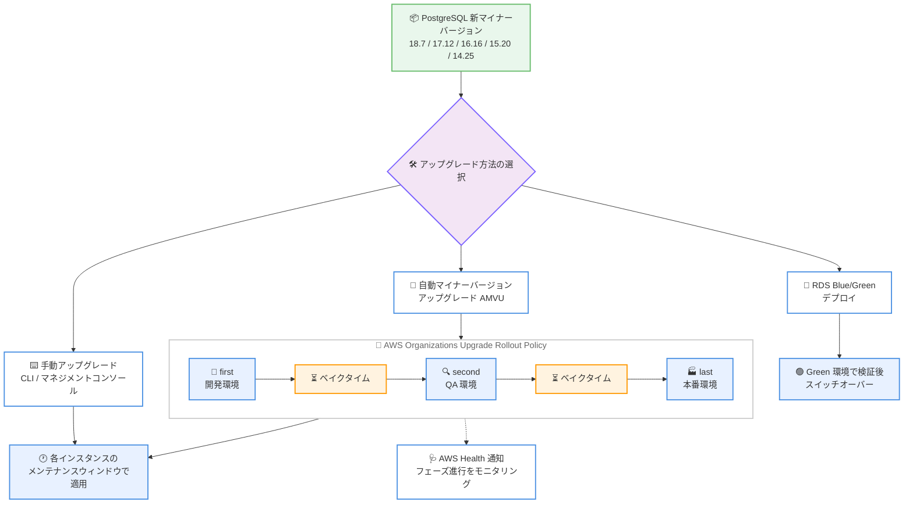

# Amazon RDS for PostgreSQL - マイナーバージョン 18.7、17.12、16.16、15.20、14.25 のサポート

**リリース日**: 2026 年 11 月 26 日
**サービス**: Amazon RDS for PostgreSQL
**機能**: PostgreSQL 最新マイナーバージョン (18.7 / 17.12 / 16.16 / 15.20 / 14.25) のサポート

📊 [このアップデートのインフォグラフィックを見る](https://takech9203.github.io/aws-news-summary/20261126-amazon-rds-postgresql-18-7-17-12-16-16-15-20-14-25.html)

## 概要

Amazon RDS for PostgreSQL が、PostgreSQL コミュニティの最新マイナーバージョン 18.7、17.12、16.16、15.20、14.25 をサポートしました。これらのバージョンは、PostgreSQL コミュニティが 2026 年 11 月 12 日にリリースしたマイナーリリースに対応するもので、過去バージョンに存在する CVE (共通脆弱性識別子) への対処と、コミュニティによる多数のバグ修正・改善が含まれています。

今回のコミュニティリリースは、約 45 件の CVE を修正するセキュリティ色の強いリリースです。複合型の同時変更に起因する問題への広範な防御 (CVE-2026-6460)、権限チェックの不備や RLS (行レベルセキュリティ) のバイパス、use-after-free やバッファオーバーランによるメモリ破壊、pg_dump / vacuumdb / reindexdb などにおける SQL インジェクションの修正が含まれます。AWS は、これらの CVE に対処するため、最新マイナーバージョンへのアップグレードを推奨しています。

アップグレード手段として、メンテナンスウィンドウ中の自動マイナーバージョンアップグレード (AMVU)、AWS Organizations の Upgrade Rollout Policy による段階的ロールアウト、ダウンタイムを最小化する RDS Blue/Green デプロイが利用できます。RDS for PostgreSQL を運用するすべてのユーザーが対象です。

**アップデート前の課題**

このアップデート以前には、以下の課題がありました。

- 既存のマイナーバージョンには、PostgreSQL コミュニティが修正した約 45 件の CVE に該当する脆弱性が残存していた
- bpchar 列の btree インデックスや GIN インデックス、pg_trgm GiST インデックスなどが破損し得るバグが未修正だった
- hash right semi-join による行の重複や、レプリケーション遅延の誤報告など 50 件超のバグが残っていた

**アップデート後の改善**

今回のアップデートにより、以下が可能になりました。

- 最新マイナーバージョンへアップグレードすることで、既知の CVE に対処できる
- 50 件を超えるコミュニティのバグ修正と安定性改善を取り込める
- AMVU、Upgrade Rollout Policy、Blue/Green デプロイを組み合わせて、環境の重要度に応じた安全なアップグレード戦略を実行できる

## アーキテクチャ図



新マイナーバージョンへのアップグレード経路を示した図です。AMVU と Upgrade Rollout Policy を組み合わせると、開発環境から本番環境へ段階的にロールアウトでき、Blue/Green デプロイではダウンタイムを最小化できます。

## サービスアップデートの詳細

### 主要機能

1. **最新マイナーバージョンのサポート**
   - PostgreSQL 18.7、17.12、16.16、15.20、14.25 が RDS for PostgreSQL で利用可能
   - PostgreSQL コミュニティが 2026 年 11 月 12 日にリリースしたマイナーバージョンに対応
   - 既知の CVE への対処と 50 件超のバグ修正を含む

2. **自動マイナーバージョンアップグレード (AMVU)**
   - 「Auto minor version upgrade」オプションを有効にすると、メンテナンスウィンドウ中に自動的にアップグレードが実行される
   - アップグレード時には、事前チェック、エンジンのアップグレード、事後チェックが順に実行される
   - 重大なセキュリティ問題がある場合やサポート終了日を迎えた場合、AMVU が無効でも RDS がマイナーバージョンアップグレードを適用することがある

3. **AWS Organizations Upgrade Rollout Policy による段階的ロールアウト**
   - 複数アカウント・複数リソースにまたがる AMVU を、first (開発)、second (QA、デフォルト)、last (本番) の 3 段階の順序で制御できる
   - 各フェーズの間にベイクタイム (検証期間) が設けられ、下位環境で問題がないことを確認してから重要な環境に進められる
   - アカウント単位のポリシーまたはリソースタグで順序を定義し、AWS Health 通知と RDS イベント通知で進行状況をモニタリングできる

4. **RDS Blue/Green デプロイによるダウンタイム最小化**
   - 本番環境 (Blue) のコピーとして Green 環境を作成し、Green 側でアップグレードと検証を実施した後にスイッチオーバーする
   - エンジンアップグレードに伴うダウンタイムを最小化できる

## 技術仕様

### サポートされるバージョン

| メジャーバージョン | 今回の最新マイナーバージョン | コミュニティサポート終了日 |
|------|------|------|
| PostgreSQL 18 | 18.7 | 2030 年 11 月 14 日 |
| PostgreSQL 17 | 17.12 | 2029 年 11 月 8 日 |
| PostgreSQL 16 | 16.16 | 2028 年 11 月 9 日 |
| PostgreSQL 15 | 15.20 | 2027 年 11 月 11 日 |
| PostgreSQL 14 | 14.25 | 2026 年 11 月 12 日 (サポート終了済み、14.25 が最終リリース) |

### 今回のコミュニティリリースに含まれる主な修正 (PostgreSQL 18.7 リリースノートより)

| 分類 | 内容 |
|------|------|
| 複合型の同時変更への防御 | CVE-2026-6460 ほか。複合型をデータ操作と同時に変更した場合の問題に対する広範な防御を導入 |
| 権限・ポリシーのバイパス修正 | ビューに対する INSERT ... ON CONFLICT DO UPDATE の不正な更新 (CVE-2026-16237)、RLS 関連の修正など |
| メモリ安全性の修正 | use-after-free、バッファオーバーラン、整数オーバーフローなど多数の修正 |
| SQL インジェクション対策 | pg_dump、vacuumdb、reindexdb などクライアントツールにおける識別子のクォート不備を修正 |
| インデックス破損の修正 | bpchar 列の btree、GIN、TOAST テーブル、pg_trgm GiST の各インデックス破損バグを修正 (影響を受けるインデックスは REINDEX を推奨) |
| その他 | プランナーの大規模な修正、スタンバイでの並列 pg_dump に関するデータ整合性修正、tzdata 2026f への更新など |

### アップグレード方法の比較

| 方法 | 特徴 | 適した用途 |
|------|------|------|
| AMVU | メンテナンスウィンドウ中に自動適用。ダウンタイムあり | 常に最新のマイナーバージョンを維持したい環境 |
| Upgrade Rollout Policy | first / second / last の 3 段階 + ベイクタイムで段階的に適用 | マルチアカウントで大規模な DB フリートを運用する組織 |
| Blue/Green デプロイ | Green 環境で検証後にスイッチオーバー。ダウンタイムを最小化 | ダウンタイム要件が厳しい本番環境 |
| 手動アップグレード | CLI / コンソールから任意のタイミングで適用 | バージョンとタイミングを厳密に管理したい環境 |

## 設定方法

### 前提条件

1. RDS for PostgreSQL DB インスタンスが稼働していること
2. Upgrade Rollout Policy を使用する場合、AWS Organizations の組織に参加し、ポリシーが有効化されていること
3. Blue/Green デプロイを使用する場合、対象インスタンスが Blue/Green デプロイの要件を満たしていること

### 手順

#### ステップ 1: 利用可能なアップグレードターゲットの確認

```bash
aws rds describe-db-engine-versions \
    --engine postgres \
    --engine-version 17.11 \
    --query "DBEngineVersions[*].ValidUpgradeTarget[*].{AutoUpgrade:AutoUpgrade,EngineVersion:EngineVersion}" \
    --output table
```

現在のエンジンバージョンからアップグレード可能なバージョンの一覧と、AMVU のターゲットバージョン (AutoUpgrade が True のもの) を確認します。

#### ステップ 2: 手動でのマイナーバージョンアップグレード

```bash
aws rds modify-db-instance \
    --db-instance-identifier mydbinstance \
    --engine-version 17.12 \
    --no-apply-immediately
```

DB インスタンスのエンジンバージョンを 17.12 に変更します。`--no-apply-immediately` を指定すると次回のメンテナンスウィンドウで適用され、`--apply-immediately` を指定すると即時に適用されます。アップグレード中はダウンタイムが発生します。

#### ステップ 3: 自動マイナーバージョンアップグレードの有効化

```bash
aws rds modify-db-instance \
    --db-instance-identifier mydbinstance \
    --auto-minor-version-upgrade \
    --apply-immediately
```

AMVU を有効化します。以降、対象バージョンが AMVU のアップグレードターゲットに指定されると、メンテナンスウィンドウ中に自動でアップグレードされます。

#### ステップ 4: Upgrade Rollout Policy 用のタグ付け (段階的ロールアウトを使う場合)

```bash
aws rds add-tags-to-resource \
    --resource-name arn:aws:rds:ap-northeast-1:123456789012:db:mydbinstance \
    --tags Key=Environment,Value=Development
```

環境を識別するタグをリソースに付与します。Upgrade Rollout Policy でこのタグを参照し、first / second / last のアップグレード順序を割り当てます。ポリシーを設定しないリソースは自動的に second の順序になります。

## メリット

### ビジネス面

- **セキュリティリスクの低減**: 約 45 件の CVE に対処した最新バージョンへ移行することで、脆弱性に起因する事業リスクを低減できる
- **運用負荷の削減**: AMVU と Upgrade Rollout Policy により、大規模な DB フリートのアップグレード作業を自動化・標準化できる
- **サービス継続性の確保**: Blue/Green デプロイによりアップグレードに伴うダウンタイムを最小化できる

### 技術面

- **安定性の向上**: インデックス破損、行の重複、レプリケーション遅延の誤報告など 50 件超のバグ修正を取り込める
- **段階的な検証**: ベイクタイムを挟んだ first / second / last のロールアウトにより、下位環境で問題を検出してから本番環境へ進められる
- **可観測性**: AWS Health 通知と RDS イベント通知 (Amazon EventBridge 連携) でアップグレードキャンペーンの進行状況を追跡できる

## デメリット・制約事項

### 制限事項

- マイナーバージョンアップグレードにはダウンタイムが発生する (長さはエンジンタイプや DB サイズに依存)
- アップグレード中は DB インスタンスのステータスが upgrading となり、変更操作ができない
- AMVU のターゲットは必ずしも最新マイナーバージョンとは限らないため、特定バージョンを維持したい場合は手動アップグレードが必要
- Upgrade Rollout Policy の対象は AMVU が有効なリソースのみで、ポリシーやタグの変更が反映されるまでに伝播時間がかかる

### 考慮すべき点

- PostgreSQL 14 はコミュニティサポートが 2026 年 11 月 12 日に終了しており、14.25 が最終マイナーリリースとなるため、PostgreSQL 15 以降へのメジャーバージョンアップグレード計画が必要
- コミュニティのリリースノートでは、bpchar 列の btree、GIN、TOAST テーブル、pg_trgm GiST の各インデックスに破損の可能性が指摘されており、該当するインデックスは REINDEX の実施を検討する
- Aurora PostgreSQL への移行を予定している場合、RDS 側のバージョンが Aurora で未サポートだと移行が遅延する可能性があるため、AMVU の無効化を早期に検討する
- 重大なセキュリティ問題やサポート終了時には、AMVU を無効にしていても RDS がアップグレードを適用する場合がある

## ユースケース

### ユースケース 1: マルチアカウント環境での段階的な一斉アップグレード

**シナリオ**: AWS Organizations 配下の数十アカウントで数百の RDS for PostgreSQL インスタンスを運用しており、CVE 対応のアップグレードを開発環境から本番環境へ安全に展開したい。

**実装例**:
```bash
# 開発環境のインスタンスに first 相当のタグを付与
aws rds add-tags-to-resource \
    --resource-name arn:aws:rds:ap-northeast-1:123456789012:db:dev-db \
    --tags Key=Environment,Value=Development

# 本番環境のインスタンスに last 相当のタグを付与
aws rds add-tags-to-resource \
    --resource-name arn:aws:rds:ap-northeast-1:123456789012:db:prod-db \
    --tags Key=Environment,Value=Production
```

**効果**: 開発環境で先行検証し、ベイクタイム中に問題がないことを確認してから QA、本番環境へ進むため、組織全体のアップグレードリスクを最小化できる。問題を検出した場合は後続環境の AMVU を無効化して展開を停止できる。

### ユースケース 2: ダウンタイム要件が厳しい本番 DB の CVE 対応

**シナリオ**: 24 時間稼働のサービスを支える本番 DB で、メンテナンスウィンドウの停止時間を確保しづらいが、CVE 対応のため速やかに 17.12 へアップグレードしたい。

**実装例**:
```bash
aws rds create-blue-green-deployment \
    --blue-green-deployment-name pg-17-12-upgrade \
    --source arn:aws:rds:ap-northeast-1:123456789012:db:prod-db \
    --target-engine-version 17.12
```

**効果**: Green 環境でアップグレード後の動作を事前検証し、準備が整った時点でスイッチオーバーすることで、ダウンタイムを最小限に抑えながら CVE に対処できる。

### ユースケース 3: PostgreSQL 14 からのメジャーバージョンアップグレード計画

**シナリオ**: PostgreSQL 14 系のインスタンスを運用しているが、コミュニティサポートが終了し 14.25 が最終リリースとなるため、サポート中のバージョンへの移行を計画する。

**実装例**:
```bash
# まず最終マイナーバージョン 14.25 へ更新して既知の CVE に対処
aws rds modify-db-instance \
    --db-instance-identifier legacy-db \
    --engine-version 14.25 \
    --no-apply-immediately

# その後、Blue/Green デプロイで 17 系などへのメジャーバージョンアップグレードを計画
```

**効果**: 当面のセキュリティリスクを 14.25 で解消しつつ、Blue/Green デプロイを利用した計画的なメジャーバージョンアップグレードで、以降もセキュリティ修正を受けられる状態を維持できる。

## 料金

マイナーバージョンアップグレード自体に追加料金はなく、通常の Amazon RDS for PostgreSQL の料金体系 (インスタンス、ストレージ、I/O など) が適用されます。Blue/Green デプロイを使用する場合は、Green 環境の稼働中に追加のインスタンス・ストレージ料金が発生する点に注意してください。

詳細は [Amazon RDS for PostgreSQL 料金ページ](https://aws.amazon.com/rds/postgresql/pricing/) を参照してください。

## 利用可能リージョン

公式発表ではリージョン別の提供状況について、Amazon RDS for PostgreSQL 料金ページで確認するよう案内されています。

## 関連サービス・機能

- **Amazon RDS Blue/Green デプロイ**: 本番環境のコピーで検証してからスイッチオーバーすることで、アップグレードのダウンタイムを最小化する機能
- **AWS Organizations**: Upgrade Rollout Policy により、マルチアカウント環境で AMVU の段階的ロールアウトを制御
- **AWS Health / Amazon EventBridge**: アップグレードキャンペーンの開始、フェーズ遷移、進行状況の通知とイベント連携
- **Amazon Aurora PostgreSQL**: 同じ PostgreSQL 互換のマネージドデータベース。移行予定がある場合は AMVU の設定に注意が必要

## 参考リンク

- 📊 [インフォグラフィック](https://takech9203.github.io/aws-news-summary/20261126-amazon-rds-postgresql-18-7-17-12-16-16-15-20-14-25.html)
- [公式発表 (What's New)](https://aws.amazon.com/about-aws/whats-new/2026/11/amazon-rds-postgresql-18-7-17-12-16-16-15-20-14-25/)
- [ドキュメント: RDS for PostgreSQL DB エンジンのアップグレード](https://docs.aws.amazon.com/AmazonRDS/latest/UserGuide/USER_UpgradeDBInstance.PostgreSQL.html)
- [ドキュメント: AWS Organizations Upgrade Rollout Policy](https://docs.aws.amazon.com/AmazonRDS/latest/UserGuide/RDS.Maintenance.AMVU.UpgradeRollout.html)
- [ドキュメント: Amazon RDS Blue/Green デプロイ](https://docs.aws.amazon.com/AmazonRDS/latest/UserGuide/blue-green-deployments.html)
- [PostgreSQL 18.7 リリースノート (コミュニティ)](https://www.postgresql.org/docs/release/18.7/)
- [PostgreSQL バージョニングポリシー](https://www.postgresql.org/support/versioning/)
- [料金ページ](https://aws.amazon.com/rds/postgresql/pricing/)

## まとめ

今回のマイナーバージョンは約 45 件の CVE に対処するセキュリティ重要度の高いリリースであり、RDS for PostgreSQL を運用するすべての環境で早期のアップグレードが推奨されます。マルチアカウント環境では AWS Organizations の Upgrade Rollout Policy による段階的ロールアウト、ダウンタイム要件が厳しい環境では Blue/Green デプロイの活用を検討してください。また、PostgreSQL 14 はコミュニティサポートが終了し 14.25 が最終リリースとなるため、14 系を利用中の場合はメジャーバージョンアップグレードの計画に着手することを推奨します。
