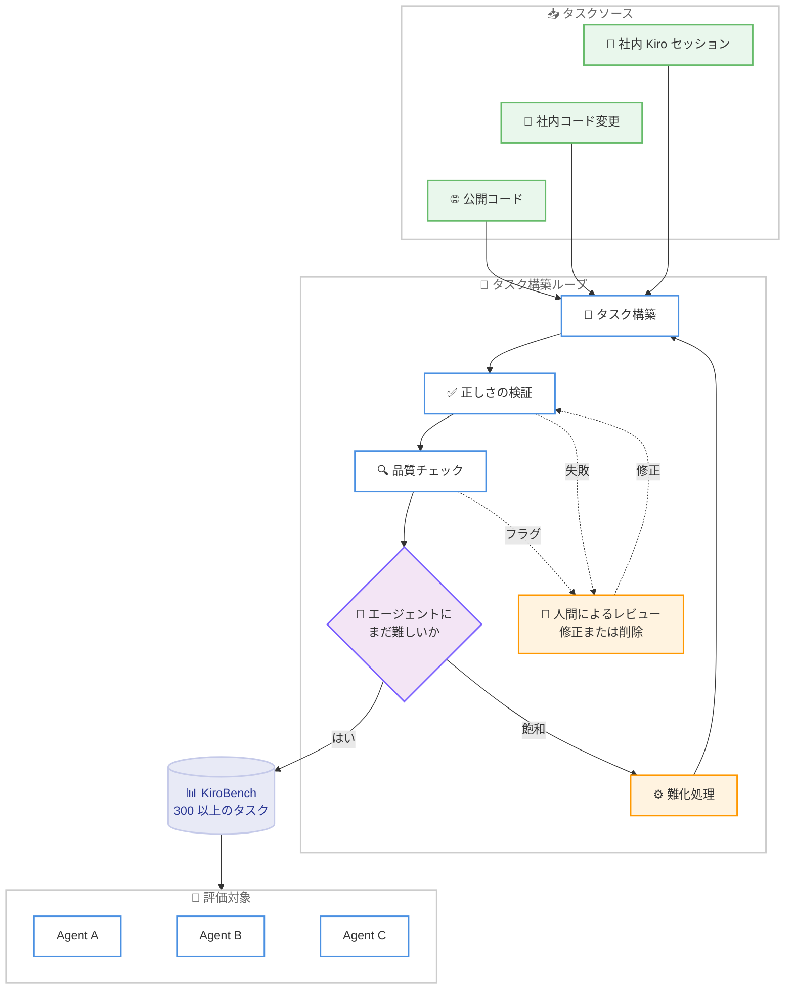

# Kiro - KiroBench: 開発者が Kiro に持ち込む実作業でコーディングエージェントを評価するベンチマーク

**リリース日**: 2026 年 11 月 26 日
**サービス**: Kiro
**機能**: KiroBench (コーディングエージェント評価用の社内ベンチマーク)

📊 [このアップデートのインフォグラフィックを見る](https://takech9203.github.io/aws-news-summary/20261126-kiro-kirobench.html)

## 概要

Kiro チームは、コーディングエージェントを実際の開発業務に基づいて評価する社内ベンチマーク「KiroBench」を公式ブログで公開しました。KiroBench は、機能開発、バグ修正、リファクタリング、コード理解、テスト作成、環境セットアップ、コマンドライン作業など 300 件以上のタスクで構成されており、その多くは Amazon 社内のエンジニアリング業務に由来します。社内コードはどのモデルの学習データにも含まれていないため、学習データ汚染 (コンタミネーション) のない評価が可能です。

各タスクは実行可能な環境として構築され、エージェントの成果物が正しいかどうかを判定する検証器 (Verifier) を備えています。検証方法は、ユニットテストなどの結果ベースの判定と、ルーブリックに基づいて言語モデルが採点するジャッジベースの判定の 2 種類があります。Kiro チームは、ツール、メモリ、コンテキスト管理、モデルルーティング、サブエージェント連携などエージェントへの変更が及ぼす影響を KiroBench で測定し、リグレッションの検出と改善効果の確認に活用しています。

このブログは新機能の発表ではなく、Kiro の品質向上を支える評価基盤の技術解説です。Kiro ユーザーや AI コーディングエージェントの導入を検討する組織にとって、エージェントの品質がどのように測定・改善されているかを理解する上で有用な情報です。

**従来の課題 (公開ベンチマークの限界)**

- 公開ベンチマーク (DeepSWE、Terminal-Bench など) はソフトウェア開発業務の一部しかカバーしておらず、実際の開発者が Kiro に持ち込む多様なユースケース (未知のコードに関する質問、機能追加、ビルド修正、複数ターンにわたる作業など) を網羅できなかった
- ベンチマークが公開されるとタスクと解答が学習データに流入し、リーダーボードへの最適化が進むため、スコアの上昇が実際の能力向上を上回る「コンタミネーションリスク」があった
- 公開リポジトリ上に新しくベンチマークを構築しても、モデルがそのコードベースを既に学習している可能性があり、この問題を完全には回避できなかった

**KiroBench による改善**

- Amazon 社内の実業務 (開発者が提供した Kiro セッション、社内リポジトリにマージされたコード変更) からタスクを構築することで、どのモデルも学習していない未知のタスクで評価できるようになった
- 曖昧な要求、ログからのエラー調査、セッション途中での要件変更など、実業務特有の複雑さを含むタスクで評価できるようになった
- シミュレートされたユーザーが複数ターンにわたって要求を明確化・変更する対話型タスクにより、実際の利用形態に近い評価が可能になった

## アーキテクチャ図

3 つのソースから構築された候補タスクは、構築・検証・品質チェックのループを通過し、エージェントにとってまだ難しいタスクのみが KiroBench に追加されます。失敗したタスクは人間がレビューして修正または削除し、エージェントが毎回解けるようになった飽和タスクは難化処理を経て再投入されます。

## サービスアップデートの詳細

### 主要機能

1. **実業務に基づく 300 件以上のタスク**
   - 機能開発、バグ修正、リファクタリング、コード理解、テスト作成、環境セットアップ、コマンドライン作業をカバー
   - Amazon 社内の Kiro 利用状況を「シナリオ × ドメイン」で分析し、利用が多くカバレッジが薄い領域に優先的にタスクを追加
   - タスクソースは 3 種類: 開発者が提供した社内 Kiro セッション、社内リポジトリにマージされたコード変更 (Rust、Python、TypeScript、Java、Kotlin などをカバー)、公開コードから専門チームが構築したタスク

2. **社内セッションからタスクを生成する 4 ステップのパイプライン**
   - **再構築**: セッション開始時と終了時のワークスペースから環境を再構築する
   - **指示文の作成**: エージェントがセッション内の要求と開始時コードから指示文を作成する。最終コードは見せないため、解答が漏れない
   - **チェックの構築**: 指示文確定後、別のエージェントが最終コードからテストを作成する。各テストは開始時コードでは失敗し、最終コードでは合格する必要がある
   - **ユーザーのシミュレーション**: シミュレートされたユーザーが複数ターンにわたりエージェントと対話する。ゴールを知る判断部と、解答を一切見ないメッセージ作成部に分離されており、解答のヒントが混入しない

3. **3 種類の品質保証チェック**
   - **ベースラインチェック**: 変更なしの提出は必ず失敗し、リファレンス解答は毎回合格することを確認
   - **整合性チェック**: 言語モデルベースの自動品質チェッカーが指示文・テスト・リファレンス解答を照合し、指示にない要件をテストが要求するなどの不整合を検出
   - **リワードハック検出**: エージェントの実行記録 (トラジェクトリ) をレビューし、テストの改ざんや解答の漏洩を利用した不正な合格を検出。同種の問題は DeepSWE や Terminal-Bench 4 などの公開ベンチマークでも発見された

4. **タスクの選定と難化 (ハードニング)**
   - **カバレッジ**: 利用が多くカバレッジが薄いシナリオを埋めるタスクを優先
   - **難易度**: 最強のエージェントでも解けないことがあるタスクのみを維持。フロンティアエージェントが毎回解けるようになったタスクは、元の作業とテストを保持したまま、より大きく現実的なジョブに包み直す (例: バグ報告ではなく未診断の本番アラートとして提示)
   - **分離性能**: 強いモデルほど高い成功率を示すタスクを維持。全フロンティアモデルのスコアが近接する場合はベンチマークとして機能していないと判断

### 測定結果 (KiroBench v1.3.3、2026 年 11 月)

Anthropic モデル 3 種と OpenAI モデル 4 種を、Kiro と各社純正ハーネス (Claude Code / Codex) で比較評価した結果が公開されています。主な知見は以下のとおりです。

- すべてのモデル・ハーネスで、推論努力 (effort) を上げるとトークン消費が増え、合格率が 2〜26 ポイント向上した
- 最高の合格率は 73.6% (Claude Opus 5.5 + Kiro ハーネス + max effort、1 試行あたり 16.6M トークン) で、最良の構成でも 4 分の 1 以上の試行が失敗しており、ベンチマークは飽和していない
- medium / high effort では Claude Opus 5.5 が Claude Sonnet 5.5 を最大 16 ポイント上回り、強いモデルと弱いモデルが明確に分離された
- 各モデルファミリー内では、どちらのハーネスでも medium / high effort におけるモデルの順位が一致しており、評価がハーネスの癖ではなくモデルの能力を反映している

**Kiro ハーネスでの主な結果 (抜粋):**

| モデル | Effort | 合格率 | トークン/試行 |
|--------|--------|--------|---------------|
| Claude Opus 5.5 | medium | 60.3% | 2.19M |
| Claude Opus 5.5 | max | 73.6% | 16.6M |
| Claude Sonnet 5.5 | medium | 44.1% | 816k |
| Claude Sonnet 5.5 | max | 70.1% | 18.7M |
| Claude Haiku 5.5 | max | 52.1% | 17.9M |
| GPT-6.1 Sol | max | 56.5% | 3.55M |
| GPT-5.6 Sol | max | 58.5% | 10.6M |

## 技術仕様

### 評価メトリクス

| メトリクス | 答える問い | 測定方法 |
|-----------|-----------|----------|
| 合格率 (Pass rate) | エージェントの成果物はタスクのチェックに合格したか | 検証に合格した試行の割合 |
| 効率 (Efficiency) | 達成に必要なコストはどれだけか | 試行あたりのトークン数 (= ドルコスト)、実時間、ターン数 |
| 指示追従 (開発中) | 与えられた制約の中で、依頼されたことを実行したか | 言語モデルジャッジが会話内の指示と変更内容を照合 |
| コード品質 (開発中) | 経験豊富なエンジニアがそのまま受け入れる変更か | 言語モデルジャッジがリファレンス解答と比較して採点 |

### タスクの構成要素

| 要素 | 詳細 |
|------|------|
| 指示 (Instruction) | タスクのゴールを記述。解答は含まない |
| 環境 (Environment) | 実行可能な作業環境。開始時のコード、依存関係、設定を再現 |
| 検証器 (Verifier) | 結果ベース (ユニットテスト、E2E テスト) またはジャッジベース (ルーブリックに基づく言語モデル採点、場合によりアンサンブル) |
| ユーザー (User) | 単一プロンプト、または複数ターンで要求を明確化・変更するシミュレートされたユーザー |

## メリット

### ビジネス面

- **エージェント品質の客観的な担保**: Kiro のツール、メモリ、モデルルーティングなどの変更がリグレッションを起こしていないかを継続的に検証でき、ユーザーは安定した品質のエージェントを利用できる
- **コストと性能のバランス評価**: 公開リーダーボード 1 位のモデルでも、コストを加味すると実ワークロードには最適でない場合がある。KiroBench は合格率と効率の両方を測定するため、コスト効率の良いモデル選択 (Auto モデルルーティングなど) の根拠になる
- **透明性の向上**: 評価手法と結果 (v1.3.3) が公開されたことで、ユーザーや導入検討組織が Kiro の品質改善プロセスを理解できる

### 技術面

- **コンタミネーションのない評価**: 非公開の社内コードに基づくタスクにより、モデルが学習済みのコードで水増しされたスコアを排除できる
- **実業務の複雑さを再現**: 曖昧な要求、ログからのデバッグ、セッション途中の要件変更など、実際の開発で発生する複雑さを評価に組み込める
- **継続的な難化メカニズム**: エージェントの進歩に合わせてタスクを難化させるパイプラインにより、ベンチマークの飽和を防ぎ、長期的に有効な測定を維持できる
- **多層的な品質保証**: ベースラインチェック、整合性チェック、リワードハック検出により、見かけ上は正常でも誤ったスコアを返す「壊れたタスク」を排除できる

## デメリット・制約事項

### 制限事項

- KiroBench は社内ベンチマークであり、タスクセット自体は公開されていない (外部からの再現検証はできない)
- 社内業務由来のタスクはホビープロジェクトや珍しいフレームワーク・言語などをカバーしないというトレードオフがある
- 公開コード由来のタスクには依然として一定のコンタミネーションリスクが残る (このため社内業務由来タスクの比率を拡大中)
- 現時点では主にコーディングタスクに焦点を当てており、非コーディング作業 (データ分析、文書作成など) のカバレッジは拡大途上

### 考慮すべき点

- 指示追従とコード品質のメトリクスはまだ開発中であり、現在公開されている結果は合格率と効率のみ
- コードマイグレーション、データ分析、DevOps、複数日にわたるワークフローなどは今後の拡張対象であり、現行バージョンではカバーされていない
- ベンチマーク結果は 2026 年 11 月時点の v1.3.3 によるものであり、タスクセットは継続的に更新される

## ユースケース

### ユースケース 1: エージェント変更のリグレッション検出

**シナリオ**: Kiro のコンテキスト管理やサブエージェント連携の実装を変更すると、予測しにくい振る舞いの変化が発生する。

**活用方法**: 変更前後で KiroBench を実行し、合格率と効率の変化を測定する。

**効果**: リグレッションを本番リリース前に検出し、改善効果のある変更のみを採用できる。

### ユースケース 2: コストを加味したモデル選択・ルーティング

**シナリオ**: 複数のフロンティアモデルから、実ワークロードに対して最適なモデルを選択したい。

**活用方法**: 合格率だけでなくトークン消費 (効率) も測定し、同等の合格率をより少ないコストで達成できる構成を特定する。例えば Claude Sonnet 5.5 が Claude Opus 5.5 の high effort 相当のスコアに到達するには、max effort で大幅に多くのトークンが必要になる。

**効果**: Auto モデルルーティングなどで、コストと性能のバランスが取れたモデル選択を実現できる。

### ユースケース 3: 評価カバレッジの計画的な拡大

**シナリオ**: 開発者の実際の利用パターンに対して、評価タスクが不足している領域を特定したい。

**活用方法**: 社内の Kiro 利用状況を「シナリオ × ドメイン」のヒートマップで分析し、利用が多いのにタスクが少ないセル (例: dev process & tooling やバックエンドにおけるコードレビュー) を特定して次のタスク追加対象とする。

**効果**: 実際の利用分布を反映した、偏りの少ないベンチマークを維持できる。

## 料金

KiroBench は Kiro の品質向上のための社内評価基盤であり、ユーザーが利用・購入する機能ではないため、料金は発生しません。

## 利用可能リージョン

グローバル (Kiro はグローバルに提供されるサービスです)

## 関連サービス・機能

- **Kiro エージェント**: KiroBench はツール、メモリ、コンテキスト管理、モデルルーティング、サブエージェント連携などエージェントの変更を評価するために使用される
- **Auto モデルルーティング**: 合格率と効率の測定結果は、コスト効率を考慮したモデル選択の根拠となる
- **Kiro の継続的評価基盤**: 関連するブログ記事「Lessons learned from one million evaluations」および「Continuous Prompt Evaluation」で評価手法の詳細が解説されている

## 参考リンク

- 📊 [インフォグラフィック](https://takech9203.github.io/aws-news-summary/20261126-kiro-kirobench.html)
- [公式ブログ: Benchmarking coding agents on the work developers bring to Kiro](https://kiro.dev/blog/kirobench/)
- [Kiro Blog](https://kiro.dev/blog/)
- [Kiro 公式サイト](https://kiro.dev/)

## まとめ

KiroBench は、Amazon 社内の実際の開発業務から構築された 300 件以上のタスクで、コーディングエージェントをコンタミネーションなしに評価する社内ベンチマークです。合格率と効率の両面でモデルとハーネスを比較し、最良の構成 (Claude Opus 5.5 + Kiro、max effort) でも合格率は 73.6% と飽和しておらず、エージェントの改善余地を継続的に測定できます。Kiro の導入を検討する組織は、この評価基盤がエージェント品質の継続的な改善を支えている点を、製品選定時の参考情報として活用できます。
