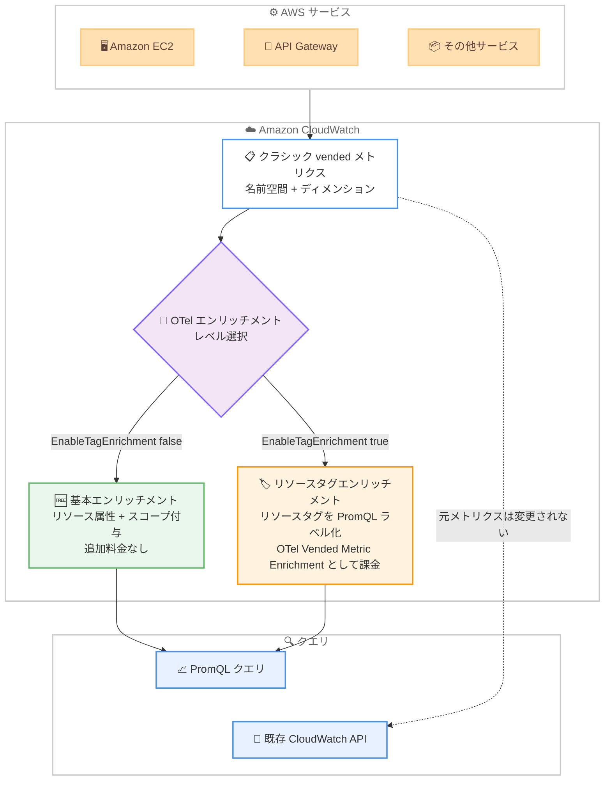

# Amazon CloudWatch - 基本 OpenTelemetry エンリッチメントを追加料金なしで提供

**リリース日**: 2026 年 11 月 27 日
**サービス**: Amazon CloudWatch
**機能**: AWS サービスメトリクスの基本 OpenTelemetry エンリッチメント (Basic OpenTelemetry Enrichment)

📊 [このアップデートのインフォグラフィックを見る](https://takech9203.github.io/aws-news-summary/20261127-amazon-cloudwatch-opentelemetry-enrichment.html)

## 概要

Amazon CloudWatch が、AWS サービスメトリクスに対する基本 OpenTelemetry (OTel) エンリッチメントを追加料金なしで提供開始しました。この機能を有効化すると、AWS サービスが CloudWatch に発行するクラシックな vended メトリクス (例: InstanceId ディメンションを持つ Amazon EC2 の CPUUtilization) が OpenTelemetry データポイントに変換され、PromQL でクエリできるようになります。

エンリッチされたメトリクスには、リソースの ARN (`cloud.resource_id`)、クラウドプロバイダー、リージョン、アカウント ID のリソース属性と、発行元サービスを識別するインストルメンテーションスコープが付与されます。既存の CloudWatch ディメンションはデータポイント属性として保持され、元のクラシックメトリクスは変更されずに既存の CloudWatch API から引き続き利用できます。

さらに、AWS リソースタグを PromQL のラベルとして使用したい場合は、上位レベルのリソースタグエンリッチメント (OTel Vended Metric Enrichment として課金) を選択できます。エンリッチメントのレベルはいつでも切り替え可能です。Prometheus / Grafana エコシステムに慣れた運用チームや、OpenTelemetry 標準で可観測性を統一したい組織にとって、AWS マネージドサービスのメトリクスを追加コストなしで OTel / PromQL の世界に取り込める重要なアップデートです。

**アップデート前の課題**

このアップデート以前には、以下の課題がありました。

- AWS サービスが発行するクラシックな vended メトリクスは CloudWatch 独自の名前空間とディメンションモデルであり、PromQL でそのままクエリできなかった
- OTel 形式でメトリクスを扱うには、各サービスが OTLP エンドポイントへネイティブに送信する一部のメトリクスに限られていた
- メトリクスがどのリソース (ARN) やアカウント、リージョンに属するかを示す標準的なリソース属性が付与されておらず、OTel ベースのツールでの横断分析が困難だった

**アップデート後の改善**

今回のアップデートにより、以下が可能になりました。

- 基本エンリッチメントを追加料金なしで有効化し、クラシック vended メトリクスを OTel データポイントとして PromQL でクエリできるようになった
- ARN、クラウドプロバイダー、リージョン、アカウント ID のリソース属性とインストルメンテーションスコープが自動付与され、OTel 標準での分析が容易になった
- 必要に応じてリソースタグエンリッチメントに切り替え、AWS リソースタグを PromQL ラベルとして活用できるようになった
- CloudWatch Omni のセットアップ時にはデフォルトで有効化され、コンソール、AWS CLI、CloudFormation、Terraform、AWS SDK からも有効化できるようになった

## アーキテクチャ図



AWS サービスが発行するクラシック vended メトリクスは、OTel エンリッチメントにより OTel データポイントへ変換され、PromQL でクエリ可能になります。基本エンリッチメントは無料、リソースタグエンリッチメントは課金対象で、元のクラシックメトリクスは変更されずに既存 API から利用できます。

## サービスアップデートの詳細

### 主要機能

1. **基本エンリッチメント (追加料金なし)**
   - リソース識別子ディメンションを持つクラシック vended メトリクスを OTel データポイントに変換
   - リソース属性としてリソース ARN (`cloud.resource_id`)、クラウドプロバイダー、リージョン、アカウント ID を付与
   - 発行元サービスを識別し OTel エンリッチ済みであることを示すインストルメンテーションスコープを付与
   - 既存の CloudWatch ディメンションはデータポイント属性として保持

2. **リソースタグエンリッチメント (課金対象)**
   - 基本エンリッチメントの内容に加え、各リソースの AWS リソースタグを PromQL ラベルとして付与
   - OTel Vended Metric Enrichment として課金され、1 つ以上のタグラベルが付与されたデータポイントのみが課金対象
   - メトリクスがどの AWS リソースタグにもマッチしない場合、データポイントは無料でパススルーされる
   - 事前にアカウントで resource tags on telemetry の有効化が必要

3. **柔軟なレベル切り替えと有効化手段**
   - `EnableTagEnrichment` パラメータでレベルを選択 (`false` で基本、`true` でリソースタグ)
   - レベルは `UpdateOTelEnrichment` でいつでも変更可能
   - CloudWatch コンソール、AWS CLI、CloudFormation、Terraform、AWS SDK から有効化可能
   - CloudWatch Omni のセットアップ時はデフォルトで有効

4. **PromQL クエリ対応**
   - エンリッチ後のメトリクスは PromQL でクエリ可能になり、Prometheus 互換のワークフローで AWS サービスメトリクスを分析できる
   - 多くの場合、エンリッチされたメトリクスは元の CloudWatch メトリクス名を維持 (一部は書き換えあり。例: API Gateway の `4XXError` + `Method` ディメンションは `4XXErrorByMethod`)

## 技術仕様

### エンリッチメントレベルの比較

| 項目 | 基本エンリッチメント | リソースタグエンリッチメント |
|------|---------------------|------------------------------|
| リソース属性 (ARN、プロバイダー、リージョン、アカウント ID) | 付与される | 付与される |
| インストルメンテーションスコープ | 付与される | 付与される |
| リソースタグの PromQL ラベル化 | なし | あり |
| 料金 | 追加料金なし | OTel Vended Metric Enrichment として課金 |
| 前提条件 | なし | resource tags on telemetry の有効化 |
| `EnableTagEnrichment` の値 | `false` | `true` (省略時のデフォルト) |

### 対象メトリクス

| 項目 | 詳細 |
|------|------|
| 対象 | クラシック名前空間・ディメンションモデルで発行される vended メトリクスのうち、リソース識別子ディメンションを持つもの |
| 対象外 | OTLP エンドポイントへネイティブに OTel 形式で送信されるメトリクス (エンリッチメント不要で PromQL クエリ可能) |
| 元メトリクスへの影響 | なし。元のクラシックメトリクスは変更されず、既存の CloudWatch API から引き続き利用可能 |
| 必要な IAM 権限 | `cloudwatch:StartOTelEnrichment` (開始時) |

### API 変更履歴

| 日付 | サービス | 変更内容 |
|------|----------|----------|
| 2026/11/27 | [Amazon CloudWatch](https://awsapichanges.com/archive/changes/f55894-monitoring.html) | 3 updated api methods - OTel エンリッチメントに `EnableTagEnrichment` フラグを追加。`true` (デフォルト) でリソース ARN とタグラベルによるエンリッチメント、`false` で無料の基本エンリッチメント |

## 設定方法

### 前提条件

1. 基本エンリッチメントには前提条件なし
2. リソースタグエンリッチメントを使用する場合は、事前にアカウントで resource tags on telemetry を有効化する (コンソール使用時は自動で有効化される)
3. `cloudwatch:StartOTelEnrichment` を実行できる IAM 権限

### 手順

#### ステップ 1: 基本エンリッチメントの開始

```bash
aws cloudwatch start-otel-enrichment --no-enable-tag-enrichment
```

アカウントの対象リージョンで基本エンリッチメントを開始します。`--no-enable-tag-enrichment` を明示的に指定することで、無料の基本エンリッチメントのみを有効化します。省略するとデフォルトで課金対象のリソースタグエンリッチメントが有効になるため注意が必要です。

#### ステップ 2: エンリッチメントレベルの確認・変更

```bash
# 現在のレベルを確認
aws cloudwatch get-otel-enrichment

# リソースタグエンリッチメントに切り替え
aws cloudwatch update-otel-enrichment --enable-tag-enrichment
```

`GetOTelEnrichment` のレスポンスには、エンリッチメント実行中であれば `EnableTagEnrichment` の値が含まれます。レベルの変更には `UpdateOTelEnrichment` を使用します (`StartOTelEnrichment` は実行中アカウントでは no-op となり、レベル変更には使えません)。なお、`UpdateOTelEnrichment` はフィルタリストを置き換えるため、既存フィルタを維持したい場合はリクエストに含める必要があります。

#### ステップ 3: PromQL でのクエリ

エンリッチメント有効化後、vended メトリクスを PromQL でクエリできます。コンソールの場合は [CloudWatch] → [Settings] の [Enable OTel Enrichment for AWS Metrics] ペインからも有効化できます。CloudFormation では `AWS::CloudWatch::OTelEnrichment` リソース、Terraform では `aws_cloudwatch_otel_enrichment` リソースを使用し、複数リージョンで有効化する場合は各リージョンで同じリソースを作成します。

## メリット

### ビジネス面

- **追加コストなしで OTel 対応**: 基本エンリッチメントは無料のため、コスト増なしに AWS サービスメトリクスを OpenTelemetry 標準で扱える
- **段階的な投資判断**: まず無料の基本レベルで価値を検証し、タグベースの分析が必要になった時点でリソースタグエンリッチメントへ切り替えられる
- **ツール統一によるスキル活用**: Prometheus / Grafana / PromQL に慣れたチームの既存スキルをそのまま AWS マネージドサービスの監視に活かせる

### 技術面

- **PromQL クエリの実現**: クラシック vended メトリクスを OTel データポイントに変換し、PromQL で柔軟に集計・フィルタリングできる
- **標準リソース属性の自動付与**: ARN、リージョン、アカウント ID などが自動付与され、マルチアカウント・マルチリージョンの横断分析が容易になる
- **後方互換性の維持**: 元のクラシックメトリクスは変更されず、既存のダッシュボード、アラーム、API 連携に影響しない

## デメリット・制約事項

### 制限事項

- 対象はクラシック vended メトリクスのうち、リソース識別子ディメンションを持つサポート対象メトリクスに限られる (対応リソース・メトリクスはドキュメントの対応表を参照)
- リソースタグエンリッチメントは課金対象で、事前に resource tags on telemetry の有効化が必要
- 一部メトリクスは OTel 名が書き換えられるため (例: `4XXErrorByMethod`)、クエリ作成時に OTel 名の確認が必要

### 考慮すべき点

- `EnableTagEnrichment` を省略するとデフォルトで課金対象のリソースタグエンリッチメントが有効になるため、無料の基本エンリッチメントのみを使いたい場合は明示的に `false` を指定する
- リソースタグエンリッチメントから基本エンリッチメントへ切り替えると、約 6 分以内に新しいメトリクスデータからタグラベルが付与されなくなり、タグラベルでフィルタ・グループ化している PromQL クエリ、ダッシュボード、アラームが新データにマッチしなくなる可能性がある
- `UpdateOTelEnrichment` はフィルタリストを毎回置き換えるため、フィルタ維持にはリクエストへの再指定が必要

## ユースケース

### ユースケース 1: Prometheus / Grafana ベースの監視基盤への AWS メトリクス統合

**シナリオ**: Kubernetes ワークロードを PromQL ベースで監視しているチームが、EC2 や API Gateway などの AWS マネージドサービスのメトリクスも同じクエリ言語で扱いたい。

**実装例**:
```bash
# 基本エンリッチメントを無料で有効化
aws cloudwatch start-otel-enrichment --no-enable-tag-enrichment
```

**効果**: 追加コストなしで AWS サービスメトリクスが PromQL クエリ可能になり、アプリケーションメトリクスと AWS マネージドサービスメトリクスを単一のクエリ体系で分析できる。

### ユースケース 2: タグベースのコスト・チーム別メトリクス分析

**シナリオ**: `team` や `environment` などのリソースタグを全リソースに付与している組織が、チーム別・環境別にメトリクスを集計したい。

**実装例**:
```bash
# resource tags on telemetry 有効化後、タグエンリッチメントへ切り替え
aws cloudwatch update-otel-enrichment --enable-tag-enrichment
```

**効果**: リソースタグが PromQL ラベルとして付与され、タグ単位でのグルーピングやフィルタリングによるチーム別・環境別のメトリクス分析が可能になる。課金は実際にタグラベルが付与されたデータポイントのみに発生する。

### ユースケース 3: IaC による組織全体での標準化

**シナリオ**: 複数アカウント・複数リージョンで運用する組織が、OTel エンリッチメントの設定を CloudFormation / Terraform でコード管理したい。

**実装例**:
```yaml
Resources:
  OTelEnrichmentExample:
    Type: AWS::CloudWatch::OTelEnrichment
    Properties:
      EnableTagEnrichment: false
```

**効果**: 各リージョンのスタックに同一リソースを配置することで、組織全体で一貫したエンリッチメント設定を宣言的に展開・維持できる。

## 料金

基本エンリッチメントは追加料金なしで利用できます。

リソースタグエンリッチメントは **OTel Vended Metric Enrichment** として課金されます。課金は 1 つ以上のリソースタグラベルが付与されたデータポイントにのみ適用され、メトリクスがどの AWS リソースタグにもマッチしない場合は無料でパススルーされます。詳細は [Amazon CloudWatch 料金ページ](https://aws.amazon.com/cloudwatch/pricing/)を参照してください。

| レベル | 料金 |
|--------|------|
| 基本エンリッチメント | 追加料金なし |
| リソースタグエンリッチメント | OTel Vended Metric Enrichment として課金 (タグラベル付与データポイントのみ) |

## 利用可能リージョン

CloudWatch OpenTelemetry メトリクスがサポートされているすべての AWS リージョンで利用可能です。

## 関連サービス・機能

- **CloudWatch Omni**: マルチクラウド・ハイブリッド環境の可観測性機能。CloudWatch Omni のセットアップ時に OTel エンリッチメントがデフォルトで有効化される
- **CloudWatch OpenTelemetry メトリクス / OTLP エンドポイント**: 一部の AWS サービスはネイティブに OTel 形式でメトリクスを送信しており、これらはエンリッチメント不要で PromQL クエリ可能
- **CloudWatch Observability Admin (resource tags on telemetry)**: リソースタグエンリッチメントの前提となる、テレメトリへのリソースタグ付与機能
- **Amazon Managed Service for Prometheus / Amazon Managed Grafana**: PromQL ベースの監視・可視化と組み合わせることで、AWS サービスメトリクスの分析体験を統一できる

## 参考リンク

- 📊 [インフォグラフィック](https://takech9203.github.io/aws-news-summary/20261127-amazon-cloudwatch-opentelemetry-enrichment.html)
- [公式発表 (What's New)](https://aws.amazon.com/about-aws/whats-new/2026/11/amazon-cloudwatch-opentelemetry-enrichment/)
- [ドキュメント: AWS vended metrics in OpenTelemetry format](https://docs.aws.amazon.com/AmazonCloudWatch/latest/monitoring/CloudWatch-OTelEnrichment.html)
- [API 変更履歴 (awsapichanges.com)](https://awsapichanges.com/archive/changes/f55894-monitoring.html)
- [料金ページ](https://aws.amazon.com/cloudwatch/pricing/)

## まとめ

Amazon CloudWatch の基本 OpenTelemetry エンリッチメントにより、AWS サービスが発行するクラシック vended メトリクスを追加料金なしで OTel データポイントに変換し、PromQL でクエリできるようになりました。Prometheus / Grafana エコシステムを採用している組織は、まず無料の基本エンリッチメントを有効化して効果を検証し、タグベースの分析が必要な場合にリソースタグエンリッチメントへの切り替えを検討することを推奨します。なお、`EnableTagEnrichment` 省略時のデフォルトは課金対象のリソースタグエンリッチメントである点に注意してください。
