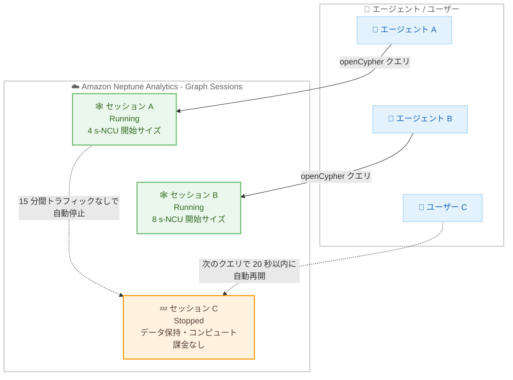

# Amazon Neptune - Neptune Graph Sessions

**リリース日**: 2026 年 11 月 27 日
**サービス**: Amazon Neptune (Neptune Analytics)
**機能**: Neptune Graph Sessions

📊 [このアップデートのインフォグラフィックを見る](https://takech9203.github.io/aws-news-summary/20261127-amazon-neptune-graph-sessions-generally-available.html)

## 概要

Amazon Neptune が、エージェント向けに設計された新しいコンピュートモード「Neptune Graph Sessions」を発表しました。Graph Sessions は Neptune Analytics の新しいグラフタイプで、セッションが動作している間だけコンピュートが稼働し、トラフィックがない状態が 15 分続くと自動的に停止 (スケールトゥゼロ) し、次のクエリが到着すると 20 秒以内に自動再開します。停止中もグラフデータ、ベクトルインデックス、設定は保持されるため、データの再ロードは不要です。

従来のプロビジョンドグラフには 16 m-NCU の最小キャパシティ制約があり、エージェント、ユーザー、タスクごとに専用の小さなグラフを多数持つような構成ではコストが課題でした。Graph Sessions は 4 s-NCU または 8 s-NCU という小さな開始サイズを選択でき、実行中に実際に使用したメモリ分のみ課金されるため、GraphRAG アシスタント、AI エージェント、ユーザー単位の分析といった断続的・予測困難なワークロードに適しています。クエリはプロビジョンドグラフと同じ Neptune Analytics エンジン上で openCypher を使用して実行でき、API、コンソール、IAM 権限も共通です。

**アップデート前の課題**

- プロビジョンドグラフは最小 16 m-NCU のキャパシティが必要で、エージェントや会話ごとの小さな専用グラフには過剰なコストが発生していた
- アイドル時間中もプロビジョンドキャパシティ分のコンピュート料金が継続的に発生していた
- エージェントワークロードはグラフサイズが予測困難で、ピークに合わせた事前のキャパシティ設計が必要だった

**アップデート後の改善**

- 4 s-NCU または 8 s-NCU の小さな開始サイズでグラフを作成でき、エージェント、ユーザー、タスクごとに専用グラフを低コストで持てるようになった
- トラフィックがない状態が 15 分続くと自動停止し、停止中はコンピュート料金がゼロになった (ストレージ料金のみ)
- メモリと CPU が自動的にバーストし (開始サイズの最大 2 倍)、実際に使用したメモリ分のみの課金になった
- 停止したセッションは次のクエリ受信時または StartGraph 呼び出しで 20 秒以内に再開し、データの再ロードが不要になった

## アーキテクチャ図



エージェントやユーザーごとに専用の Graph Session を割り当てる構成です。実行中のセッションのみコンピュート課金が発生し、アイドルになったセッションは 15 分後に自動停止してデータを保持したまま次のクエリを待ちます。

## サービスアップデートの詳細

### 主要機能

1. **スケールトゥゼロと自動再開**
   - トラフィックがない状態が 15 分続くと、セッションは自動的に停止する (StopGraph による手動停止も可能)
   - 停止中はコンピュート料金が発生せず、グラフデータ、ベクトルインデックス、設定は保持される
   - 次のクエリ受信時または StartGraph 呼び出しで 20 秒以内に再開する (再開直後の最初のクエリはセッション起動を待つため、クライアントタイムアウトの考慮が必要)
   - 新規セッションの作成は約 30 秒で完了する

2. **小さな開始サイズとバースト可能なコンピュート**
   - 開始サイズは 4 s-NCU または 8 s-NCU から選択する (1 s-NCU = 1 GiB メモリ + 0.25 vCPU)
   - メモリは開始サイズの最大 2 倍まで自動的にバーストする (4 s-NCU は最大 8 GiB、8 s-NCU は最大 16 GiB)
   - CPU も開始サイズの約 2 倍までバーストし、CPU バーストは追加料金なし
   - バースト上限に達するとスロットリングされるため、より大きな容量が必要な場合は UpdateGraph API で開始サイズを 8 s-NCU に変更するか、プロビジョンドグラフへ変換する

3. **使用量ベースの課金**
   - コンピュートは s-NCU 時間単位で、セッション実行中のみ秒単位で課金される
   - 課金額は実際に使用したメモリに追従し、開始サイズを下回ることはない (小さいサイズに収まるグラフは小さいサイズで課金)
   - ストレージは保持されるグラフデータに対して GB-月単位で課金される (セッションあたり最小 1 GB)
   - Database Savings Plans が Neptune Serverless と同様に 30% 割引で適用される

4. **プロビジョンドグラフと同じエンジン・ツール**
   - プロビジョンドグラフと同じ Neptune Analytics エンジン、API、コンソール、IAM 権限を使用する
   - openCypher でクエリ可能で、バッチロードによる Amazon S3 からのデータロードにも対応する
   - AWS Management Console、AWS CLI、AWS SDK から作成できる

## 技術仕様

### 開始サイズと容量

| 開始サイズ | 実行中の最小課金 | vCPU (開始時 / バースト) | メモリ (開始時 / バースト) |
|------|------|------|------|
| 4 s-NCU | 4 s-NCU | 1 vCPU / 最大 2 vCPU | 4 GiB / 最大 8 GiB |
| 8 s-NCU | 8 s-NCU | 2 vCPU / 最大 4 vCPU | 8 GiB / 最大 16 GiB |

### セッション状態と課金

| セッション状態 | コンピュート (s-NCU 時間) | ストレージ (GB-月) |
|------|------|------|
| Running | 使用メモリ分を秒単位で課金 (開始サイズが下限) | 課金あり |
| Stopped | 課金なし | 課金あり |
| 削除済み | 課金なし | 課金なし |

### プロビジョンドグラフとの比較

| 項目 | プロビジョンドグラフ | Graph Session |
|------|------|------|
| computeConfiguration | provisionedGraph | graphSession |
| キャパシティ | 16 m-NCU 以上 | 開始サイズ 4 または 8 s-NCU |
| アイドル時の動作 | 停止・削除まで継続課金 | 15 分間トラフィックなしで自動停止、コンピュート課金ゼロ |
| 再開 | 手動再起動 | クエリ受信で 20 秒以内に自動再開 |
| レプリカ | サポート | 非サポート (自動再開のため不要) |
| エクスポートタスク | サポート | 近日対応予定 |
| CloudFormation | サポート | 近日対応予定 |

### クォータ・スループット制限

| 項目 | デフォルト値 |
|------|------|
| リージョンあたりの最大 Graph Sessions 数 (Running + Stopped) | 25 (引き上げ可能) |
| 同時に実行可能な最大アクティブセッション数 | 10 (引き上げ可能) |
| 1 秒あたりのリクエスト数 | 4 vCPU 時に約 40 |
| 同時接続数 | 4 vCPU 時に最大 150 |
| セッション作成時間 | 約 30 秒 |
| 停止セッションの再開時間 | 20 秒以内 |

### API 変更履歴

| 日付 | サービス | 変更内容 |
|------|----------|----------|
| 2026/11/27 | [Amazon Neptune Graph](https://awsapichanges.com/archive/changes/f55894-neptune-graph.html) | 9 updated api methods - オンデマンドのエフェメラルコンピュートを基盤とする Graph Sessions のサポートを追加 |

## 設定方法

### 前提条件

1. AWS アカウントと Neptune Analytics の利用権限 (IAM)
2. Graph Sessions が利用可能なリージョンの選択 (利用可能リージョンの項を参照)
3. AWS CLI を使用する場合は、neptune-graph コマンドをサポートする最新バージョンの AWS CLI

### 手順

#### ステップ 1: Graph Session の作成

```bash
aws neptune-graph create-graph --graph-name 'test-neptune-session' \
  --region us-east-1 \
  --compute-configuration '{"graphSession": {"minMemory": 4}}' \
  --public-connectivity \
  --vector-search '{"dimension": 384}'
```

create-graph コマンドで Graph Session を作成します。--compute-configuration の graphSession でグラフタイプをセッションに指定し、minMemory で開始サイズ (4 または 8 s-NCU) を選択します。この例ではパブリックエンドポイントとベクトル検索 (384 次元) を有効化しています。作成は約 30 秒で完了します。コンソールの場合はグラフ作成時に [Session] を選択し、開始サイズを選びます。

#### ステップ 2: 作成状況の確認

```bash
aws neptune-graph get-graph --graph-identifier <graph-id>
```

get-graph コマンドでグラフのステータスを確認します。ステータスが Available になるとクエリを実行できます。後方互換性のためレスポンスには provisionedMemory フィールドも返されますが、computeConfiguration を参照することが推奨されています。

#### ステップ 3: セッションの停止・開始 (必要に応じて)

```bash
# 手動で停止する場合
aws neptune-graph stop-graph --graph-identifier <graph-id>

# 手動で開始する場合 (クエリ受信でも自動再開)
aws neptune-graph start-graph --graph-identifier <graph-id>
```

セッションは 15 分間トラフィックがないと自動停止しますが、StopGraph で明示的に停止することもできます。停止中のセッションはクエリ受信または StartGraph で 20 秒以内に再開します。データが不要になったらセッションを削除することで、ストレージ課金も終了します。

## メリット

### ビジネス面

- **コスト最適化**: 実行中に使用したメモリ分のみの秒単位課金で、アイドル時のコンピュート料金がゼロになるため、断続的なワークロードのコストを大幅に削減できる
- **スモールスタート**: 16 m-NCU の最小制約なしに 4 s-NCU からグラフを開始でき、PoC や開発・テスト用途でも気軽に利用できる
- **Savings Plans 対応**: Database Savings Plans が 30% 割引で適用され、Neptune Serverless と同等の割引率で継続利用コストを抑えられる

### 技術面

- **エージェントアーキテクチャとの親和性**: エージェント、会話、タスクごとに分離された専用グラフを割り当てられ、GraphRAG などのコンテキスト分離設計が容易になる
- **運用の自動化**: 自動停止・自動再開により、セッションの消し忘れによる課金やキャパシティ管理の運用負荷がなくなる
- **データ保持による高速再開**: 停止中もグラフデータとベクトルインデックスが保持され、再開時のデータ再ロードが不要で 20 秒以内に利用を再開できる

## デメリット・制約事項

### 制限事項

- 利用可能リージョンはプロビジョンドグラフより限定される (10 リージョン、東京リージョンを含む)
- 開始サイズは 4 または 8 s-NCU のみで、バースト上限 (最大 16 GiB メモリ) を超えるワークロードにはプロビジョンドグラフへの変換が必要
- レプリカとスナップショットは非サポート、エクスポートタスクと CloudFormation は近日対応予定
- デフォルトクォータはリージョンあたり最大 25 セッション、同時アクティブは 10 セッション (引き上げ可能)。アクティブセッションがクォータ上限に達すると、停止中のセッションはクエリ受信時に自動再開できない
- スループットは 4 vCPU 時に約 40 リクエスト/秒、最大 150 同時接続で、vCPU 数に比例して低下する

### 考慮すべき点

- 再開直後の最初のクエリはセッション起動 (20 秒以内) を待つため、クライアント側のタイムアウトとリトライの設計が必要
- ほぼ常時稼働するワークロードでは、小さなプロビジョンドグラフよりコストが高くなる場合があり、定常的なワークロードにはプロビジョンドグラフが推奨される
- Graph Sessions は Neptune Analytics の機能であり、トランザクショナルなグラフデータベースである Neptune Database の Neptune Serverless とは別物。持続的な同時負荷下での低レイテンシなトランザクショナルクエリには Neptune Database が適する
- 停止中もストレージ課金 (最小 1 GB) は継続するため、不要になったセッションは削除する

## ユースケース

### ユースケース 1: GraphRAG アシスタント

**シナリオ**: 会話やナレッジスコープごとにナレッジグラフを分離した GraphRAG アシスタントを構築する。会話は断続的に発生し、各グラフのサイズは予測困難。

**実装例**:
```bash
# 会話ごとに専用セッションを作成
aws neptune-graph create-graph --graph-name 'graphrag-conversation-001' \
  --compute-configuration '{"graphSession": {"minMemory": 4}}' \
  --public-connectivity --vector-search '{"dimension": 1024}'
```

**効果**: 会話ごとに分離されたグラフでコンテキスト汚染を防ぎつつ、会話がアイドルの間はコンピュート課金ゼロで運用できる。ベクトルインデックスも停止中に保持されるため、会話再開時に即座に検索可能。

### ユースケース 2: テナント・ユーザー単位の分析グラフ

**シナリオ**: SaaS アプリケーションでテナントやユーザーごとに分離されたグラフ分析環境を提供する。大半のテナントグラフはほとんどの時間アイドル状態。

**実装例**:
```bash
# テナントごとに専用セッションを作成し、タグで管理
aws neptune-graph create-graph --graph-name 'tenant-a-graph' \
  --compute-configuration '{"graphSession": {"minMemory": 8}}' \
  --public-connectivity --tags tenant=tenant-a
```

**効果**: テナント間の完全なデータ分離を実現しながら、アイドル中のテナントグラフはストレージ課金のみとなり、多数の小さなグラフを低コストで運用できる。

### ユースケース 3: データレイク上のエフェメラル分析

**シナリオ**: Amazon S3 のデータレイクに格納されたデータに対して、必要なときだけグラフ分析を実行する。

**実装例**:
```bash
# セッションを作成し、S3 からバッチロードで
# データを投入して分析後に削除する
aws neptune-graph create-graph --graph-name 'adhoc-analysis' \
  --compute-configuration '{"graphSession": {"minMemory": 8}}' \
  --public-connectivity
# 分析完了後に削除してストレージ課金も終了
aws neptune-graph delete-graph --graph-identifier <graph-id> --skip-snapshot
```

**効果**: 分析のたびにセッションを作成・削除することで、常設のグラフ環境を持たずにアドホックなグラフ分析を実行できる。オープンソースの Python ライブラリ nx-neptune がデータレイク上のグラフ分析をサポートする。

## 料金

Graph Sessions はコンピュートとストレージの 2 つのディメンションで課金されます。

- **コンピュート**: s-NCU 時間単位、秒単位課金。セッションが Running 状態の間のみ発生し、実際に使用したメモリに追従する (開始サイズが課金の下限)。CPU バーストは追加料金なし
- **ストレージ**: 保持されるグラフデータに対して GB-月単位で課金 (バイト時間で継続計測)。Running、Stopped どちらの状態でも発生し、セッションあたり最小 1 GB
- **その他**: セッションの作成・停止・開始自体は無料。Database Savings Plans がコンピュートに 30% 割引で適用される。データ転送と Amazon S3 などのソースシステムへのアクセスは標準の AWS 料金

最新の料金は [Amazon Neptune 料金ページ](https://aws.amazon.com/neptune/pricing/)を参照してください。

## 利用可能リージョン

Graph Sessions は以下の 10 リージョンで利用可能です (プロビジョンドグラフはより多くのリージョンで利用可能)。

- 米国東部 (バージニア北部): us-east-1
- 米国東部 (オハイオ): us-east-2
- 米国西部 (オレゴン): us-west-2
- アジアパシフィック (ムンバイ): ap-south-1
- アジアパシフィック (シンガポール): ap-southeast-1
- アジアパシフィック (シドニー): ap-southeast-2
- アジアパシフィック (東京): ap-northeast-1
- 欧州 (フランクフルト): eu-central-1
- 欧州 (アイルランド): eu-west-1
- 欧州 (ストックホルム): eu-north-1

## 関連サービス・機能

- **Amazon Neptune Analytics**: Graph Sessions はこのサービスの新しいグラフタイプ。プロビジョンドグラフと同じエンジン、API、openCypher クエリ、ベクトル検索機能を提供する
- **Amazon Neptune Database (Neptune Serverless)**: トランザクショナルなグラフデータベース。Graph Sessions とは別の製品で、持続的な同時負荷下での低レイテンシクエリに適する
- **Amazon Bedrock**: GraphRAG や AI エージェントのワークロードで、ナレッジグラフのバックエンドとして Graph Sessions を組み合わせられる
- **Amazon S3**: バッチロードによるグラフデータのロード元として利用し、データレイク上のエフェメラル分析を実現する
- **Database Savings Plans**: Graph Sessions のコンピュートに 30% 割引が適用される

## 参考リンク

- 📊 [インフォグラフィック](https://takech9203.github.io/aws-news-summary/20261127-amazon-neptune-graph-sessions-generally-available.html)
- [公式発表 (What's New)](https://aws.amazon.com/about-aws/whats-new/2026/11/amazon-neptune-graph-sessions-generally-available)
- [ドキュメント: How Neptune Graph Sessions work](https://docs.aws.amazon.com/neptune-analytics/latest/userguide/graph-sessions.html)
- [ドキュメント: グラフタイプの選択](https://docs.aws.amazon.com/neptune-analytics/latest/userguide/gettingStarted-graph-types.html)
- [ドキュメント: Neptune Analytics Getting Started](https://docs.aws.amazon.com/neptune-analytics/latest/userguide/gettingStarted.html)
- [ドキュメント: Limits for Neptune Analytics](https://docs.aws.amazon.com/neptune-analytics/latest/userguide/analytics-limits.html)
- [料金ページ](https://aws.amazon.com/neptune/pricing/)
- [nx-neptune (GitHub)](https://github.com/awslabs/nx-neptune)

## まとめ

Neptune Graph Sessions は、エージェント時代のグラフワークロードに合わせて Neptune Analytics の最小利用単位とコストモデルを刷新するアップデートです。16 m-NCU の最小制約なしにエージェント、ユーザー、タスクごとの専用グラフを持て、アイドル時はコンピュート課金ゼロ、クエリ受信で 20 秒以内に自動再開します。GraphRAG やマルチテナント分析を検討している場合は、東京リージョンを含む対応リージョンでまず 4 s-NCU のセッションを作成し、実ワークロードでのコストと性能を評価することを推奨します。
