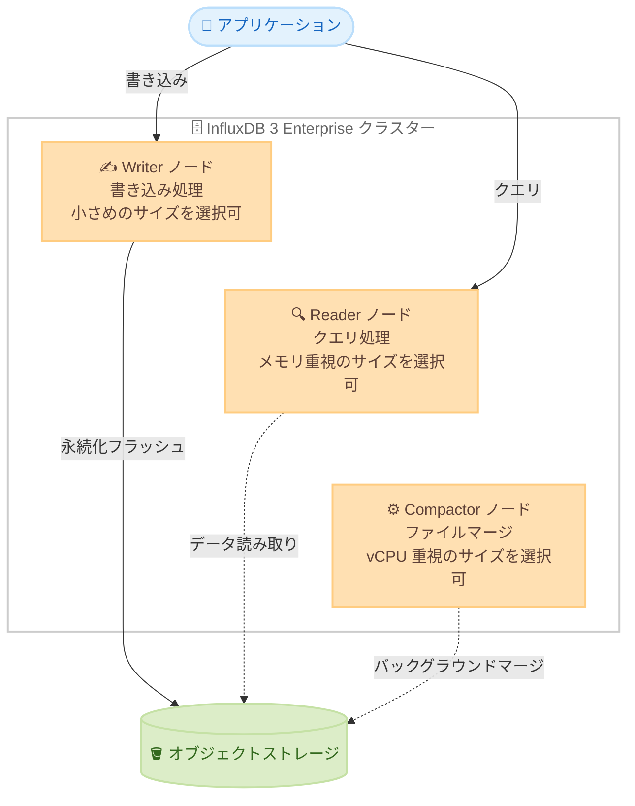

# Amazon Timestream for InfluxDB 3 - ヘテロジニアスクラスターのサポート

**リリース日**: 2026 年 11 月 27 日
**サービス**: Amazon Timestream for InfluxDB
**機能**: InfluxDB 3 Enterprise クラスターにおけるヘテロジニアスクラスター (ノードロールごとのインスタンスサイズ指定)

📊 [このアップデートのインフォグラフィックを見る](https://takech9203.github.io/aws-news-summary/20261127-influxdb-heterogeneous-cluster.html)

## 概要

Amazon Timestream for InfluxDB 3 がヘテロジニアスクラスターをサポートしました。InfluxDB 3 Enterprise クラスターを構成する各ノードロール (writer、reader、compactor) に対して、それぞれ異なるインスタンスサイズを個別に割り当てることができるようになります。

各ノードロールはリソース要件が異なります。writer は書き込みを処理し、オブジェクトストレージへの永続化フラッシュが律速となります。reader はクエリキャッシュや複雑なクエリの処理のためにメモリを必要とします。compactor はバックグラウンドでファイルをマージするために vCPU を必要とします。今回のアップデートにより、各ロールの特性に合わせてインスタンスサイズを最適化し、コスト効率の高いクラスター構成が可能になります。

時系列データベースを大規模に運用するチームや、読み取り・書き込み・コンパクションの負荷バランスがワークロードによって大きく異なるユーザーにとって、コスト最適化とパフォーマンスチューニングの両面で有用なアップデートです。

**アップデート前の課題**

- 以前はクラスター内のすべてのノードが同一のインスタンスサイズで動作する必要があった
- 特定のロール (例: reader) だけをスケールアップしたい場合でも、クラスター全体のサイズを変更する必要があった
- その結果、すでに適切なサイズだったノードに対しても未使用の余剰リソース分の料金を支払う必要があった

**アップデート後の改善**

- クラスター作成時または既存クラスターへのノード追加時に、各ロールのインスタンスサイズを個別に設定できるようになった
- reader をより大きなインスタンスに配置してクエリキャッシュを拡大しつつ、writer は小さいサイズのまま維持するといった構成が可能になった
- compactor に多くの vCPU を割り当てる際に、クラスターの他の部分に変更を加える必要がなくなった

## アーキテクチャ図



InfluxDB 3 Enterprise クラスターの各ノードロールに異なるインスタンスサイズを割り当てられるようになり、ロールごとのリソース特性に合わせた構成が可能になります。

## サービスアップデートの詳細

### 主要機能

1. **ノードロールごとのインスタンスサイズ指定**
   - writer、reader、compactor の 3 つのノードロールに対して、それぞれ異なるインスタンスサイズを割り当て可能
   - クラスター作成時に各ロールのサイズを設定できる
   - 既存クラスターへのノード追加時にもサイズを設定できる

2. **複数の設定インターフェース**
   - Amazon Timestream コンソールから設定可能
   - AWS CLI から設定可能
   - AWS SDK から設定可能

3. **追加料金なしで利用可能**
   - ヘテロジニアスクラスター機能自体に追加料金は発生しない
   - 選択したサイズに応じた各ノードの標準料金のみを支払う

## 技術仕様

### ノードロールとリソース特性

公式発表では、各ノードロールのリソース特性として以下が示されています。

| ノードロール | 役割 | リソース特性 |
|------|------|------|
| writer | 書き込みの処理 | オブジェクトストレージへの永続化フラッシュが律速となる |
| reader | クエリの処理 | クエリキャッシュと複雑なクエリのためにメモリを必要とする |
| compactor | ファイルのマージ | バックグラウンドでファイルをマージするために vCPU を必要とする |

### DB インスタンスクラス

Timestream for InfluxDB では、メモリ最適化型の `db.influx` インスタンスクラスファミリーが提供されています (公式ドキュメントより)。

| インスタンスクラス | vCPU | メモリ (GiB) |
|------|------|------|
| db.influx.medium | 1 | 8 |
| db.influx.large | 2 | 16 |
| db.influx.xlarge | 4 | 32 |
| db.influx.2xlarge | 8 | 64 |
| db.influx.4xlarge | 16 | 128 |
| db.influx.8xlarge | 32 | 256 |
| db.influx.12xlarge | 48 | 384 |
| db.influx.16xlarge | 64 | 512 |
| db.influx.24xlarge | 96 | 768 |

## 設定方法

### 前提条件

1. AWS アカウントと Timestream for InfluxDB の操作権限を持つ IAM プリンシパル
2. クラスターを配置する VPC、サブネット、セキュリティグループ
3. InfluxDB 3 Enterprise クラスターを利用すること (本機能は InfluxDB 3 Enterprise クラスターが対象)

### 手順

#### ステップ 1: クラスター作成時にロールごとのサイズを指定

Amazon Timestream コンソールで InfluxDB 3 Enterprise クラスターを作成する際に、writer、reader、compactor の各ノードロールに対してインスタンスサイズを個別に指定します。ワークロードの特性 (書き込み量、クエリの複雑さ、コンパクション負荷) に応じてサイズを選択します。

#### ステップ 2: 既存クラスターへのノード追加時にサイズを指定

既存の InfluxDB 3 Enterprise クラスターにノードを追加する際にも、追加するノードのインスタンスサイズを指定できます。これにより、稼働中のクラスターの特定ロールのみを強化できます。

#### ステップ 3: AWS CLI / AWS SDK での設定

コンソールと同様の設定は AWS CLI および AWS SDK からも実行できます。具体的なパラメーターやコマンド構文は [Timestream for InfluxDB のドキュメント](https://docs.aws.amazon.com/timestream/)および [API リファレンス](https://docs.aws.amazon.com/ts-influxdb/latest/ts-influxdb-api/)を参照してください。

## メリット

### ビジネス面

- **コスト最適化**: 必要なロールだけを大きなインスタンスにできるため、クラスター全体を一律にスケールアップする場合と比べて未使用リソースへの支払いを削減できる
- **追加料金なし**: 機能の利用自体に追加料金は不要で、選択したサイズの標準ノード料金のみで利用できる
- **段階的な拡張**: ワークロードの成長に合わせて特定ロールのみを強化でき、投資を段階的に行える

### 技術面

- **ロール特性に合わせた最適化**: メモリを必要とする reader、vCPU を必要とする compactor など、各ロールのリソース特性に合わせたサイズ選択が可能
- **影響範囲の局所化**: compactor の強化などの変更をクラスターの他の部分に影響を与えずに実施できる
- **柔軟な運用**: クラスター作成時だけでなく、既存クラスターへのノード追加時にもサイズを指定できる

## デメリット・制約事項

### 制限事項

- 本機能は InfluxDB 3 Enterprise クラスターが対象 (公式発表に明記)
- インスタンスサイズは Timestream for InfluxDB が提供する `db.influx` インスタンスクラスの範囲から選択する

### 考慮すべき点

- ロールごとに異なるサイズを選択できるため、各ロールの実際のリソース使用状況 (メモリ、vCPU、書き込みスループット) をモニタリングしたうえでサイズを決定することが望ましい
- サイズ構成が複雑になるため、どのロールにどのサイズを割り当てたかを構成管理で明確にしておく必要がある

## ユースケース

### ユースケース 1: 読み取り負荷が高い分析ワークロード

**シナリオ**: ダッシュボードやアドホック分析による複雑なクエリが多く、書き込み量は安定している時系列ワークロード。

**実装例**:
```text
reader: 大きめのインスタンスサイズを割り当ててクエリキャッシュを拡大
writer: 現状の書き込み量に適した小さめのサイズを維持
```

**効果**: クエリ性能を向上させながら、writer 側の余剰リソースへの支払いを回避できる。

### ユースケース 2: コンパクション負荷の高いワークロード

**シナリオ**: 高頻度の書き込みにより小さなファイルが大量に生成され、バックグラウンドのコンパクションが追いつかないワークロード。

**実装例**:
```text
compactor: vCPU の多いインスタンスサイズを割り当ててマージ処理を強化
writer / reader: 既存のサイズを変更せずに維持
```

**効果**: クラスターの他の部分に影響を与えることなく、コンパクション性能のみを強化できる。

### ユースケース 3: 既存クラスターの段階的なスケール

**シナリオ**: 運用中の InfluxDB 3 Enterprise クラスターで、利用拡大に伴い特定ロールのリソースが不足し始めた。

**実装例**:
```text
既存クラスターへのノード追加時に、追加ノードのインスタンスサイズを個別に指定
不足しているロールのみを強化し、他のロールは現状維持
```

**効果**: クラスター全体の再構成を行わずに、必要な箇所だけを段階的に拡張できる。

## 料金

ヘテロジニアスクラスター機能の利用に追加料金はありません。選択したサイズに応じた各ノードの標準料金を支払います。

Timestream for InfluxDB の料金はインスタンス時間 (インスタンスクラスに基づく)、ストレージ、データ転送で構成されます。詳細は [Amazon Timestream 料金ページ](https://aws.amazon.com/timestream/pricing/)を参照してください。

## 利用可能リージョン

Amazon Timestream for InfluxDB が利用可能なすべての AWS リージョンの InfluxDB 3 Enterprise クラスターで利用できます。

Timestream for InfluxDB は、米国東部 (バージニア北部)、米国東部 (オハイオ)、米国西部 (オレゴン)、アジアパシフィック (東京)、アジアパシフィック (シンガポール)、アジアパシフィック (シドニー)、アジアパシフィック (ムンバイ)、欧州 (フランクフルト)、欧州 (アイルランド) などのリージョンで利用可能です。最新のリージョン一覧は [Amazon Timestream エンドポイントとクォータ](https://docs.aws.amazon.com/general/latest/gr/timestream.html)を参照してください。

## 関連サービス・機能

- **Amazon S3**: InfluxDB 3 のアーキテクチャでは writer の永続化フラッシュ先、および compactor のマージ対象としてオブジェクトストレージが利用される
- **Amazon Timestream for InfluxDB (InfluxDB 2.x)**: オープンソース InfluxDB 2.x 互換のマネージドインスタンス。Multi-AZ 構成やリードレプリカをサポート
- **AWS CLI / AWS SDK**: クラスター作成やノード追加時のロールごとのサイズ指定をプログラマブルに実行可能

## 参考リンク

- 📊 [インフォグラフィック](https://takech9203.github.io/aws-news-summary/20261127-influxdb-heterogeneous-cluster.html)
- [公式発表 (What's New)](https://aws.amazon.com/about-aws/whats-new/2026/11/influxdb-heterogeneous-cluster/)
- [Amazon Timestream ドキュメント](https://docs.aws.amazon.com/timestream/)
- [Amazon Timestream for InfluxDB API リファレンス](https://docs.aws.amazon.com/ts-influxdb/latest/ts-influxdb-api/)
- [料金ページ](https://aws.amazon.com/timestream/pricing/)
- [リージョン一覧 (エンドポイントとクォータ)](https://docs.aws.amazon.com/general/latest/gr/timestream.html)

## まとめ

Amazon Timestream for InfluxDB 3 のヘテロジニアスクラスターサポートにより、writer、reader、compactor の各ノードロールに異なるインスタンスサイズを割り当て、ワークロード特性に合わせたコスト効率の高いクラスター構成が可能になりました。InfluxDB 3 Enterprise クラスターを運用している場合は、各ロールのリソース使用状況を確認し、過剰なサイズのロールの縮小や不足しているロールの強化を検討することを推奨します。
